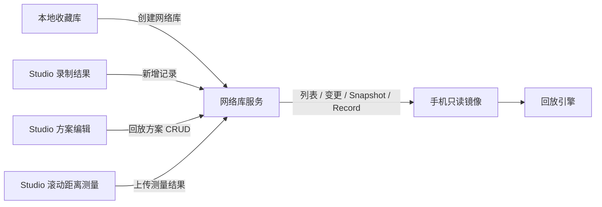

# Touch Kit 网络库 API 契约

> 本文档为网络库服务端与客户端（Touch Kit Studio、Touch Kit SDK）之间的唯一现行 API 契约。
> 机器可读契约见同目录 [`openapi.json`](openapi.json)。

## 1. 概览与架构

网络库由内网服务端维护。服务端是网络库目录、目录树、手势记录、回放方案、库版本（`revision`）和变更游标（`changeToken`）的**唯一真相源**。手机保存可随时重新同步的只读镜像；回放模块只读取本地镜像，不在回放链路直接请求网络服务。



架构约束：

1. **本地库与网络库完全隔离**：本地库是纯客户端数据，客户端可任意增删改其目录结构与记录组类型，与服务端无关；本地库和网络库不共享 `libraryId`、`nodeId`、`recordId`、`planId` 或文件。
2. **创建网络库是一次性副本**：客户端用本地库创建网络库时，服务端生成一份全新副本（`serverLibraryId`、`nodeId`、`recordId`、`planId` 及文件全部由服务端重新生成，见第 10 节）。副本一旦创建即与原本地库**彻底断开**：此后本地库的任何改动不影响网络库，网络库的任何改动也不回写本地库。
3. **网络库结构与类型由服务端所有**：网络库的目录树与记录组类型（`groupKind` / `typeSignature`）是服务端持有的真相源。客户端对网络库只能**读取 Snapshot、新增 / 删除手势记录、上传手势的滚动距离测量结果、按所有权读写回放方案**，**不得修改其目录结构或记录组类型**；改类型、改目录只能通过服务端（管理端或内部任务）完成。客户端往网络组加类型不符的手势时服务端直接 `409` 拒绝，**不允许客户端转换组类型**（见第 8.2 节）。
4. 客户端不直接修改网络镜像的目录树；同步成功后使用完整 Snapshot 替换镜像。
5. 新增记录、回放方案写入是实时请求；失败时不写入镜像，也不加入离线队列。
6. Snapshot 返回完整目录树、完整 Record Descriptor 清单和完整回放方案清单；Record 内容按 `recordId + sha256` 增量下载。
7. 网络 API 不传输录屏、缩略图、临时录制文件或将设备 UDID 写入手势数据；`X-CHR-Device-UDID` 仅作为回放方案写请求的所有权 Header 使用（见第 3 节、第 9 节）。
8. 本契约不包含登录鉴权、WebSocket、Tree Patch、离线编辑和双向合并。

### 1.1 ID 规约（全局强制）

所有 `recordId`、`nodeId`、`planId` 一律为**大写 UUID**，与客户端本地 `NSUUID.UUID.UUIDString` 及 `planId` 完全一致（例如 `A0794FA8-D68E-4ECF-9D13-EF296F74D6CF`）。

- **禁止**任何前缀：不得出现 `record-`、`node-`、`group-`、`plan-` 等前缀，也不得出现 `record-server-id`、`node-record` 这类可读占位符字面值。
- 服务端在创建网络库、重写引用、新增记录、创建回放方案时，一律生成新的大写 UUID。
- 客户端在创建网络库或新增记录请求中携带的临时 ID，仅用于本请求内部建立引用关系；服务端不得沿用其字面值或前缀，必须替换为新生成的大写 UUID。
- `serverLibraryId` 由服务端在创建网络库时生成，同样为大写 UUID。

> 本文档正文中出现的示例 ID 一律使用大写 UUID。

### 1.2 Schema 兼容标识

响应与请求中的 `schema` 是 Wire Format 兼容标识，不是 Objective-C 类名。客户端必须以响应的 `schema` 判断 Snapshot 和写响应的数据结构，不能仅依据 Base URL 或 URL 路径判断。

| 数据 | `schema` 固定值 |
|---|---|
| 健康检查 | `chr.network-health/v1` |
| 网络库列表 | `chr.network-library-list/v1` |
| 变更列表 | `chr.network-library-changes/v1` |
| 网络库 Snapshot | `chr.network-library-snapshot/v2` |
| 创建网络库请求 | `chr.network-library-create/v2` |
| 新增记录请求 | `chr.network-record-create/v1` |
| 新增记录结果 | `chr.network-record-create-result/v1` |
| 回放方案（持久化对象内嵌） | `chr.playback-plan/v1` |
| 创建方案请求 | `chr.network-playback-plan-create/v2` |
| 方案写结果 | `chr.network-playback-plan-result/v2` |
| 上传滚动距离测量请求 | `chr.network-scroll-measurement/v1` |
| 上传滚动距离测量结果 | `chr.network-scroll-measurement-result/v1` |

> 表里的 `/v1`、`/v2` 是**每个常量各自的固定字面值**，不是本契约的版本，也不代表存在“旧版本”——详见第 2 节的版本号说明。服务端按上表**逐字原样**下发（该 `/v1` 就 `/v1`，该 `/v2` 就 `/v2`），客户端按字面值校验。

服务端必须严格使用上表的固定值，不得为改展示名称或“统一版本号”而修改这些字符串（改了客户端即校验失败）。

## 2. Base URL

用户配置完整 API Base URL，可包含端口和服务挂载路径：

```text
http://aweme.rapp.lan/v1
```

本文中所有路径均**相对于该 Base URL**，客户端把相对路径原样拼接到 Base URL 之后，**不会自行插入 `/v1` 或任何前缀**。

> **⚠️ 关于路径和 Schema 里出现的版本号——请先读这一段，否则容易误解**
>
> **本契约没有“版本”这个概念，本文档就是唯一的当前设计。** 不存在“V1 契约 / V2 契约”，也不需要做任何版本升级或兼容。你会在两个地方看到形似版本号的东西，它们**都不是本契约的版本**：
>
> 1. **URL 里的 `/v1`（例如 `http://aweme.rapp.lan/v1/...`）** —— 这是**服务端自己把接口挂载在 `/v1` 下**的部署习惯，属于用户配置的 Base URL 的一部分，跟本契约无关。本契约只定义相对路径（如 `/network-libraries`、`/network-libraries/{serverLibraryId}/snapshot`）；服务端想挂在 `/`、`/api/v1` 还是别的前缀都行，用户添加服务器时把完整前缀写进 Base URL，客户端原样拼接。**不存在 `/v2/...` 路径，本契约也不要求任何 URL 版本。** 下文 HTTP 示例里的 `/v1/...` 只是因为示例 Base URL 恰好是 `.../v1`。
>
> 2. **JSON `schema` 字段里的 `chr.xxx/vN`（例如 `chr.network-library-snapshot/v2`）** —— 这是**线格式标识常量**，客户端按字面值逐字校验。字符串末尾的 `/v1`、`/v2` 只是每个常量各自的**固定字面值**（不同能力当初定名时带上的后缀），**不代表契约有两个版本，也和 URL 无关**。服务端必须**按本文档给出的字面值原样下发**（该是 `/v1` 就发 `/v1`，该是 `/v2` 就发 `/v2`），既不要“统一成一个版本”，也不要自行升降级——改了客户端就校验不过。

| Base URL | API 路径 | 最终 URL |
|---|---|---|
| `http://aweme.rapp.lan/v1` | `/health` | `http://aweme.rapp.lan/v1/health` |
| `http://aweme.rapp.lan/v1` | `/network-libraries` | `http://aweme.rapp.lan/v1/network-libraries` |
| `http://10.0.0.8:8080/api/v1` | `/network-libraries/A0794FA8-D68E-4ECF-9D13-EF296F74D6CF/snapshot` | `http://10.0.0.8:8080/api/v1/network-libraries/A0794FA8-D68E-4ECF-9D13-EF296F74D6CF/snapshot` |

Base URL 必须满足：

- Scheme 为 `http` 或 `https`。
- 不包含用户信息、Query 或 Fragment。
- 保存时移除末尾 `/`。
- 动态 ID 必须作为单独的 Path Segment 进行百分号编码。

## 3. HTTP 约定

### 3.1 鉴权与所有权

本服务部署在受信任内网，不包含身份认证：

- 客户端不发送 `Authorization`；服务端不要求 Bearer Token、API Key、OAuth 或其他身份凭证。
- 本契约不定义由鉴权产生的 `401`。
- `changeToken` 是同步游标，不是身份凭证。

回放方案的所有权基于 `X-CHR-Device-UDID`：

- 所有回放方案**写请求**（创建 / 更新 / 删除）必须携带 `X-CHR-Device-UDID`，值为当前私有设备的稳定 UDID。
- UDID 所有权是产品权限，不是对抗性身份认证；但服务端仍必须做 Header 比对（见第 4 节、第 9 节），客户端不能仅靠隐藏 UI 执行越权操作。

### 3.2 请求与响应

- 客户端发送 `Accept: application/json`。
- JSON 请求发送 `Content-Type: application/json; charset=utf-8`；JSON 响应使用同一 `Content-Type`。
- `204 No Content` 和 `304 Not Modified` 没有响应体。
- 时间戳使用 Unix Epoch 毫秒整数；`durationNs`、`tNs` 使用纳秒整数。
- JSON 对象不得包含 OpenAPI 未声明的字段。
- 所有写请求（POST / PUT / DELETE 方案、PUT 滚动距离测量）必须携带 UUID 格式的 `Idempotency-Key`。

### 3.3 API 总览

| 方法 | 路径 | 成功状态 | 说明 |
|---|---|---:|---|
| `GET` | `/health` | `200` | 健康检查 |
| `GET` | `/network-libraries` | `200` | 获取全部网络库 |
| `GET` | `/network-libraries/changes?since={changeToken}` | `200` | 获取增量变化 |
| `GET` | `/network-libraries/{serverLibraryId}/snapshot` | `200`, `304` | 完整目录、记录清单和回放方案清单 |
| `GET` | `/network-libraries/{serverLibraryId}/records/{recordId}` | `200` | 下载完整记录 |
| `POST` | `/network-libraries/{serverLibraryId}/record-groups/{nodeId}/records` | `201` | 向记录组新增记录 |
| `DELETE` | `/network-libraries/{serverLibraryId}/records/{recordId}` | `204` | 删除记录 |
| `PUT` | `/network-libraries/{serverLibraryId}/records/{recordId}/scroll-measurements` | `200` | 上传一条滚动距离测量结果（第 8.4 节） |
| `POST` | `/network-libraries` | `201` | 从本地库创建网络库（含回放方案导入） |
| `POST` | `/network-libraries/{serverLibraryId}/record-groups/{recordGroupId}/playback-plans` | `201` | 创建自定义回放方案 |
| `PUT` | `/network-libraries/{serverLibraryId}/playback-plans/{planId}` | `200` | 更新自定义回放方案 |
| `DELETE` | `/network-libraries/{serverLibraryId}/playback-plans/{planId}` | `204` | 删除自定义回放方案 |

`GET /network-libraries` 没有 `bundleId` Query 参数；`bundleId` 是网络库的可选属性。

## 4. 健康检查

```http
GET /v1/health HTTP/1.1
Host: aweme.rapp.lan
Accept: application/json
```

```http
HTTP/1.1 200 OK
Content-Type: application/json; charset=utf-8
Cache-Control: no-store
```

```json
{
  "schema": "chr.network-health/v1",
  "status": "ok"
}
```

Studio 只有在 HTTP 状态为 `200`，并且 `schema`、`status` 完全匹配时，才显示服务在线。

## 5. 列表

```http
GET /v1/network-libraries HTTP/1.1
Host: aweme.rapp.lan
Accept: application/json
```

```json
{
  "schema": "chr.network-library-list/v1",
  "changeToken": "ct_124",
  "libraries": [
    {
      "serverLibraryId": "A0794FA8-D68E-4ECF-9D13-EF296F74D6CF",
      "name": "抖音常用手势",
      "bundleId": "com.ss.iphone.ugc.Aweme",
      "icon": null,
      "revision": 18,
      "updatedAt": 1786334400000
    }
  ]
}
```

`changeToken` 表示生成本次列表时的服务端变更边界。没有网络库时，`libraries` 必须为 `[]`，仍然返回有效的 `changeToken`。

## 6. 变更

```http
GET /v1/network-libraries/changes?since=ct_124 HTTP/1.1
Host: aweme.rapp.lan
Accept: application/json
```

```json
{
  "schema": "chr.network-library-changes/v1",
  "changeToken": "ct_127",
  "changed": [
    { "serverLibraryId": "A0794FA8-D68E-4ECF-9D13-EF296F74D6CF", "revision": 19 }
  ],
  "deletedServerLibraryIds": ["B1F2C3D4-5E6F-4A7B-8C9D-0E1F2A3B4C5D"]
}
```

规则：

- `since` 必须是服务端之前返回的、不透明的 `changeToken`。
- 客户端不得自行生成 `ct_0` 或解析游标内容。
- 无变化时，`changed` 和 `deletedServerLibraryIds` 均为 `[]`。
- 游标过期返回 `410 change_token_expired`。
- 客户端完成本轮全部更新和删除后，才能保存响应中的新游标；游标必须按规范化后的 API Base URL 分开保存。

### 6.1 首次同步

1. 客户端没有当前 Base URL 对应的游标时，先请求网络库列表。
2. 用户选择网络库后，客户端下载所选库的完整 Snapshot 和 Record。
3. 全部镜像写入成功后，保存列表响应中的 `changeToken`。
4. 后续使用该游标请求 Changes。

### 6.2 同步流程

```text
没有游标：List → Snapshot → Record → 原子写入镜像 → 保存 List changeToken

已有游标：Changes
              ├─ changed → Snapshot → Record
              └─ deleted → 删除对应镜像和订阅
           全部成功 → 保存 Changes changeToken

410：重新 List → 为仍存在的已订阅库执行完整同步 → 保存新 changeToken
```

同步必须满足事务语义：

- 在临时目录中构造新镜像。
- 校验完整 Tree、Descriptor、Record Model、回放方案引用、JCS SHA-256 和 ETag。
- 全部成功后原子替换旧镜像。
- 任一步失败时保留旧镜像和旧 `changeToken`。

## 7. Snapshot

### `GET /network-libraries/{serverLibraryId}/snapshot`

```http
GET /v1/network-libraries/A0794FA8-D68E-4ECF-9D13-EF296F74D6CF/snapshot HTTP/1.1
Host: aweme.rapp.lan
Accept: application/json
If-None-Match: "18"
```

缓存没有变化：

```http
HTTP/1.1 304 Not Modified
ETag: "18"
```

缓存已变化或未提供 `If-None-Match`：

```http
HTTP/1.1 200 OK
Content-Type: application/json; charset=utf-8
ETag: "25"
```

成功响应为 `chr.network-library-snapshot/v2`，除 `library`、`tree`、`records` 外，包含 `playbackPlans`：

```json
{
  "schema": "chr.network-library-snapshot/v2",
  "serverLibraryId": "A0794FA8-D68E-4ECF-9D13-EF296F74D6CF",
  "revision": 25,
  "library": {
    "name": "抖音",
    "bundleId": "com.ss.iphone.ugc.Aweme",
    "icon": {
      "kind": 3,
      "mediaType": "image/png",
      "dataBase64": "iVBORw0KGgoAAAANSUhEUgAAAAEAAAABCAQAAAC1HAwCAAAAC0lEQVR42mNk+A8AAQUBAScY42YAAAAASUVORK5CYII="
    }
  },
  "tree": {
    "rootIds": ["C2D3E4F5-6A7B-4C8D-9E0F-1A2B3C4D5E6F"],
    "nodes": {
      "C2D3E4F5-6A7B-4C8D-9E0F-1A2B3C4D5E6F": {
        "type": "category",
        "nodeId": "C2D3E4F5-6A7B-4C8D-9E0F-1A2B3C4D5E6F",
        "name": "浏览",
        "childIds": ["D3E4F5A6-7B8C-4D9E-0F1A-2B3C4D5E6F7A"]
      },
      "D3E4F5A6-7B8C-4D9E-0F1A-2B3C4D5E6F7A": {
        "type": "record",
        "nodeId": "D3E4F5A6-7B8C-4D9E-0F1A-2B3C4D5E6F7A",
        "name": "查看下一个视频",
        "parentId": "C2D3E4F5-6A7B-4C8D-9E0F-1A2B3C4D5E6F",
        "recordIds": ["E4F5A6B7-8C9D-4E0F-1A2B-3C4D5E6F7A8B"],
        "playbackPlanIds": ["66BEC501-4A20-4BF3-9F70-6D175178B2F8"],
        "groupKind": "single",
        "typeSignature": ["interval", "swipe_up"]
      }
    }
  },
  "records": [
    {
      "recordId": "E4F5A6B7-8C9D-4E0F-1A2B-3C4D5E6F7A8B",
      "sha256": "a0f1983292202b4cd6dd9abd39cb905e92b05d2cd5edf3a89d7417dc806b97b8"
    }
  ],
  "playbackPlans": [
    {
      "planId": "66BEC501-4A20-4BF3-9F70-6D175178B2F8",
      "kind": "default",
      "name": "默认方案",
      "targetGroupId": "D3E4F5A6-7B8C-4D9E-0F1A-2B3C4D5E6F7A",
      "createdAt": 1787000000000,
      "updatedAt": 1787000000000,
      "revision": 1,
      "createdByDeviceUDID": "00008110-001234567890801E",
      "plan": {
        "schema": "chr.playback-plan/v1",
        "target": {
          "libraryId": "A0794FA8-D68E-4ECF-9D13-EF296F74D6CF",
          "recordGroupId": "D3E4F5A6-7B8C-4D9E-0F1A-2B3C4D5E6F7A"
        },
        "match": { "required": [] },
        "selection": { "kind": "random" },
        "replay": { "mode": "configId", "configId": "default" }
      }
    }
  ]
}
```

目录树必须满足：

- `tree.nodes` 是以 `nodeId` 为 Key 的扁平对象，Key 必须等于节点内的 `nodeId`。
- Category Node 只使用 `childIds`；Record Group Node 只使用 `recordIds`，并携带 `playbackPlanIds`。
- 每个非根节点恰好有一个父节点。
- 全树无环，所有节点均能从 `rootIds` 到达。
- 每条 Record 恰好属于一个 Record Group。
- Snapshot 中的 Record Descriptor 必须与 Tree 引用的 Record 集合完全相同。

回放方案一致性，服务端必须保证：

- 每个 `playbackPlans[].planId` 恰好被一个记录组的 `playbackPlanIds[]` 引用；两侧集合完全一致。
- 方案 `targetGroupId`、`plan.target.recordGroupId` 与引用它的记录组一致；`plan.target.libraryId` 等于 `serverLibraryId`。
- Snapshot、手势清单和方案清单来自同一个库 `revision`。
- 方案、树或引用关系任一损坏时，不得返回部分成功 Snapshot，返回 `500 invalid_library_state` 并记录服务端错误。

## 8. 记录读写

### 8.1 下载 Record

```http
GET /v1/network-libraries/A0794FA8-D68E-4ECF-9D13-EF296F74D6CF/records/E4F5A6B7-8C9D-4E0F-1A2B-3C4D5E6F7A8B HTTP/1.1
Host: aweme.rapp.lan
Accept: application/json
```

```http
HTTP/1.1 200 OK
Content-Type: application/json; charset=utf-8
ETag: "a0f1983292202b4cd6dd9abd39cb905e92b05d2cd5edf3a89d7417dc806b97b8"
```

响应体是完整的 Gesture Record。`ETag` 是带双引号的 Record SHA-256。测过滚动距离的记录，`meta` 里还带 `scrollMeasurements`（见第 8.4 节）。

```json
{
  "recordId": "E4F5A6B7-8C9D-4E0F-1A2B-3C4D5E6F7A8B",
  "meta": {
    "displayName": "上滑",
    "userTags": [],
    "savedAt": 1786334400000,
    "durationNs": 1000000000,
    "screenPoints": { "w": 414, "h": 736 },
    "screenScale": 3,
    "orientation": 0,
    "targetBundleIds": ["com.ss.iphone.ugc.Aweme"]
  },
  "segments": [
    { "type": "interval", "durationNs": 1000000000 }
  ]
}
```

### 8.2 向记录组新增 Record

```http
POST /v1/network-libraries/A0794FA8-D68E-4ECF-9D13-EF296F74D6CF/record-groups/D3E4F5A6-7B8C-4D9E-0F1A-2B3C4D5E6F7A/records HTTP/1.1
Host: aweme.rapp.lan
Accept: application/json
Content-Type: application/json; charset=utf-8
Idempotency-Key: 5F7B7F36-D96E-4F8F-A4AC-84C4A7C0B168
```

```json
{
  "schema": "chr.network-record-create/v1",
  "record": {
    "recordId": "F5A6B7C8-9D0E-4F1A-2B3C-4D5E6F7A8B9C",
    "meta": {
      "displayName": "上滑",
      "userTags": [],
      "savedAt": 1786334400000,
      "durationNs": 1000000000,
      "screenPoints": { "w": 414, "h": 736 },
      "screenScale": 3,
      "orientation": 0,
      "targetBundleIds": ["com.ss.iphone.ugc.Aweme"]
    },
    "segments": [
      { "type": "interval", "durationNs": 1000000000 }
    ]
  },
  "groupConstraint": {
    "expectedGroupKind": "single",
    "recordTypeSignature": ["interval"]
  }
}
```

**类型签名（`typeSignature`）的来源——务必先读：**

- `typeSignature` 是一个由**客户端计算**的字符串数组（每个手势段对应一项），服务端**只存储和比较，绝不自己计算**。
- 计算算法（几何启发式：方向、位移、时长、手指数等）只存在于客户端；服务端拿到的每一项都是**不透明串**，例如 `"interval"`、`"swipe_up:f1"`（上滑、单指）、`"tap:f1"`、`"pinch_in:f2"`（双指捏合）。**注意末尾的 `:fN` 是手指数后缀，是签名的一部分，服务端不得裁剪或改写。**
- 客户端在新增记录请求里通过 `groupConstraint.recordTypeSignature` 提供该记录的签名；在创建网络库导入包里通过每个记录组节点的 `typeSignature`/`groupKind` 提供。服务端一律**原样存储**。

服务端对 `groupKind` 与 `typeSignature` 只做**锁定 + 比较**（不计算、不裁决）：单一组的第一条记录把它的签名锁成该组的 `typeSignature`。新增记录时：

- 客户端给的签名与已锁定 `typeSignature` **一致（数组逐项相等）** → 正常写入。
- **不一致** → 返回 `409 record_group_type_mismatch`。

> **大白话说明（网络组类型，客户端一律不能转，只有服务端能转）**
> 网络组的类型（单一 / 混合）归服务端所有：客户端往网络组加一条类型不符的手势时，**服务端直接拒绝（409）**，不允许客户端把单一组转成混合组。**转换类型只能由服务端（管理端）操作**。请求里的 `groupConstraint` 只是客户端对目标组类型的乐观断言，方便提前发现不符；最终以服务端锁定的类型为准。（注：本地组是纯客户端数据，可以自由转类型；上面这条只约束网络组。）

请求中的 `record.recordId` 只标识本次客户端提交。服务端生成最终 `recordId`（大写 UUID，见第 1.1 节），写入 Record 和目录树，并在响应中返回；不得沿用客户端提交的字面值或任何前缀。

同一网络库内，客户端提交的原始 `recordId` 必须唯一。若客户端使用新的 `Idempotency-Key` 再次上传相同原始 `recordId`，服务端返回 `409 record_already_exists`；客户端应将 `error.message` 展示给用户，不得静默重试。

> **大白话说明（记录只有一个对外身份 = 服务端 recordId；原始提交 ID 仅作去重令牌）**
> 客户端提交的 `recordId`（A）被服务端**替换**成新生成的大写 UUID（B），B 是这条记录在网络库里**唯一对外的身份**——Snapshot、下载、回放、管理后台展示都只用 B。原始的 A **不作为身份保留、不下发给客户端、也不在管理后台展示**；服务端只把 A 存为**内部去重键**，用来实现"同一条不能在同一个库里传两次"。
>
> 去重的**范围是"同一网络库内"，不是全库**：同一个原始 A 可以被导入 / 上传到**多个**网络库，各自拿到**不同**的服务端 B（一个原始 → 多个替换）；只有"往同一个库塞第二次 A"才 `409`。
>
> 去重是**一次平铺查找，不递归**：客户端提交的永远是它**稳定的本地 UUID**，绝不会回传服务端生成的 B，所以不存在 `A→B→C` 需要向上追溯的链——服务端按"当前库 + 提交的原始 ID"查一次即可。

```http
HTTP/1.1 201 Created
Location: /v1/network-libraries/A0794FA8-D68E-4ECF-9D13-EF296F74D6CF/records/A6B7C8D9-0E1F-4A2B-3C4D-5E6F7A8B9C0D
Content-Type: application/json; charset=utf-8
```

```json
{
  "schema": "chr.network-record-create-result/v1",
  "serverLibraryId": "A0794FA8-D68E-4ECF-9D13-EF296F74D6CF",
  "recordId": "A6B7C8D9-0E1F-4A2B-3C4D-5E6F7A8B9C0D",
  "revision": 20,
  "changeToken": "ct_128"
}
```

### 8.3 删除 Record

```http
DELETE /v1/network-libraries/A0794FA8-D68E-4ECF-9D13-EF296F74D6CF/records/A6B7C8D9-0E1F-4A2B-3C4D-5E6F7A8B9C0D HTTP/1.1
Host: aweme.rapp.lan
Accept: application/json
```

成功响应：

```http
HTTP/1.1 204 No Content
```

DELETE 使用幂等语义：

- 网络库存在且 Record 存在：删除 Record、移除目录树引用、递增 `revision` 和 `changeToken`，返回 `204`。
- 网络库存在但 Record 已不存在：不再产生变更，仍返回 `204`。
- 网络库不存在：返回 `404 library_not_found`。

### 8.4 上传滚动距离测量结果

Studio 在一个全屏滚动视图上回放整条记录（任何记录：单段 / 多段，滑动 / 点击 / 长按……），每次记下**列表偏移** `(dx, dy)` 和**用时** `durationMs`（发出回放 → 列表最后一次滚动）。结果存在记录的 `meta.scrollMeasurements`，按三层组织：**机型 + 分辨率 → 画布模式 → 每次测试**。网络库记录在客户端只读，所以测量结果经本接口上传，由**服务端合并**后随正常同步下发到所有设备。

画布模式 = 测试用滚动视图能往哪滚（列表的滚动方向会影响同一手势最终滚多远）：

| 模式 | 含义 | 结果 |
|---|---|---|
| `vertical` | 只垂直滚动 | `dx` 恒为 0 |
| `horizontal` | 只水平滚动 | `dy` 恒为 0 |
| `both` | 垂直 + 水平都能滚 | `dx`、`dy` 都可能非 0 |

`dx` / `dy`：滚动视图 contentOffset 的变化量，设计分辨率 pt，**带符号**——上滑 `dy > 0`、下滑 `dy < 0`、左滑 `dx > 0`、右滑 `dx < 0`。不引起滚动的手势为 0。

#### 请求：上传本轮新测试

```http
PUT /v1/network-libraries/A0794FA8-D68E-4ECF-9D13-EF296F74D6CF/records/E4F5A6B7-8C9D-4E0F-1A2B-3C4D5E6F7A8B/scroll-measurements HTTP/1.1
Host: aweme.rapp.lan
Accept: application/json
Content-Type: application/json; charset=utf-8
Idempotency-Key: 0C9E1B3A-7F2D-4A6E-9B8C-5D4E3F2A1B0C
```

```json
{
  "schema": "chr.network-scroll-measurement/v1",
  "measurement": {
    "deviceModel": "iPhone10,2",
    "screenPoints": { "w": 414, "h": 736 },
    "screenScale": 3,
    "osVersion": "16.7.16",
    "mode": "vertical",
    "samples": [
      { "dx": 0, "dy": 1460, "durationMs": 1180, "measuredAt": 1793764800000 },
      { "dx": 0, "dy": 1502, "durationMs": 1210, "measuredAt": 1793764803000 }
    ]
  }
}
```

| 字段 | 类型 | 必填 | 规则 |
|---|---|:---:|---|
| `deviceModel` | string | ✅ | 硬件型号，如 `iPhone10,2` |
| `screenPoints` | `{w, h}` | ✅ | 竖屏宽×高，均为正数（与 `deviceModel` 一起定位「机型 + 分辨率」项，四舍五入取整比较） |
| `mode` | string | ✅ | `vertical` / `horizontal` / `both` |
| `samples` | ScrollSample[] | ✅ | 本轮新测试，1~10 个 |
| `screenScale` | number | | 2 / 3 |
| `osVersion` | string | | 测量设备系统版本 |

`ScrollSample` = `{ dx, dy, durationMs, measuredAt }`，四个字段都必填：`dx`、`dy` 可为负；`durationMs` ≥ 0（不滚动为 0）；`measuredAt` 为设备上报的 Unix Epoch 毫秒，只展示，**不参与**排序。`measurement` 与 `ScrollSample` 都不得包含上表以外的字段（第 3.2 节），否则返回 `422 invalid_scroll_measurement`。

#### 服务端合并规则

1. **定位**：在该记录 `meta.scrollMeasurements` 中找 `deviceModel` 相同、`screenPoints` 四舍五入后 `w`、`h` 都相同的项；没有就新建一项。
2. **更新设备信息**：该项的 `screenScale`、`osVersion` 取本次请求的值（设备可能升级过系统）。
3. **追加并截断**：把请求的 `samples` 按原顺序追加到该项 `modes[mode].samples` 末尾，只保留**最后 10 个**（按服务端收到的先后，丢最旧的；不按 `measuredAt` 排序）。
4. **重算统计**：按截断后的 `samples` **逐字段**算 `min` / `max` / `avg`（字段为 `dx`、`dy`、`durationMs`；`min.dy` 与 `min.durationMs` 可来自不同次）。`avg` 四舍五入保留 1 位小数，`min` / `max` 取原值。
5. 其它机型、其它模式的数据不变。
6. **不记录测量设备**：请求不带 `X-CHR-Device-UDID`，服务端也不得把任何设备 UDID 写进记录（第 1 节约束 7、第 11.3 节）。
7. **权限**：任何客户端都可以上传，不区分记录的上传者。
8. **原子性**：锁定 `NetworkLibrary` 行，在一个事务内更新记录内容、重算该记录 JCS SHA-256、递增库 `revision`、推进 `changeToken`（第 12 节）。只改 `meta`，`recordId` 不变。
9. **幂等**：范围为 HTTP Method + 请求 Path + `Idempotency-Key`。相同 Body 重放返回首次结果、**不重复追加**；不同 Body 复用 Key 返回 `409 idempotency_conflict`。
10. **数值原样**：按 JSON number 原样保存与下发，不要转字符串。

成功：

```http
HTTP/1.1 200 OK
Content-Type: application/json; charset=utf-8
```

```json
{
  "schema": "chr.network-scroll-measurement-result/v1",
  "serverLibraryId": "A0794FA8-D68E-4ECF-9D13-EF296F74D6CF",
  "recordId": "E4F5A6B7-8C9D-4E0F-1A2B-3C4D5E6F7A8B",
  "revision": 26,
  "changeToken": "ct_202"
}
```

客户端一批全部传完后同步该库；同步拉回的 Snapshot 必须已包含本次写入（响应之前完成落库，同第 8.2 节）。

错误：`404 library_not_found`、`404 record_not_found`、`422 invalid_scroll_measurement`、`409 idempotency_conflict`、`413 payload_too_large`。

#### 记录里的样子

```json
"meta": {
  "displayName": "快甩→停1.5s→下滑",
  "userTags": [],
  "savedAt": 1786334400000,
  "durationNs": 1714000000,
  "screenPoints": { "w": 414, "h": 736 },
  "screenScale": 3,
  "orientation": 0,
  "targetBundleIds": ["com.ss.iphone.ugc.Aweme"],
  "scrollMeasurements": [
    {
      "deviceModel": "iPhone10,2",
      "screenPoints": { "w": 414, "h": 736 },
      "screenScale": 3,
      "osVersion": "16.7.16",
      "modes": {
        "vertical": {
          "samples": [
            { "dx": 0, "dy": 643.3, "durationMs": 2410, "measuredAt": 1793764800000 },
            { "dx": 0, "dy": 649.3, "durationMs": 2450, "measuredAt": 1793764803000 }
          ],
          "min": { "dx": 0, "dy": 643.3, "durationMs": 2410 },
          "max": { "dx": 0, "dy": 649.3, "durationMs": 2450 },
          "avg": { "dx": 0, "dy": 646.3, "durationMs": 2430 }
        }
      }
    }
  ]
}
```

没测过的记录不带 `scrollMeasurements`。**新增记录（第 8.2 节）与创建网络库导入（第 10 节）上传的 `record.meta` 也可能已带 `scrollMeasurements`**（本地测过的手势），服务端按同一 Schema 校验并原样保存，不得因此返回 `422 invalid_record`。

## 9. 回放方案

### 9.1 回放方案对象

默认方案与自定义方案使用同一持久化对象，仅 `kind` 不同：

```json
{
  "planId": "66BEC501-4A20-4BF3-9F70-6D175178B2F8",
  "kind": "custom",
  "name": "自定义方案 1",
  "alias": "默认滑动",
  "createdAt": 1787000000000,
  "updatedAt": 1787000000000,
  "revision": 1,
  "createdByDeviceUDID": "00008110-001234567890801E",
  "targetGroupId": "D3E4F5A6-7B8C-4D9E-0F1A-2B3C4D5E6F7A",
  "plan": {
    "schema": "chr.playback-plan/v1",
    "target": {
      "libraryId": "A0794FA8-D68E-4ECF-9D13-EF296F74D6CF",
      "recordGroupId": "D3E4F5A6-7B8C-4D9E-0F1A-2B3C4D5E6F7A"
    },
    "match": { "required": [] },
    "selection": { "kind": "random" },
    "replay": { "mode": "configId", "configId": "default" }
  }
}
```

约束：

1. `planId` 必须由服务端生成，为所有网络库全局唯一的大写 UUID（见第 1.1 节）；客户端创建请求不得传入。
2. `targetGroupId` 和 `plan.target` 的库/记录组归属由 URL 和服务端重写，客户端不得跨组指定目标。
3. `createdByDeviceUDID` 由请求 Header `X-CHR-Device-UDID` 写入，客户端不能在 JSON Body 指定或更新。
4. 方案只允许指向本网络库内的记录组；若出现 `plan.scope.recordIds`，其中每个 ID 都只能引用该组中的记录。缺少 `scope` 表示整个记录组。
5. 非空 `alias` 在同一记录组内大小写不敏感唯一；`name` 可重复。服务端必须生成 `alias_normalized`（去首尾空白、Unicode NFC 规范化、大小写折叠），并建立唯一索引 `(server_library_id, target_group_id, alias_normalized)`。空 alias 存为 `NULL`，不参与该唯一约束。
6. `revision` 从 1 开始，每次更新递增；创建者不可改变。
7. 创建和更新请求中的 `alias` 字段必须存在；空字符串表示“未设置别名”，服务端规范化为 `NULL`，不参与唯一约束。
8. 每个记录组必须恰好有一个 `kind: "default"` 方案。它与自定义方案使用相同的 `planId`、持久化、Snapshot 和回放链路；默认方案不可删除、不可迁移。其余方案为 `kind: "custom"`。
9. 默认方案的服务端固定内容为：`name` 为 `默认方案`、`alias` 为空、`scope` 和 `stageReplays` 均不出现、`match.required` 为空数组、`selection` 为 `{ "kind": "random" }`、`replay` 为 `{ "mode": "configId", "configId": "default" }`。创建网络库时服务端必须校验并规范化为此内容；任何后续修改默认方案的请求返回 `422 default_playback_plan_protected`。

`plan` 的策略字段以客户端实际序列化为准：筛选条件位于 `match.required`；选择方式位于 `selection`；非空候选范围位于 `scope.recordIds`；阶段覆盖（仅非空时出现）是 `stageReplays` 数组，每项为 `{ "segmentIndex": 0, "replay": { ... } }`。`replay.mode` 只能为 `configId` 或 `inline`；前者使用 `configId`，后者使用 `options`。

### 9.2 创建方案

`POST /network-libraries/{serverLibraryId}/record-groups/{recordGroupId}/playback-plans`

Header：`Idempotency-Key`、`X-CHR-Device-UDID`。

```json
{
  "schema": "chr.network-playback-plan-create/v2",
  "kind": "custom",
  "name": "自定义方案 1",
  "alias": "默认滑动",
  "plan": {
    "schema": "chr.playback-plan/v1",
    "match": { "required": [] },
    "selection": { "kind": "random" },
    "replay": { "mode": "configId", "configId": "default" }
  }
}
```

请求必须携带 `kind: "custom"`，不得携带 `planId`、`createdByDeviceUDID`、`revision` 或 `target`。任一字段存在即返回 `422 invalid_playback_plan`；服务端不能静默忽略。最终方案的这些字段分别由服务端 UUID、请求 Header、当前版本和 URL 目标生成。

成功：`201 chr.network-playback-plan-result/v2`：

```json
{
  "schema": "chr.network-playback-plan-result/v2",
  "serverLibraryId": "A0794FA8-D68E-4ECF-9D13-EF296F74D6CF",
  "planId": "66BEC501-4A20-4BF3-9F70-6D175178B2F8",
  "revision": 26,
  "planRevision": 1,
  "changeToken": "ct_201"
}
```

### 9.3 更新方案

`PUT /network-libraries/{serverLibraryId}/playback-plans/{planId}`

Header：`Idempotency-Key`、`X-CHR-Device-UDID`、`If-Match-Plan-Revision`（**必填**，当前方案 `planRevision`；缺失返回 `409 plan_revision_conflict`，落后也返回 `409`）。

Body 与创建相同，且 `kind` 必须仍为 `custom`；默认方案的 PUT 一律返回 `422 default_playback_plan_protected`。不允许改变目标记录组；携带 `planId`、`createdByDeviceUDID`、`revision` 或 `target` 同样返回 `422 invalid_playback_plan`。

仅 `createdByDeviceUDID` 与 Header 相等时允许更新（否则 `403 playback_plan_owner_required`）。成功返回同一 `planId`、递增后的库 `revision`、`changeToken` 和方案 `planRevision`，Schema 为 `chr.network-playback-plan-result/v2`，HTTP 状态 `200`。

### 9.4 删除方案

`DELETE /network-libraries/{serverLibraryId}/playback-plans/{planId}`

Header：`Idempotency-Key`、`X-CHR-Device-UDID`、`If-Match-Plan-Revision`（**必填**，当前方案 `planRevision`；缺失返回 `409 plan_revision_conflict`）。

仅创建者可删除 `kind: "custom"` 方案；删除默认方案返回 `422 default_playback_plan_protected`。成功事务必须同时删除方案、从记录组 `playbackPlanIds[]` 移除 ID、递增库 `revision` 并推进 `changeToken`；返回 `204`。

## 10. 创建网络库导入

`POST /network-libraries`（即 `POST /v1/network-libraries`）从本地库创建网络库，请求与响应均使用 V2 Schema，并必须包含 `playbackPlans`。

```http
POST /v1/network-libraries HTTP/1.1
Host: aweme.rapp.lan
Accept: application/json
Content-Type: application/json; charset=utf-8
Idempotency-Key: DA5A7342-47AA-44D8-85CF-F2A411871AAA
X-CHR-Device-UDID: 00008110-001234567890801E
```

请求 Tree 中的每个记录组恰好对应一个默认方案。方案的 `targetGroupId` 引用请求 Tree 的临时 node ID；每个 `plan` 是可编辑的策略体，**不含** `target`、`planId`、`createdByDeviceUDID`、`revision`。请求 Tree 与 Record 中的 `nodeId`、`recordId` 仅是本次导入包内部的临时引用。

`records` 是**完整手势记录**（与 `POST .../records` 的 `record` 同构：含 `meta`、`segments` 等全部内容），不是只带 `recordId` 的引用——服务端凭完整内容落库。导入 Tree 的记录组节点**必须携带** `groupKind` 与 `typeSignature`（由客户端计算并提供，见第 8.2 节的 ID/类型规约），服务端**原样存储、不重新计算**；节点**不携带** `playbackPlanIds`（由顶层 `playbackPlans` 建立）。

```json
{
  "schema": "chr.network-library-create/v2",
  "library": {
    "name": "抖音",
    "bundleId": "com.ss.iphone.ugc.Aweme",
    "icon": null
  },
  "tree": {
    "rootIds": ["local-group-a"],
    "nodes": {
      "local-group-a": {
        "type": "record",
        "nodeId": "local-group-a",
        "name": "查看下一个视频",
        "recordIds": ["local-record-a"],
        "groupKind": "single",
        "typeSignature": ["interval"]
      }
    }
  },
  "records": [
    {
      "recordId": "local-record-a",
      "meta": {
        "displayName": "查看下一个视频",
        "userTags": [],
        "savedAt": 1786334400000,
        "durationNs": 1000000000,
        "screenPoints": { "w": 414, "h": 736 },
        "screenScale": 3,
        "orientation": 0,
        "targetBundleIds": ["com.ss.iphone.ugc.Aweme"]
      },
      "segments": [
        { "type": "interval", "durationNs": 1000000000 }
      ]
    }
  ],
  "playbackPlans": [
    {
      "kind": "default",
      "name": "默认方案",
      "alias": "",
      "targetGroupId": "local-group-a",
      "plan": {
        "schema": "chr.playback-plan/v1",
        "match": { "required": [] },
        "selection": { "kind": "random" },
        "replay": { "mode": "configId", "configId": "default" }
      }
    }
  ]
}
```

> 上例中 `local-group-a`、`local-record-a` 仅是客户端上传的**临时导入引用**，用于在本请求内建立 Node/Record/方案的引用关系；服务端不得沿用其字面值或前缀，必须替换为新生成的大写 UUID（见第 1.1 节）。

服务端以描述符中的 `targetGroupId` 确定目标，重写 Node/Record 引用后必须：

1. 为每个记录组（`nodeId`）、记录（`recordId`）和方案（`planId`）生成新的、全局唯一的**大写 UUID**（与本地 `NSUUID.UUID.UUIDString` 及 `planId` 一致，禁止任何前缀）。
2. 生成新的 `serverLibraryId`（大写 UUID）。
3. 重写 `rootIds`、`parentId`、`childIds`、`recordIds` 引用，并将每个方案的 `plan.target` 重写为最终 `serverLibraryId` 和最终记录组 ID。
4. 从请求 Header `X-CHR-Device-UDID` 写入每个方案的 `createdByDeviceUDID`。
5. 返回含最终方案的完整 V2 Snapshot（与 `GET /network-libraries/{serverLibraryId}/snapshot` 的 `200` 响应相同）。

本地原方案不删除；其 `planId` 不迁移、不复用。

创建完成后，该网络库是一份归服务端所有的独立副本，与发起创建的本地库**再无关联**（见第 1 节架构约束 2、3）：此后本地库的改动不影响该网络库；网络库的目录结构与记录组类型由服务端持有，客户端只能读取 Snapshot、新增 / 删除记录、按所有权读写回放方案，不能改其结构或类型。

成功响应：

```http
HTTP/1.1 201 Created
Location: /v1/network-libraries/A0794FA8-D68E-4ECF-9D13-EF296F74D6CF/snapshot
Content-Type: application/json; charset=utf-8
ETag: "1"
```

服务端必须拒绝以下情况，均返回 `422 invalid_playback_plan`（或按具体校验返回 `422 invalid_library` / `422 invalid_record`），且不得创建部分网络库：缺少 `playbackPlans`、某记录组没有或有多条默认方案、`targetGroupId` 不属于请求 Tree 的记录组、默认方案内容不符合第 9.1 节固定约束、`plan` 中出现服务端控制字段。

服务端以后若通过管理端或内部任务新增记录组，也必须在同一事务内创建该组唯一的默认方案；本契约没有新增或变更 HTTP 路径。

## 11. 公共数据模型

### 11.1 Node Icon

支持四种图标：

| `kind` | 类型 | 必需字段 |
|---:|---|---|
| `0` | SF Symbol | `symbolName` |
| `1` | Emoji | `emoji` |
| `2` | 网络图片 | `url`，且必须为 HTTP/HTTPS URL |
| `3` | 内联图片 | `mediaType`、`dataBase64` |

`kind=3` 在网络 API 中必须使用以下结构：

```json
{
  "kind": 3,
  "mediaType": "image/png",
  "dataBase64": "iVBORw0KGgoAAAANSUhEUgAAAAEAAAABCAQAAAC1HAwCAAAAC0lEQVR42mNk+A8AAQUBAScY42YAAAAASUVORK5CYII="
}
```

- `mediaType` 当前只允许 `image/png`。
- `dataBase64` 是不带 `data:` 前缀的标准 Base64；解码结果必须是有效的标准 PNG，最大 512 KiB。
- 服务端必须保存并在 List、Snapshot 中原样返回该对象，不得改成设备本地路径。
- Web 展示时可使用 `src = "data:" + mediaType + ";base64," + dataBase64`。
- `dataRef` 仅用于设备本地文件引用，禁止出现在网络请求或响应中；收到时返回 `422 invalid_library`。
- iOS 客户端上传前会把 App Bundle 中可能存在的 CgBI PNG 解码并重新编码为标准 PNG，服务端不需要识别 CgBI。

### 11.2 Record Hash

Record Descriptor 的 `sha256`、Record 响应的 `ETag` 和客户端校验值使用同一算法：

```text
canonicalBytes = RFC 8785 JCS(recordObject)
sha256 = lowercase_hex(SHA-256(canonicalBytes))
etag = DQUOTE + sha256 + DQUOTE
```

- `sha256` 使用**小写十六进制**。
- 服务端和客户端不得对 Pretty-Printed 文件字节直接计算 Hash。

### 11.3 隐私字段

Gesture Segment 不得包含 `deviceUDID`。客户端上传前必须移除；服务端收到该字段时返回 `422 invalid_record`。其他 Gesture Record 字段以 `openapi.json` Schema 为准。

## 12. 原子性、幂等与权限边界

- 任何会修改网络库树或方案的操作——Record 新增/删除、节点变更、方案创建、方案更新、方案删除——都必须先锁定同一 `NetworkLibrary` 行，再在一个事务内修改实体、树索引、库 `revision`、更新时间和 `changeToken`。不得先写 JSON 树、后写方案，或让两个并发写操作各自基于旧树覆盖对方的索引。
- 所有写请求都必须携带 UUID 格式的 `Idempotency-Key`：
  - 对记录写与创建网络库，幂等范围由 HTTP Method、请求 Path 和 Key 共同确定。
  - 对回放方案写请求，幂等范围必须额外包含 `X-CHR-Device-UDID`，唯一键为 `method + canonicalPath + deviceUDID + idempotencyKey`，并保存请求 Body 哈希。
  - 相同范围、相同 Body 重放首次结果，不重复创建资源。
  - 相同范围、不同 Body 返回 `409 idempotency_conflict`。
  - 不同设备即使偶然使用相同 Key 也互不冲突、不重放响应。
  - 客户端重试同一次逻辑提交时复用原 Key；新的逻辑提交生成新 Key。
  - 服务端至少保留幂等结果 24 小时。
- 当前为受信任内网，UDID 所有权是产品权限，不是对抗性身份认证；服务端仍必须做 Header 比对，客户端不能仅靠隐藏 UI 执行越权操作。
- 服务器管理端可绕过创建者限制，但其行为必须记录审计日志。

## 13. 状态码与错误

所有 JSON 错误使用统一格式，响应头 `X-Request-Id` 与响应体 `error.requestId` 必须相同：

```http
HTTP/1.1 404 Not Found
Content-Type: application/json; charset=utf-8
X-Request-Id: req_01JABCDEF
```

```json
{
  "error": {
    "code": "library_not_found",
    "message": "Network library does not exist.",
    "requestId": "req_01JABCDEF"
  }
}
```

| HTTP | `error.code` | 场景 |
|---:|---|---|
| `400` | `invalid_json` | JSON 无法解析或请求体不是对象 |
| `400` | `missing_change_token` | 缺少 `since` |
| `400` | `invalid_change_token` | 游标格式或来源无效 |
| `400` | `invalid_device_udid` | `X-CHR-Device-UDID` 缺失或格式非法 |
| `403` | `playback_plan_owner_required` | 非创建设备更新或删除方案 |
| `404` | `library_not_found` | 网络库不存在 |
| `404` | `record_group_not_found` | 目标节点不存在或不是 Record Group |
| `404` | `record_not_found` | GET Record 时记录不存在 |
| `404` | `playback_plan_not_found` | 目标方案不存在 |
| `409` | `idempotency_conflict` | 同幂等 Key 搭配不同 Body |
| `409` | `record_already_exists` | 同一网络库已存在相同客户端提交 `recordId` 的手势 |
| `409` | `record_group_type_mismatch` | 记录签名与目标记录组已锁定的 `typeSignature` 不一致（网络组类型客户端不能转，转类型只走服务端管理端） |
| `409` | `playback_plan_alias_conflict` | 同组别名冲突 |
| `409` | `plan_revision_conflict` | `If-Match-Plan-Revision` 缺失或落后（更新/删除方案必填） |
| `410` | `change_token_expired` | 变更游标已过期 |
| `413` | `payload_too_large` | 请求体超过限制 |
| `422` | `invalid_library` | 网络库或目录树校验失败 |
| `422` | `invalid_record` | Gesture Record 校验失败 |
| `422` | `invalid_scroll_measurement` | 滚动距离测量结果校验失败（第 8.4 节） |
| `422` | `invalid_playback_plan` | 方案、候选范围或组类型配置无效，或携带服务端控制字段 |
| `422` | `playback_plan_target_invalid` | 试图跨库、跨组或修改目标 |
| `422` | `default_playback_plan_protected` | 试图修改或删除默认方案，或默认方案内容不符合固定约束 |
| `500` | `invalid_library_state` | Snapshot 组装时方案/树/引用损坏 |
| `500` | `internal_error` | 服务端未预期错误 |

请求体限制：

- `POST /network-libraries`：16 MiB。
- `POST .../records`：2 MiB。
- `PUT .../scroll-measurements`：64 KiB。

本契约不定义 `401` 和 `429`。

## 14. 服务端验收

1. 所有端点在不发送 `Authorization` 时按业务返回，不出现 Token 相关 `401`。
2. Base URL 为 `/v1` 时，所有相对路径正确挂载，不产生 `/v1/v1`；不存在 `/v2/...` 路径。
3. 首次同步、无变化同步、增量同步和 `410` 全量恢复正常。
4. Snapshot 的 Tree、Descriptor、Record 集合与回放方案引用完整一致；库 `revision` 单调递增。
5. 相同 Record 的 Descriptor Hash、JCS Hash 和 ETag 完全相同（小写十六进制）。
6. POST 幂等重试不重复创建资源，不同请求体复用 Key 返回 `409`。
7. 重复 DELETE Record 返回 `204`，且不会重复递增版本。
8. 创建网络库后，本地导入 ID 已全部替换为服务端大写 UUID，返回方案 target 全部使用重写后的 ID，无任何 `record-`/`node-`/`local-` 前缀残留。
9. 错误响应始终包含一致的 `X-Request-Id` 和 `error.requestId`。
10. 超过请求体限制时返回 `413 payload_too_large`。
11. 创建方案后 Snapshot 同时出现方案实体和记录组索引，库 `revision` 递增一次。
12. 两台不同 UDID 设备：创建者更新/删除成功，另一设备收到 `403 playback_plan_owner_required`。
13. 方案幂等重试不会产生第二个 `planId` 或第二次 `revision` 递增；两台设备使用相同 `Idempotency-Key` 创建方案时互不干扰；同一设备以同 Key 提交不同 Body 时返回 `409`。
14. 别名冲突、无效 stage 配置、跨组 candidate 都返回可展示的 `409`/`422`，不写入部分状态。
15. 删除方案后 Snapshot 不含该方案，也没有悬空 `playbackPlanIds`。
16. 每个导入或服务端新建的记录组均有且仅有一条默认方案，且其 ID 同时位于 `playbackPlans[]` 和 `playbackPlanIds[]`。
17. 两个并发的 Record、节点或方案写操作不会丢失对方的树索引；最终 Snapshot 同时包含两次合法变更。
18. 客户端携带任一服务端控制字段创建或更新方案时返回 `422`，不产生任何持久化变更。
19. 上传滚动距离测量：`200` 后 GET Record 可见；同机型同分辨率同模式再传，`samples` 追加且只留最后 10 个，`min`/`max`/`avg` 按截断后的样本逐字段重算；换模式写到同一机型项的另一个 `modes` 键；换机型或分辨率新建一项；同一请求幂等重放不重复追加；每次库 `revision` 递增、记录 `sha256` 变化；`mode` 非法、样本缺字段或带未声明字段、`samples` 为空或超过 10 个返回 `422 invalid_scroll_measurement`；负数偏移正常保存；记录内不出现任何设备 UDID。
20. 新增记录与创建网络库导入的 `record.meta` 带 `scrollMeasurements` 时正常保存并原样下发。
