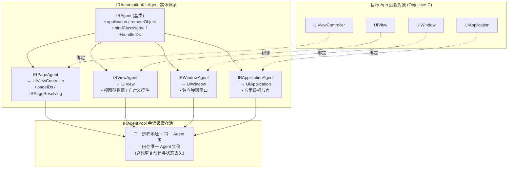
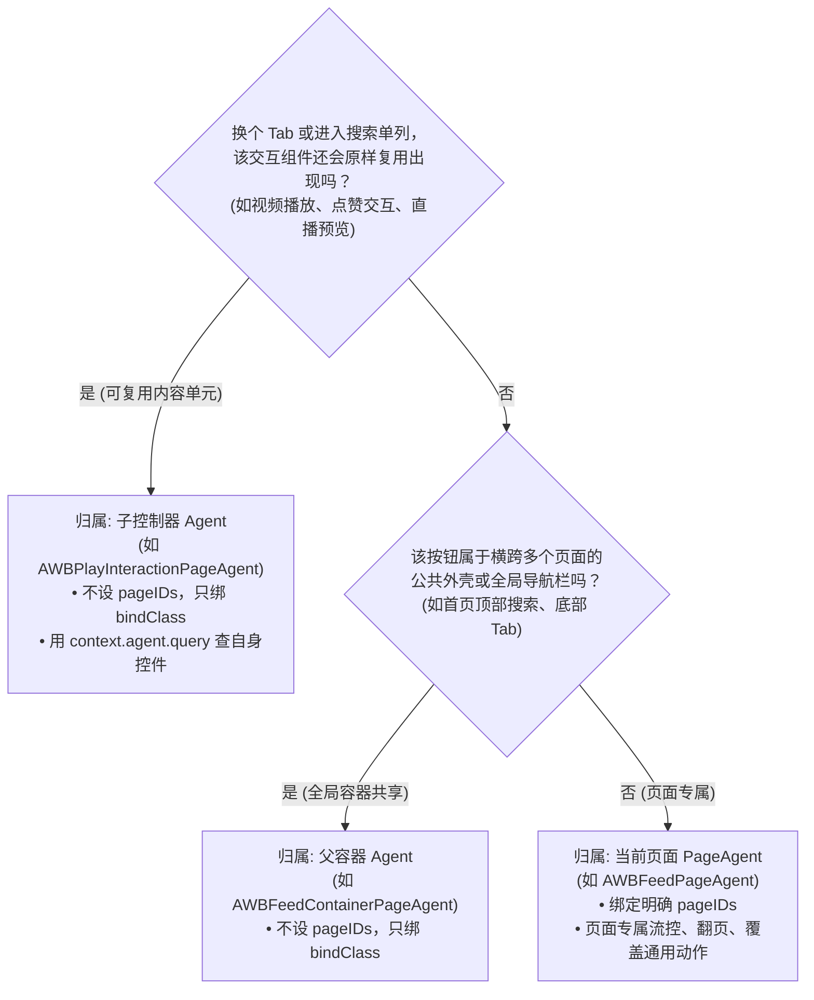
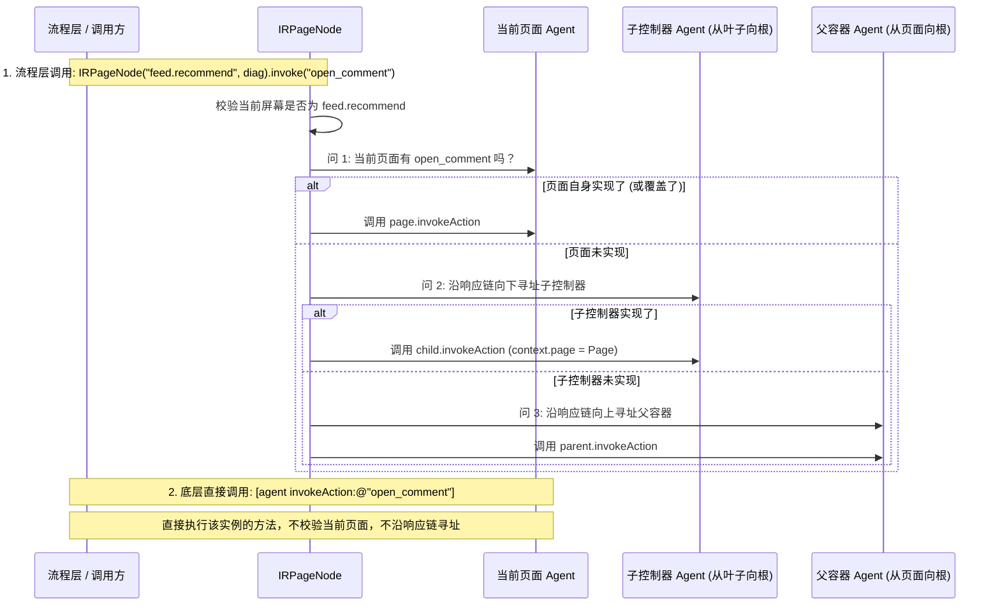

# Agents 实体体系与 Action 动作签名规范（`DOC-03`）

> 文档编号：`DOC-03`（可在 `skills/` 下用 `rg "DOC-03"` 定位本文档）

IRAutomationKit 采用面向对象的实体分层，将目标 App 的原生 UI 树映射为具备自动化能力的 **Agent 实体体系**，并通过 **Action 动作系统** 统一管理各层级可触发的行为与数据交互。

---


## 目录索引

- [`[DOC-03.1]` 1. Agents 实体层级与池化映射](#DOC-03.1)
  - [`[DOC-03.1.1]` 1.1 四类 Agent 实体分工](#DOC-03.1.1)
  - [`[DOC-03.1.2]` 1.2 实例创建与会话池化 (`IRAgentPool`)](#DOC-03.1.2)
- [`[DOC-03.2]` 2. Action 动作注册与签名构建](#DOC-03.2)
  - [`[DOC-03.2.1]` 2.1 原子动作注册（简写）](#DOC-03.2.1)
  - [`[DOC-03.2.2]` 2.2 `[R-FMT-02]` 完整签名动作构建 (`IRActionBuilder`)](#DOC-03.2.2)
  - [`[DOC-03.2.3]` 2.3 原子事件 vs 控制流事件边界（何时必须用 `IRFlowSession` / `IRWatchTimeline`）](#DOC-03.2.3)
  - [`[DOC-03.2.4]` 2.4 禁止用局部函数/Block 批量注册同构对称 Action](#DOC-03.2.4)
    - [`[DOC-03.2.4.1]` 典型范例：拟人漫游事件 (`switch_video`)](#DOC-03.2.4.1)
    - [`[DOC-03.2.4.2]` 典型范例 2：看播 + 伴生可选动作闭环 (`watch`)](#DOC-03.2.4.2)
  - [`[DOC-03.2.5]` 2.4 `[R-FLOW-02]` 裸用 `IRPageNode` 必须严格检查调用结果（红线）](#DOC-03.2.5)
- [`[DOC-03.3]` 3. 三种调用模式与只读安全沙箱](#DOC-03.3)
- [`[DOC-03.4]` 4. 执行现场规范 (`IRActionContext`)](#DOC-03.4)
  - [`[DOC-03.4.1]` 4.1 `[R-ACT-03]` 参数读取：`getParam` vs `findParam`](#DOC-03.4.1)
  - [`[DOC-03.4.2]` 4.2 `[R-ACT-05]` 查询返回值：`NSNull.null` 与 `nil`](#DOC-03.4.2)
  - [`[DOC-03.4.3]` 4.3 实体指代：`context.agent` vs `context.page`](#DOC-03.4.3)
  - [`[DOC-03.4.4]` 4.4 `[R-FLOW-05]` 子控制器与动态宿主页面初始化 `IRPageNode`：`session.page(context.page.pageID)`](#DOC-03.4.4)
- [`[DOC-03.5]` 5. 事件归属决策：页面、子控制器还是父容器？](#DOC-03.5)
  - [`[DOC-03.5.1]` 5.1 容器路由动作与流转漫游动作设计模式](#DOC-03.5.1)
- [`[DOC-03.6]` 6. 两层调用机制与响应链寻址](#DOC-03.6)
- [`[DOC-03.7]` 7. Action 事件 vs 普通函数的选型决策规范](#DOC-03.7)
  - [`[DOC-03.7.1]` 7.1 本质差异与权责矩阵](#DOC-03.7.1)
  - [`[DOC-03.7.2]` 7.2 选型场景清单](#DOC-03.7.2)
    - [`[DOC-03.7.2.1]` 必须注册为 Action 的场景：](#DOC-03.7.2.1)
    - [`[DOC-03.7.2.2]` 必须写成当前类 OC 私有方法的场景（`[R-FMT-01]` 禁止写 `static` C 函数）：](#DOC-03.7.2.2)
  - [`[DOC-03.7.3]` 7.3 一分钟判定决策树](#DOC-03.7.3)
- [`[DOC-03.8]` 8. Good vs Bad 对比清单](#DOC-03.8)

---

<a id="DOC-03.1"></a>
## `[DOC-03.1]` 1. Agents 实体层级与池化映射

Agent 是目标 App 远程对象的本地代理。子类与远程对象的底层类一一对应：



<a id="DOC-03.1.1"></a>
### `[DOC-03.1.1]` 1.1 四类 Agent 实体分工
1. **`IRPageAgent` ↔ `UIViewController`**：最核心的业务实体。持有 `pageID` 参与页面识别；可注册页面独有流控、子控制器内容动作或外层容器共享动作。
2. **`IRViewAgent` ↔ `UIView`**：针对复杂自定义视图控件或视图型弹窗（如评论弹窗、自定义浮层）。可注册控件私有动作（如 `tap`、`close`）。
3. **`IRWindowAgent` ↔ `UIWindow`**：针对独立浮动窗口（如全屏登录窗口 `AWELoginWindow`）。
4. **`IRApplicationAgent` ↔ `UIApplication`**：代表应用自身，挂载全局应用级行为。

<!-- [/DOC-03.1.1] -->
<a id="DOC-03.1.2"></a>
### `[DOC-03.1.2]` 1.2 实例创建与会话池化 (`IRAgentPool`)
- **同址同类唯一性**：Agent 实例由框架的会话级 `IRAgentPool` 统一托管。对同一个远程内存地址（`address`）和绑定的同一个 Agent 类，框架始终复用同一个实例。
- **生命周期绑定**：Agent 随每次感知屏幕分析或视图树遍历按需生成，内部持有 `IRObject *remoteObject`，会话断开后自动释放。

---

<!-- [/DOC-03.1.2] -->
<!-- [/DOC-03.1] -->
<a id="DOC-03.2"></a>
## `[DOC-03.2]` 2. Action 动作注册与签名构建

四种 Agent 子类均支持注册动作（`IRAgent` 基类本身不可注册）。动作由 **`IRIdentity`（动作名 + 说明）** 与 **执行体（Block）** 组成。

<a id="DOC-03.2.1"></a>
### `[DOC-03.2.1]` 2.1 原子动作注册（简写）
适用于无入参、无返回值、无需可用性探测的简单操作：

```objc
+ (void)load {
    [self registerAction:IRIdentityMake(@"next_video", @"切换到下一条视频")
                   block:^BOOL(IRApplication *app, IRActionContext *context, IRDiagnostics *diag) {
        do {
            BOOL ok = app.swipe(200, 600, 200, 200, 0.25, diag);
            if (!ok) break;
            // 校验界面响应
            app.waitPageChange(context.page, 5.0, diag);
        } while (NO);
        return diag.noError;
    }];
}
```

<!-- [/DOC-03.2.1] -->
<a id="DOC-03.2.2"></a>
### `[DOC-03.2.2]` 2.2 `[R-FMT-02]` 完整签名动作构建 (`IRActionBuilder`)
适用于需要强类型入参校验、支持返回值查询、提供可用性判断或挂载标签的动作（已作废并禁用 `action.arg` / `action.result` / `action.perform` 点语法，编译期直接报错；统一使用 `setTypeEncodingBlock:` 与 `setPerformBlock:`）：

```objc
+ (void)load {
    [self registerAction:IRIdentityMake(@"search_guess", @"点击猜你想搜关键词")
                 builder:^(IRActionBuilder *action) {
        // 1. 声明入参与返回值 (推荐集中写在 setTypeEncodingBlock: 内)
        [action setTypeEncodingBlock:^(IRTypeEncoding *encoding) {
            encoding.arg(@"keyword", IRSchemaTypeString).setComment(@"要点击的关键词");
            encoding.argWith(@"timeout", @5.0).setComment(@"最大超时");
            encoding.result(IRSchemaTypeString).setComment(@"最终成功点击的词条");
        }];

        // 2. 声明支持可用性检查 (IRActionModeAvailable)
        action.available(YES);

        // 3. 挂载标签: 供 ListBrowse 或外部按标签筛选可用事件
        action.tags(@[ @"browse.view", @"search.interaction" ]);

        // 4. 统一执行体
        [action setPerformBlock:^BOOL(IRApplication *app, IRActionContext *context, IRDiagnostics *diag) {
            // 分支 A: 可用性检查 (只读，仅靠已存感知数据判断)
            if (context.isAvailable) {
                return context.agent.query.texts(@"*猜你想搜*").visible().element.exists(nil);
            }

            // 分支 B: 查询模式 (只读提取数据，不执行点击)
            if (context.isQuery) {
                IRUIElement *cell = context.agent.query.views(@"AWESearchGuessCell").visible().first().element;
                context.result = cell.text(diag) ?: NSNull.null;
                return diag.noError;
            }

            // 分支 C: 正常执行模式 (Perform)
            do {
                NSString *kw = [context.getParam(@"keyword") stringValue];
                if (diag.hasError) break;

                IRUIElement *target = context.agent.query.texts(kw).visible().first().element;
                if (!target.tap(diag)) break;

                context.result = kw; // 记录返回值
            } while (NO);
            return diag.noError;
        }];
    }];
}
```

<!-- [/DOC-03.2.2] -->
<a id="DOC-03.2.3"></a>
### `[DOC-03.2.3]` 2.3 原子事件 vs 控制流事件边界（何时必须用 `IRFlowSession` / `IRWatchTimeline`）

> [!IMPORTANT]
> **判定标准**（完整对照表见 [DOC-04-page-flow.md](DOC-04-page-flow.md#15-判定标准哪些事件是原子事件哪些是控制流事件)）：
> - **原子事件（不用 `IRFlowSession`）**：仅限**单一不可分**的物理动作或纯只读查询——如单按钮点击（`open_comment`）、单步手势（`next_video`）、单控件输入、单页面退出（`back`）、纯属性/模型查询（`is_ad` / `video_info`）。内部**不得**串联多个 `invoke` 或使用时间轴。
> - **控制流事件（必须用 `IRFlowSession` / `ListBrowse`）**：只要满足以下**任意一条**，一律按控制流编码：
>   1. **多步串联 / 跨页面压栈**（调用 ≥ 2 个子 Action 或跨页进出，如 `flow`、`try_comment`）；
>   2. **循环 / 条件漫游**（多轮循环或分支切换，如 `switch_video`、`browse_nurture`）；
>   3. **时间轴 / 伴生触发**（按时长停留或伴生交互编排，如 `watch`、`watch_content`，**必须**使用 `node.timeline(name, seconds)`，禁止裸调 `AWBWatchWithProgress`）。
> - **为什么强制收口**：`session.page(...)` 自动将 `invoke`、`loop`、`repeat`、`timeline` 纳入框架异常监控与自愈体系，步骤失败自动触发 `onException`，无需在业务代码里手写多层 `if (!ok)` 或 `if (hasError)`。

<!-- [/DOC-03.2.3] -->
<a id="DOC-03.2.4"></a>
### `[DOC-03.2.4]` 2.4 禁止用局部函数/Block 批量注册同构对称 Action

> [!IMPORTANT]
> **严禁**写 `void (^registerLook)(...) = ...` 然后连调两次去注册 `scroll_down` / `scroll_up` 这类只有方向/参数不同的对称 Action！
> - **唯一正确做法**：同构操作**只注册一个 Action**（如 `scroll`），通过入参（如 `encoding.argWith(@"direction", @"down")`）区分方向或模式。

<a id="DOC-03.2.4.1"></a>
#### `[DOC-03.2.4.1]` 典型范例：拟人漫游事件 (`switch_video`)
```objc
[self registerAction:IRIdentityMake(@"switch_video", @"拟人切换视频") builder:^(IRActionBuilder *action) {
    [action setPerformBlock:^BOOL(IRApplication *app, IRActionContext *context, IRDiagnostics *diag) {
        // 串流程事件: 直接 return [IRFlowSession execute:...]
        return [IRFlowSession execute:^(IRFlowSession *session) {
            IRPageNode *feed = session.page(AWBPageIDFeed);

            // 1. 随机方向: 若向下 (down)，直接切到下一个视频
            if (!feed.weightOrValue(@"switch_direction", @"down").is(@"up")) {
                feed.invoke(@"next_video");
                return;
            }

            // 2. 随机回滚个数 (1~3 步)
            NSInteger steps = feed.weightOrValue(@"switch_rewatch_steps", @1).integerValue;

            // 3. 向上滚动 + 间隔
            feed.loop(@"rewatch_prev", steps, ^(NSUInteger index, NSUInteger total, BOOL *stop) {
                feed.invoke(@"prev_video");
                feed.wait(feed.weightOrValue(@"switch_swipe_interval", @(0.5)).doubleValue);
            });

            // 4. 观看回滚到的内容
            feed.invoke(@"watch_content");

            // 5. 向下切向下一个视频
            feed.invoke(@"next_video");

        } onException:nil onFinally:nil diag:diag];
    }];
}];
```

<!-- [/DOC-03.2.4.1] -->
<a id="DOC-03.2.4.2"></a>
#### `[DOC-03.2.4.2]` 典型范例 2：看播 + 伴生可选动作闭环 (`watch`)
```objc
// 串联主看播与伴生动作 (try_comment / try_search)，同样使用 IRFlowSession，伴生失败自动 skip 隔离
return [IRFlowSession execute:^(IRFlowSession *session) {
    IRPageNode *playerNode = session.page(nil);
    AWBWatchWithProgress(playerNode, title, seconds);

    if (playerNode.available(@"try_comment")) {
        playerNode.invoke(@"try_comment");
    }
    if (playerNode.available(@"try_search")) {
        playerNode.invoke(@"try_search");
    }
} onException:^(IRFlowException *exception) {
    // 只有特定可选伴生步骤失败、且通过 backToSelf() 确认退回原宿主页面，才允许 skip；其余错误默认终止
    IRPageNode *node = IRPageNode(context.page.pageID, nil);
    if ([@[@"try_search", @"try_comment"] containsObject:exception.name] && node.backToSelf()) {
        exception.skip();
    }
} onFinally:nil diag:diag];
```

<!-- [/DOC-03.2.4.2] -->
<!-- [/DOC-03.2.4] -->
<a id="DOC-03.2.5"></a>
### `[DOC-03.2.5]` 2.4 `[R-FLOW-02]` 裸用 `IRPageNode` 必须严格检查调用结果（红线）

> [!CAUTION]
> **在非 Session 环境下（仅限纯原子操作）裸用 `IRPageNode`（如 `IRPageNode(nil, diag)`），必须严格检查每一次调用的执行结果！**
> 1. **严禁无视返回值盲目裸奔**：`node.invoke(...)` 原生返回 `BOOL`。在非 Session 场景下，动作失败**不会**自动抛出异常，如果不检查返回值，代码将无视错误继续向下执行，造成严重逻辑越界；
> 2. **循环内部必须快速阻断**：在 `loop`、`repeat` 或 `repeatUntil` 中，一旦 `invoke` 返回 `NO`，必须立即置 `*stop = YES; return;` 停止循环；
> 3. **原子动作守门 (`do-while(NO)`)**：对于单步原子动作内的先后检查（如点击后等页面变化），使用 `do { ... } while (NO);` 并在每步后判定 `if (diag.hasError) break;`。

```objc
do {
    if (!IRPageNode(nil, diag).invoke(@"some_atomic_step")) {
        break;
    }
    app.waitPageChange(context.page, 5, diag);
} while (NO);
return diag.noError;
```

---

<!-- [/DOC-03.2.5] -->
<!-- [/DOC-03.2] -->
<a id="DOC-03.3"></a>
## `[DOC-03.3]` 3. 三种调用模式与只读安全沙箱

`IRActionContext.mode` 决定了当前调用的语义边界：

| 模式 (`IRActionMode`) | 触发入口 | 目的 | 执行环境安全保护 | 返回与产出 |
|---|---|---|---|---|
| **`IRActionModePerform`**<br/>(默认执行) | `invokeAction` /<br/>`node.invoke` | 驱动界面流转、触发点击与输入 | 正常运行在持有执行权的 UI 任务线程上 | 返回 `YES/NO`；可选写入 `context.result` |
| **`IRActionModeQuery`**<br/>(数据查询) | `invokeQuery` /<br/>`node.invokeQuery` | 提取当前界面的结构化业务数据 | **只读沙箱**：触摸、滑动、输入、等待操作会被框架直接拦截并抛错 | 将提取结果写入 `context.result` |
| **`IRActionModeAvailable`**<br/>(可用性探测) | `available` /<br/>`node.available` | 询问当前上下文该动作是否可以被执行 | **只读沙箱**：严禁执行任何坐标操作与视图树刷新 | 直接返回 `YES`（可用）或 `NO`（不可用） |

> [!CAUTION]
> `[R-ACT-04]` **可用性分支（`isAvailable`）性能铁律**：
> 1. 可用性判断是在主流程挑选接收者时高频同步调用的，**严禁在 `isAvailable` 分支内执行耗时的 IPC 抓取或视图树重拍**！
> 2. 优先仅使用当前已有的响应链信息（如 `context.page.pageID`、`context.agent` 类名）或极快的缓存判定。
> 3. 不可在 `isAvailable` 里写 `tap`、`sleep`、`waitPage` 等操作，沙箱会直接判定失败。

---

<!-- [/DOC-03.3] -->
<a id="DOC-03.4"></a>
## `[DOC-03.4]` 4. 执行现场规范 (`IRActionContext`)

<a id="DOC-03.4.1"></a>
### `[DOC-03.4.1]` 4.1 `[R-ACT-03]` 参数读取：`getParam` vs `findParam`
统一使用上下文 Block 获取参数，**禁止裸读 `context.params[@"key"]`**：
- **`context.getParam(@"name")`（必填参数）**：取不到时自动向 `context.diag` 记录错误并返回 `nil`。
- **`context.findParam(@"name", defaultValue)`（可选参数）**：取不到或值为 `NSNull` 时返回默认值，**不记录错误**。

```objc
NSInteger loopCount = [context.findParam(@"count", @3) integerValue];
NSString *targetTitle = [context.getParam(@"title") stringValue];
if (diag.hasError) {
    break; // 必填参数缺失，直接中断退出
}

// 拟人权重覆盖惯用法 (Param-Weight Override Idiom): 外部参数 > 拟人权重 > 兜底默认值
NSInteger watchCount = [context.findParam(@"watch_count", node.weightOrValue(@"flow_watch_count", @(6))) integerValue];
node.ensure(watchCount > 0, @"目标观看数无效");
```

<!-- [/DOC-03.4.1] -->
<a id="DOC-03.4.2"></a>
### `[DOC-03.4.2]` 4.2 `[R-ACT-05]` 查询返回值：`NSNull.null` 与 `nil`
在查询模式下，严格区分“执行成功但数据为空”与“执行报错”：
- **执行成功但业务空值**（如未找到推荐词）：`context.result = NSNull.null; return diag.noError;`（调用方判定为成功，拿到 `NSNull`）。
- **执行失败**（如视图被遮挡或 IPC 失败）：`diag.error(-1, @"读取失败"); context.result = nil; return diag.noError;`（调用方判定为失败）。

<!-- [/DOC-03.4.2] -->
<a id="DOC-03.4.3"></a>
### `[DOC-03.4.3]` 4.3 实体指代：`context.agent` vs `context.page`（及 `[R-ARCH-07]` 实例方法准则）

- **`context.agent`（`__kindof IRAgent *`）**：**必定是当前注册并执行该 Action 的 Agent 实例本身（即当前类的实例）**。
  - 在哪个 Agent 类里调用 `registerAction:`，`context.agent` 的运行时类型就一定是哪个类（因为声明了 `__kindof`，可直接 `AWBXxxPageAgent *agent = context.agent;`，无需强转）。
  - 在当前 Agent 内部查找自身局部视图控件，**必须使用 `context.agent.query`**（范围限定在自身视图子树内，避免误扫到后台预渲染元素）。
  - **`[R-ARCH-07]` 严禁“类方法 + 传 `context.agent` 实例”反模式**：在 `+load` 闭包内 `self` 是类对象，而 `context.agent` 已经是当前类的实例。凡操作当前 Agent 实例的辅助方法或数据读取，**必须定义为实例方法或实例只读属性**（通过 `agent.xxx` 或 `[agent xxx]` 调用），**严禁写成 `+buildInfoForRoom:(AWBLiveRoomPageAgent *)room` 之类的类方法再调 `[self buildInfoForRoom:room]` 把实例当参数传给类方法**！
- **`context.page`（`__kindof IRPageAgent *`）**：**是当前屏幕正在显示的页面代理（带 `pageID` 的顶层页面 Agent），不一定是当前 `context.agent`**：
  - 当该 Action 注册在**子控制器 Agent**（如 `AWBPlayerPageAgent`、`AWBLivePreStreamPageAgent`，只绑 `bindClass`、不设 `pageIDs`）或**父容器 Agent** 上时，`context.agent` 是该子控制器/容器实例，而 **`context.page` 是当前屏幕上真正显示的页面**（如 `feed.recommend`、`video.detail.feed`）；
  - 只有当 Action 直接注册在当前显示的页面类自身上时，`context.page` 才与 `context.agent` 指向同一实例。
  - 因此：读当前所处页面的 `pageID`（`context.page.pageID`）或在子控制器动作内触发跳转并等待页面变更时，**必须传 `context.page`**：
    ```objc
    // ✅ 正确：等待当前显示的页面发生变化
    app.waitPageChange(context.page, 5.0, diag);

    // ❌ 错误：传子控制器 context.agent 会导致判断失效
    app.waitPageChange(context.agent, 5.0, diag);
    ```

<!-- [/DOC-03.4.3] -->
<a id="DOC-03.4.4"></a>
### `[DOC-03.4.4]` 4.4 `[R-FLOW-05]` 子控制器与动态宿主页面初始化 `IRPageNode`：`session.page(context.page.pageID)`

当 Action 注册在**子控制器 Agent**（如 `AWBPlayerPageAgent`、`AWBLivePreStreamPageAgent`，自身不设 `pageIDs`，可被推荐流、关注流、搜索单列详情等多个父页面复用）或**多 `pageID` 页面**中时，在 `setPerformBlock:` 的 `IRFlowSession` 内初始化当前页面的 `IRPageNode` 节点，**必须统一传入 `context.page.pageID`**（严禁硬编码写 `session.page(nil)`）：

```objc
[action setPerformBlock:^BOOL(IRApplication *app, IRActionContext *context, IRDiagnostics *diag) {
    return [IRFlowSession execute:^(IRFlowSession *session) {
        // ✅ 正确：动态绑定当前宿主页面的 pageID（有页面标识则自动带上，无则为 nil）
        IRPageNode *node = session.page(context.page.pageID);
        node.decision(@"watch_preview")
            .params(context.params)
            .execute();
        context.result = node.result;
    } onException:nil onFinally:nil diag:diag];
}];
```

- **核心原理**：
  - 若当前宿主页面带有页面标识（`context.page.pageID` 非空），`session.page(context.page.pageID)` 构造的节点在执行动作、发起决策请求、页面在场校验以及异常恢复（`backToSelf()`）时**会自动带上该宿主页面标识**；
  - 若没有页面标识，`context.page.pageID` 自然为 `nil`；
  - 这样子控制器无论被嵌入在哪个父页面中使用，都能在运行期准确识别并锁定当前所处的页面位置。

---

<!-- [/DOC-03.4.4] -->
<!-- [/DOC-03.4] -->
<a id="DOC-03.5"></a>
## `[DOC-03.5]` 5. 事件归属决策：页面、子控制器还是父容器？

在新增动作前，先通过 `mpa hitchain` 观察控件所属的 ViewController 架构：



| 归属位置 | 特征与配置 | 查找范围与行为特征 | 典型案例 |
|---|---|---|---|
| **子控制器 `Agent`** | 不设 `pageIDs`，只填 `bindClass` | 仅操作本子控制器视图树，供多个外层页面无缝复用 | 视频播放层 `AWEPlayInteractionViewController` 的 `watch` / `like` / `open_comment`；直播间卡片预览 |
| **父容器 `Agent`** | 不设 `pageIDs`，只填 `bindClass` | 操作全局容器级控件，向所有子 Tab 页面向上冒泡提供服务 | 首页外层容器 `AWEFeedContainerViewController` 的 `open_search`、频道切换 |
| **当前页面 `Agent`** | 声明固定或解析的 `pageIDs` | 掌控整个页面的业务控制流，或在特殊页面覆盖子控制器动作 | 推荐页 `AWBFeedPageAgent` 的 `next_video` / `flow`；搜索结果页的切换 Tab |

<a id="DOC-03.5.1"></a>
### `[DOC-03.5.1]` 5.1 容器路由动作与流转漫游动作设计模式

在 Feed 或列表容器页面 Agent（如 `AWBFeedPageAgent`）中，应当遵循以下高阶模式：
1. **容器路由动作（如 `watch_content`）**：
   - 容器（Feed）最清楚当前展示的 Cell 是什么类型；
   - 负责识别分流：若当前 Cell 支持常规内容消费，路由调用子控制器的 `watch`（享受全套内容消费）；若遇到未知卡片、Lynx 小游戏、动态广告，走 Feed 兜底权重停留时长，**天然向前兼容未来任何新卡片**。
2. **流转漫游动作（如 `switch_video`）**：
   - 容器（Feed）掌握列表滑动与回看；
   - **方向与步数全量权重化**：滑动方向使用离散权重（如 `switch_direction`：`down` 94%、`up` 6%）；向上回看步数使用离散数值权重（如 `switch_rewatch_steps`：`1` 70%、`2` 20%、`3` 10%）；回看停留使用区间权重（如 `switch_rewatch_dwell`：`brief` 1.5~3.5s 70%、`medium` 3.5~6.0s 30%）；
   - **基于 `IRPageNode` 循环优雅表达物理动作，严格检查错误与阻断**：
     > [!CAUTION]
     > **严禁裸调 `feed.invoke` 忽视返回值！严禁在 Action 内部随意调用外部 C 函数搞自制等待！**
     > - `feed.invoke(...)` 原生返回 `BOOL`，必须判断返回值。在循环内部若失败必须立即标记 `*stop = YES; return;`；
     > - 多阶段动作间必须检查 `if (feed.hasError) return NO;`，阻断错误向后雪崩；
     > - 动作等待一律使用 `IRPageNode` 原生的 `feed.wait(seconds)` 或 `feed.waitUntil`，天然享受任务检查点中断与生命周期响应。
     ```objc
     IRWeightSelection *dirSel = feed.weightOrValue(@"switch_direction", nil);
     if ([dirSel.name isEqualToString:@"up"]) {
         NSInteger steps = feed.weightOrValue(@"switch_rewatch_steps", @1).integerValue;
         if (steps <= 0) steps = 1;

         // 1. 向上回滑 N 屏 (每步严格检查 invoke 状态)
         feed.loop(@"rewatch_prev", steps, ^(NSUInteger index, NSUInteger total, BOOL *stop) {
             if (!feed.invoke(@"prev_video")) {
                 *stop = YES;
                 return;
             }
             if (index + 1 < total) feed.wait(0.4);
         });
         if (feed.hasError) return NO;

         // 2. 拟人随机停留看一眼 (使用原生 feed.wait)
         NSTimeInterval dwell = feed.weightOrValue(@"switch_rewatch_dwell", @(2.5)).doubleValue;
         if (dwell > 0) feed.wait(dwell);

         // 3. 向下回滑回到主线
         feed.loop(@"rewatch_return", steps, ^(NSUInteger index, NSUInteger total, BOOL *stop) {
             if (!feed.invoke(@"next_video")) {
                 *stop = YES;
                 return;
             }
             if (index + 1 < total) feed.wait(0.4);
         });
         if (feed.hasError) return NO;
     }

     // 4. 正常顺流看下一个新作品
     return feed.invoke(@"next_video");
     ```
   - 模拟真实人类偶然往回看作品的习惯，彻底打破机器人单向死板滚动的风控特征。

---

<!-- [/DOC-03.5.1] -->
<!-- [/DOC-03.5] -->
<a id="DOC-03.6"></a>
## `[DOC-03.6]` 6. 两层调用机制与响应链寻址



- **底层调用**：`[agent invokeAction:actionID params:... result:... diag:...]` 仅在当前传入的 `agent` 实体及其类继承链上寻找动作，不检查屏幕状态，不走响应链寻址。
- **流程层节点调用**：`IRPageNode(pageID, diag).invoke(actionID)` 会优先锁定当前页面，并自动在 **“当前页面 → 下层子控制器 → 上层容器”** 的限定响应链上寻找第一个具备该动作的实体执行。

---

<!-- [/DOC-03.6] -->
<a id="DOC-03.7"></a>
## `[DOC-03.7]` 7. Action 事件 vs 普通函数的选型决策规范

在模块设计时，严禁“什么都做成事件”（导致事件表臃肿失焦），也严禁“随手写 OC 私有业务方法”（破坏框架统一调用契约）。

<a id="DOC-03.7.1"></a>
### `[DOC-03.7.1]` 7.1 本质差异与权责矩阵

| 维度 | **Action 事件 (`registerAction:`)** | **普通函数 (`static` C 函数 / 静态辅助)** |
|---|---|---|
| **地位** | 框架运行时**一等公民**，注册到全局表 | 文件/模块私有的底层执行细节与纯算法 |
| **可见性** | **面向外部可见**（上层 Flow、响应链、命令行 `amt ops`） | **内部私有**（仅本文件或当前 Action 可见） |
| **能力支持** | 享有 `available` 探测、`isQuery` 只读沙箱、三级响应链寻址、诊断隔离 | 纯代码调用栈，无模式分流与框架防护 |
| **定位** | **业务契约（Contract）与操作单元** | **微观实现（Implementation Detail）与纯算法** |

<!-- [/DOC-03.7.1] -->
<a id="DOC-03.7.2"></a>
### `[DOC-03.7.2]` 7.2 选型场景清单

<a id="DOC-03.7.2.1"></a>
#### `[DOC-03.7.2.1]` 必须注册为 Action 的场景：
1. **具备明确业务语义的操作单元**：`watch`（消费内容）、`switch_video`（拟人切换）、`watch_content`（容器分流）、`open_comment`（打开评论）、`back`（退出页面）；
2. **需要跨层级复用或响应链寻址**：如播放器子控制器的 `watch` / `like`，在推荐、关注、搜索详情等多页面被调度；
3. **需要支持模式分流**：需回答“能不能做”（`isAvailable`）或提供只读数据（`isQuery`）；
4. **需要支持命令行独立单测**：在终端通过 `amt ops -a <name>` 独立触发与验证。

<!-- [/DOC-03.7.2.1] -->
<a id="DOC-03.7.2.2"></a>
#### `[DOC-03.7.2.2]` 必须写成当前类 OC 私有方法的场景（`[R-FMT-01]` 禁止写 `static` C 函数）：
1. **纯数据转换、枚举映射与数学计算**：如 `AWBItemTypeFromRawType(NSInteger rawType)`、`AWBClampDuration(...)`；
2. **单个 Action 内部拆解的微观物理手势**：如 `switch_video` 内部具体的贝塞尔滑动微操作、坐标偏移计算；
3. **控制器复杂内存解包的工具胶水**：如从远程控制器解包复杂 ivar 并强转为强类型模型的辅助代码；
4. **异常自愈的具体执行策略（Recovery Policy）**：如在 `onException` 回调里调用的自愈退回函数。

<!-- [/DOC-03.7.2.2] -->
<!-- [/DOC-03.7.2] -->
<a id="DOC-03.7.3"></a>
### `[DOC-03.7.3]` 7.3 一分钟判定决策树

```
                          有一段逻辑需要封装
                                  │
                                  ▼
                 是否涉及界面操作、流程编排或对外数据查询？
                         /                 \
                       是                   否 (纯计算 / 数据转换 / 内存拆解)
                       │                    │
                       ▼                    ▼
             需要通过响应链寻址吗？          写成【静态 C 函数 / 辅助方法】
             或者需要命令行独立调试 (amt ops)？ (static void / static id)
             或者需要 isAvailable / Query？
                   /              \
                 是                否 (仅为某个 Action 内部拆出的私有物理步骤)
                 │                 │
                 ▼                 ▼
          注册为【Action 事件】     写成【静态 C 辅助函数】
     (registerAction:builder:)   (避免污染全局 Action 表)
```

---

<!-- [/DOC-03.7.3] -->
<!-- [/DOC-03.7] -->
<a id="DOC-03.8"></a>
## `[DOC-03.8]` 8. Good vs Bad 对比清单

| 场景 | ❌ 错误做法 (Bad) | ✅ 正确做法 (Good) | 说明 |
|---|---|---|---|
| **执行体退出** | 中途直接 `return NO;` 或在末尾写 `return YES;` | 多分支 `do { ... break; } while(NO);`，统一在结尾 `return diag.noError;` | 裸写布尔值会导致 `diag` 状态与返回值脱节，调用方拿到 `NO` 却找不到错误诊断信息。 |
| **参数提取** | 直接读取字典：`NSString *kw = context.params[@"kw"];` | 使用 `[context.getParam(@"kw") stringValue]` 或 `context.findParam` | 裸读无法享受参数签名自动补齐默认值、类型转换（如字符串转数值）以及缺失时自动记入 `diag` 的保护机制。 |
| **查询返回值** | 没查到数据时直接置 `context.result = nil; return YES;` | 区分业务空值 `context.result = NSNull.null;` 与报错 `diag.error(-1, @"...");` | `nil` 会被框架判定为未返回结果；返回空数组/空文本应置为 `NSNull.null` 明确告知调用方查询成功但结果为空。 |
| **可用性探测** | 在 `isAvailable` 分支中调用 `app.waitPage(...)` 或点击检查 | 仅读取 `context.page.pageID` 或已有响应链进行轻量级内存判定 | 可用性探测运行在只读沙箱中，任何触摸或等待操作会被直接拦截报错；且可用性需极速响应。 |
| **复用组件归属** | 把每个页面的点赞和评论动作分别复制写在每个页面的 `PageAgent` 里 | 将交互动作一次性注册在通用的子控制器 `AWEPlayInteractionViewController` 的 Agent 上 | 利用 `IRPageNode` 沿响应链向子控制器寻址的机制，一次编写，在推荐、关注、同城等所有包含该组件的页面全量复用。 |
| **子控制器跳转等待** | 子控制器点击后写 `app.waitPageChange(context.agent, 5, diag)` | 点击后写 `app.waitPageChange(context.page, 5, diag)` | `context.agent` 是当前执行动作的子控制器实例，而 `context.page` 才是当前显示的页面代理；页面跳转时 `context.page` 才会改变。 |
| **实例辅助方法调用** | 在 `+load` 里写 `[self buildInfoForRoom:room]`（类方法把 `context.agent` 实例当参数传进去） | 写成实例属性/实例方法：`room.currentAweme` 或 `room.liveInfo` | `context.agent` 已经是当前 Agent 类的实例，把实例传给类方法是典型的 C 静态过程式反模式（`[R-ARCH-07]`）。 |
| **模型数据与字典导出** | 页面已有 `currentAwemeModel`，却在 Action 里手写 `NSMutableDictionary *info = [aweme.dictionaryValue mutableCopy]; info[@"item_type"] = @"live";` | 在模型中定义强类型字段并做安全判断，在 Agent 上声明只读属性 `agent.liveInfo` 从模型组装字典，Action 中直接读 `agent.liveInfo` | 页面有模型时严禁在 Action 内手拼散装字典，字段与安全判断必须内聚在模型与只读属性中（`[R-ARCH-04]`）。 |
| **子控制器初始化页面节点** | 子控制器 `setPerformBlock:` 内写 `IRPageNode *node = session.page(nil);` | 统一写 `IRPageNode *node = session.page(context.page.pageID);` | 有宿主页面标识时自动带上（请求/校验/退回均定位到当前宿主页），无则为 `nil`；子控制器无论嵌在哪个页面都能正确识别所处位置（`[R-FLOW-05]` / `[DOC-03.4.4]`）。 |
<!-- [/DOC-03.8] -->
