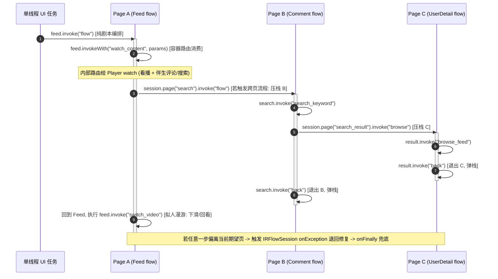

# PageAgent 控制流规范：压栈交接、异常处理与流控模式（`DOC-04`）

> 文档编号：`DOC-04`（可在 `skills/` 下用 `rg "DOC-04"` 定位本文档）

本文档聚焦 **PageAgent 控制流事件**的编排、页面间嵌套压栈交接与异常处理规范；页面创建/绑定/代码分区见 [DOC-02-page-agent.md](DOC-02-page-agent.md)，事件注册与归属见 [DOC-03-page-actions.md](DOC-03-page-actions.md)。

---


## 目录索引

- [`[DOC-04.1]` 1. 架构总览：单线程 UI 页面控制流压栈交接（`A → B → C`）](#DOC-04.1)
- [`[DOC-04.2]` 1.5 `[R-FLOW-01]` 判定标准：哪些事件是原子事件，哪些是控制流事件？](#DOC-04.2)
- [`[DOC-04.3]` 2. 两种标准控制流模式（必须使用异常处理封装）](#DOC-04.3)
  - [`[DOC-04.3.1]` 2.1 通用流程编排（`IRFlowSession`）](#DOC-04.3.1)
  - [`[DOC-04.3.2]` 2.2 列表浏览状态机（`IRPageAgent+IRListBrowse`）](#DOC-04.3.2)
- [`[DOC-04.4]` 3. 多轮等待 / 观看 / 轮询使用 `IRPageNode`（`loop` / `repeat` / `repeatUntil` / `waitUntil`）](#DOC-04.4)
- [`[DOC-04.5]` 4. 拟人权重与强类型传参](#DOC-04.5)

---

<a id="DOC-04.1"></a>
## `[DOC-04.1]` 1. 架构总览：单线程 UI 页面控制流压栈交接（`A → B → C`）

由于自动化运行在**单线程同步 UI 任务**上，跨页面控制流天然采用**“压栈 → 执行 → 退出弹栈”**的同步调用栈模型：
- **调用者（上游页面）**：只负责触发页面切换（如 `feed.invoke(@"open_comment")`），随后把控制权交给目标页节点控制流。
- **被调用者（下游页面）**：只管执行自己页面内的控制流，**结束时主动退出自己页面（如 `back` 弹栈）**，控制权同步回到上一页。
- **异常恢复**：若执行中页面异常离开预期页，由 `IRFlowSession` 的 `onException` 统一尝试退回当前层期望页面（能回到即算修复，可 `skip()` / `retry()`），`onFinally` 负责最终兜底。



---

<!-- [/DOC-04.1] -->
<a id="DOC-04.2"></a>
## `[DOC-04.2]` 1.5 `[R-FLOW-01]` 判定标准：哪些事件是原子事件，哪些是控制流事件？

写任何 Action 前先按以下**唯一判定表**归类，归错类会直接导致遗漏 `IRFlowSession` / `IRWatchTimeline` 或过度封装：

| 维度 | 原子事件 (Atomic Action) | 控制流事件 (Flow Action) |
|---|---|---|
| **语义边界** | **单一不可分**的物理动作或纯数据查询（点一个按钮、滑一次、输一段文字、读一个状态/模型、退出当前页） | 满足**任一**即算控制流：<br/>1. **多步串联 / 跨页压栈**：调用 ≥ 2 个子 Action（`invoke`）或跨页面进出<br/>2. **循环 / 条件漫游**：含多轮循环或分支路由（如回看、翻页浏览）<br/>3. **时间轴 / 伴生触发**：含按时长停留与进度节点编排（`watch`、`timeline`） |
| **典型例子** | `open_comment`、`open_search`、`next_video`、`prev_video`、`back`、`is_ad`、`video_info`、`open_ad` | `flow`、`watch`（视频/图集看播）、`watch_content`、`switch_video`、`try_comment`、`try_search`、`browse_nurture`、`browse_ad` |
| **内部禁区** | **严禁**调用 `IRPageNode.invoke` 串联多个业务动作；**严禁**使用 `IRWatchTimeline` 或业务循环 | **严禁**在裸 `do-while` 里手写多步 `invoke`、手写裸 `for` 循环或裸调 `AWBWatchWithProgress` |
| **标准写法** | `do { ... break; } while (NO); return diag.noError;`（纯查询可直接赋值返回 `diag.noError`） | 必须用 `[IRFlowSession execute:...]`（或 `registerListBrowse:`）；看播与伴生交互优先用 `registerDecisionPoint:` + `node.decision(pointID)`（或 `node.timeline(name, seconds)`） |
| **代码位置** | 主类 `.m` 或原子事件分类（`+Interaction`） | 优先放 `+Flow.m` / `+ListBrowse.m`（极小页面只有单个 `watch` 时可放主类 `+load` 末尾第 4 步） |

---

<!-- [/DOC-04.2] -->
<a id="DOC-04.3"></a>
## `[DOC-04.3]` 2. 两种标准控制流模式（必须使用异常处理封装）

控制流事件**禁止裸跑多步操作而不做异常处理**，必须使用以下两种封装之一：

<a id="DOC-04.3.1"></a>
### `[DOC-04.3.1]` 2.1 通用流程编排（`IRFlowSession`）
- 在 `+load`（或 `+Flow` 分类 `+load`）注册的流程事件 `perform` 中，必须用 `[IRFlowSession execute:onException:onFinally:diag:]` 包裹流程，内部通过 `session.page(pageID)` 获取页面节点。
- 异常回调 `onException` 中**禁止无脑 `retry()`**，且**默认即终止，不需要显式写 `exception.abort()`**：
  - 不可重试错误（元素不存在、列表到底）需要容忍继续时才调 `skip()`；需要终止时直接 `return`（不调 `retry()` / `skip()` 即自动终止）。
  - 可重试错误限制重试次数（建议 ≤ 2 次）并配合冷却等待。
  - 若在 `onException` 内自行执行退回修复，使用 `IRPageNode(..., diag)` 直接操作，避免再次触发会话异常递归。

```objc
[self registerAction:IRIdentityMake(@"flow", @"feed 页面控制流")
             builder:^(IRActionBuilder *action) {
    action.perform(^BOOL(IRApplication *app, IRActionContext *context, IRDiagnostics *diag) {
        [IRFlowSession execute:^(IRFlowSession *session) {
            IRPageNode *feed = session.page(@"feed");
            NSInteger total = [context.findParam(@"watch_count", feed.weightOrValue(@"flow_watch_count", @(6))) integerValue];
            feed.ensure(total > 0, @"目标观看数无效");

            // 纯剧本骨架: 只管看内容与切视频
            feed.loop(@"watch_loop", total, ^(NSUInteger index, NSUInteger totalCount, BOOL *stop) {
                // 1. 观看当前内容 (Feed 内部识别 Cell 类型路由: 支持则调 watch，不支持走兜底权重)
                feed.invokeWith(@"watch_content", @{ @"index": @(index + 1), @"total": @(totalCount) });

                // 2. 拟人切换视频 (Feed 内部自决漫游: 大概率下滑，偶发回看 1~N 屏)
                feed.invoke(@"switch_video");
            });
        } onException:^(IRFlowException *exception) {
            // 不管停在什么页面，能退回 feed 就算修复成功
            if (!IRPageNode(@"feed", nil).isVisible()) {
                IRPageNode(nil, diag).repeat(@"back_to_feed", ^(NSUInteger iteration, BOOL *stop) {
                    if (IRPageNode(@"feed", nil).isVisible() || iteration >= 5 || !IRPageNode(nil, diag).invoke(@"back")) {
                        *stop = YES;
                    }
                });
            }
            if (IRPageNode(@"feed", nil).isVisible() && exception.canSkip) {
                exception.skip();
                return;
            }
            // 不调 retry() / skip() 默认即终止，无需显式写 exception.abort()
        } onFinally:^(IRFlowSession *session, IRDiagnostics *flowDiag) {
            // 控制流兜底：无论成功、跳过或终止都会执行
        } diag:diag];
        return diag.noError;
    });
}];
```

<!-- [/DOC-04.3.1] -->
<a id="DOC-04.3.2"></a>
### `[DOC-04.3.2]` 2.2 列表浏览状态机（`IRPageAgent+IRListBrowse`）
- 在 `+load` 中使用 `+registerListBrowse:contextClass:builder:` 注册列表浏览场景（内置 `IRFlowSession` 异常封装），自动打上 `browse.flow` 标签。
- 通过 `browse.view`（查看）、`browse.slide`（滑动）、`browse.exit`（退出）、`browse.info`（只读信息查询）标签声明阶段动作，并在步骤中严格落实 `maxItems` 上限与连续条目未前移防死循环熔断（详见 [DOC-09-browse.md](DOC-09-browse.md)）。

```objc
[self registerListBrowse:IRIdentityMake(@"browse_ad", @"广告场景浏览")
            contextClass:AWBSearchListBrowseContext.class
                 builder:^(IRListBrowseBuilder *flow) {
    flow.arg(@"max_items", IRSchemaTypeInteger).setDefaultValue(@15).setComment(@"最多看几条");
    flow.onStep(^(IRListBrowseStep *step, AWBSearchListBrowseContext *list) {
        if (step.at(IRListBrowseStageView)) {
            step.item.watched == 0 ? step.invokeWith(@"watch_item", @{ @"seconds": @3 }) : step.skip();
        } else if (step.at(IRListBrowseStageSlide)) {
            list.listState.reachedEnd ? step.skip() : step.invoke(@"next_item");
        } else if (step.at(IRListBrowseStageExit)) {
            step.invoke(@"back");
        }
    }, ^(IRFlowException *exception, IRListBrowseStep *step, AWBSearchListBrowseContext *list) {
        // 不调 retry() / skip() 默认即终止，无需显式写 exception.abort()
    });
}];
```

---

<!-- [/DOC-04.3.2] -->
<!-- [/DOC-04.3] -->
<a id="DOC-04.4"></a>
## `[DOC-04.4]` 3. 多轮等待 / 观看 / 轮询使用 `IRPageNode`（`loop` / `repeat` / `repeatUntil` / `waitUntil`）

- 涉及多秒观看、分段等待或轮询（如 `watch` 按秒更新进度、循环刷条目），**优先使用 `IRPageNode(context.page.pageID, diag)` 的 `loop` / `repeat` / `repeatUntil` / `waitUntil`**，不要手写裸 `for` + `sleep`。
- **内置页面断言与自愈触发**：`IRPageNode` 的每轮循环在**每一轮开始前自动检查当前页面是否仍在场**，一旦页面跳走或被中断会立即停止或触发 Session 的 `onException` 自愈，配合结尾 `return diag.noError;` 保证状态一致。
- **自带画板活动提示、自动诊断清理与链式 `.onExhausted`**：
  - `node.repeatUntil(name, count, interval, ^(attempt, total, stop){ ... })`：自动在 RemoteCanvas 画板上屏 `"%@ 1/N"`，重试失败显示 `"重试 %@ 2/N"`；每次重试前自动清除上一轮临时 diag 错误，间隔走 `task sleep`；`*stop = YES` 提前终止（成功或报致命错）；支持链式 `.onExhausted(^{ ... })` 定制耗尽错误（不链式则自动兜底写默认错误）；
  - `node.waitUntil(name, timeout, interval, ^(stop){ ... })`：自动在画板上屏轮询等待时长（如 `"1.2/5.0s"`），`*stop = YES` 提前终止；超时且未提前 `*stop` 时支持链式 `.onExhausted(^{ ... })`。

---

<!-- [/DOC-04.4] -->
<a id="DOC-04.5"></a>
## `[DOC-04.5]` 4. 拟人权重与强类型传参

- **禁止裸写 `arc4random` / `arc4random_uniform`**：所有“看几个、停多久、选哪档”的随机决策统一在原始主类 `+load` 里用 `[self registerWeight:...]` 注册权重空间（空间 ID 默认为当前 `PageAgent` 类名），并在 `-factorStrengthForName:` / `-disabledItemIDsWithPath:` 中注入运行时因子（详见 [DOC-05-weight.md](DOC-05-weight.md)）。
- **数据模型化**：跨动作或跨端（如搜索决策上下文、浏览结果回传）传递 ≥ 3 个字段或嵌套数据时，必须定义强类型 Model（配合 `CHRModel` 或 `AWBAweme`），**禁止**用散装 `NSDictionary` 字面量键名在多个模块间拼凑传递。
<!-- [/DOC-04.5] -->
