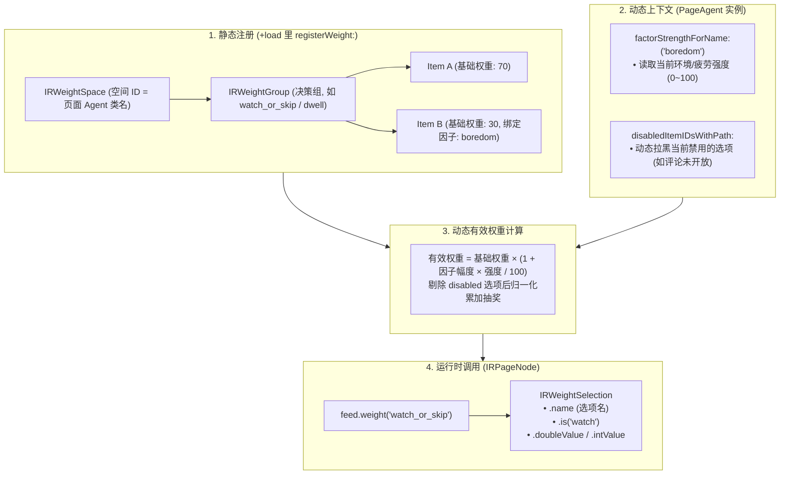

# Weight 拟人权重系统与决策规范（`DOC-05`）

> 文档编号：`DOC-05`（可在 `skills/` 下用 `rg "DOC-05"` 定位本文档）

在自动化脚本中，“**做不做某事、做哪个分支、停留多久、滑动几屏**”等决策如果使用硬编码或朴素随机数，会导致机器特征极其明显（如固定停留时长、机械的等概率选择）。
IRAutomationKit 提供了面向拟人自动化的 **Weight 权重系统**：
- **结构化空间与组**：每个页面 Agent 拥有独立的权重空间（Space），划分为不同的决策组（Group）与选项（Item）；
- **动态环境因子 (Factors)**：选项权重可随当前会话状态（如“越刷越不耐烦”的疲劳度 `boredom`、账号活跃度等）动态缩放；
- **动态条件禁用**：支持根据界面实时状态（如当前没有评论区）动态拉黑特定选项；
- **服务端可控调参**：权重配置支持未来从云端下发与热更新，无需重新打包编译。

---


## 目录索引

- [`[DOC-05.1]` 1. `[R-ACT-01]` 核心铁律：严禁在业务代码中裸写随机函数](#DOC-05.1)
- [`[DOC-05.2]` 2. 权重系统架构与计算模型](#DOC-05.2)
- [`[DOC-05.3]` 3. 页面 Agent 权重注册规范](#DOC-05.3)
- [`[DOC-05.4]` 4. 动态环境上下文与禁用重写](#DOC-05.4)
  - [`[DOC-05.4.1]` 4.1 因子强度重写 (`factorStrengthForName:`)](#DOC-05.4.1)
  - [`[DOC-05.4.2]` 4.2 动态选项禁用重写 (`disabledItemIDsWithPath:`)](#DOC-05.4.2)
- [`[DOC-05.5]` 5. 流程层调用语法糖 (`IRPageNode+IRWeight`)](#DOC-05.5)
  - [`[DOC-05.5.1]` 5.1 基础调用与条件分支](#DOC-05.5.1)
  - [`[DOC-05.5.2]` 5.2 安全兜底取值 (`weightOrValue`) 与一行式链式判定](#DOC-05.5.2)
  - [`[DOC-05.5.3]` 5.3 结果多次使用的避坑规则](#DOC-05.5.3)
  - [`[DOC-05.5.4]` 5.4 `[R-ACT-02]` 参数与权重覆写标准惯用法 (Param-Weight Override Idiom)](#DOC-05.5.4)
- [`[DOC-05.6]` 6. Good vs Bad 对比清单](#DOC-05.6)

---

<a id="DOC-05.1"></a>
## `[DOC-05.1]` 1. `[R-ACT-01]` 核心铁律：严禁在业务代码中裸写随机函数

> [!CAUTION]
> **严禁在自动化业务代码中裸写 `arc4random()`、`arc4random_uniform()` 或 `rand()`！**
> - 裸随机生成的行为分布均匀且机械，极易被风控模型通过统计特征（如均匀分布、无上下文疲劳衰减）识别；
> - 裸随机参数写死在代码中，线上无法针对不同账号画像或策略动态下发调参；
> - 所有概率选择、分支决策、停留时长、滑动幅度，**必须全部注册为权重组（Weight Group）并通过权重接口取值**。

---

<!-- [/DOC-05.1] -->
<a id="DOC-05.2"></a>
## `[DOC-05.2]` 2. 权重系统架构与计算模型



---

<!-- [/DOC-05.2] -->
<a id="DOC-05.3"></a>
## `[DOC-05.3]` 3. 页面 Agent 权重注册规范

权重空间在 `PageAgent` 的 `+load` 方法中通过 `+registerWeight:` 注册（空间 ID 自动取当前 `PageAgent` 的类名）。

> [!TIP]
> **观看决策点（`registerDecisionPoint:`）的权重无需在 `registerWeight:` 中重复注册**：
> 使用 `[self registerDecisionPoint:IRIdentityMake(@"watch_video", @"...") builder:^(IRDecisionPointBuilder *point) { ... }]` 时，框架会自动在当前 `PageAgent` 的权重空间注册 `<pointID>.duration`（总时长）、`<pointID>.<action>.progress`（N 段均分 0~100% 询问进度）和 `<pointID>.<action>.probability`（万分比触发概率），并可通过 `point.remote(YES/NO)` 控制是否请求远程网络决策（默认 `NO`）。详见 `[DOC-11.5.1]`。
> 注意：`IRWeight` 按当前类独立注册权重空间（不沿继承链共享），若子类 Agent 会作为命中实例执行决策点，子类也需在自身 `+load` 中调用 `registerDecisionPoint:`。

```objc
@implementation AWBFeedPageAgent

+ (void)load {
    // 注册权重空间 (严格按 +load 规范组织在 registerAgent 之后)
    [self registerWeight:^(id<IRWeightSpaceDescriptorBuilder> space) {
        // 1. 离散分支选择: 看还是划走
        [space registerGroup:IRIdentityMake(@"watch_or_skip", @"看还是划走")
                     builder:^(id<IRWeightGroupDescriptorBuilder> group) {
            group.registerItem(IRIdentityMake(@"watch", @"完整观看"), 70);
            group.registerItem(IRIdentityMake(@"skip", @"直接划走"), 30)
                 .setIncludeFactors(@[ @"type_boredom" ]); // 绑定疲劳度因子
        }];

        // 2. 连续区间取值: 观看停留时长 (绑定 IRTimeRange)
        [space registerGroup:IRIdentityMake(@"dwell", @"观看停留时长")
                     builder:^(id<IRWeightGroupDescriptorBuilder> group) {
            group.registerItem(IRIdentityMake(@"glance", @"匆匆一瞥"), 40)
                 .setValue(IRTimeRangeMake(1.5, 3.5)); // 秒数区间 [1.5, 3.5]
            group.registerItem(IRIdentityMake(@"normal", @"正常观看"), 50)
                 .setValue(IRTimeRangeMake(5.0, 12.0));
            group.registerItem(IRIdentityMake(@"deep", @"深度沉浸"), 10)
                 .setValue(IRTimeRangeMake(18.0, 35.0));
        }];

        // 3. 离散数值取值: 每次搜索后翻几屏
        [space registerGroup:IRIdentityMake(@"result_swipes", @"滑动屏幕数")
                     builder:^(id<IRWeightGroupDescriptorBuilder> group) {
            group.registerItem(IRIdentityMake(@"one", nil), 40).setValue(@1);
            group.registerItem(IRIdentityMake(@"two", nil), 45).setValue(@2);
            group.registerItem(IRIdentityMake(@"three", nil), 15).setValue(@3);
        }];

        // 4. 拟人漫游权重: 切换视频方向、回看步数与停留区间 (用于 switch_video)
        [space registerGroup:IRIdentityMake(@"switch_direction", @"切换视频方向")
                     builder:^(id<IRWeightGroupDescriptorBuilder> group) {
            group.registerItem(IRIdentityMake(@"down", @"向下看下一个作品"), 94);
            group.registerItem(IRIdentityMake(@"up", @"向上回看历史作品"), 6);
        }];

        [space registerGroup:IRIdentityMake(@"switch_rewatch_steps", @"回看作品数")
                     builder:^(id<IRWeightGroupDescriptorBuilder> group) {
            group.registerItem(IRIdentityMake(@"1", @"回看上 1 个作品"), 70).setValue(@1);
            group.registerItem(IRIdentityMake(@"2", @"回看上 2 个作品"), 20).setValue(@2);
            group.registerItem(IRIdentityMake(@"3", @"回看上 3 个作品"), 10).setValue(@3);
        }];

        [space registerGroup:IRIdentityMake(@"switch_rewatch_dwell", @"回看停留时长")
                     builder:^(id<IRWeightGroupDescriptorBuilder> group) {
            group.registerItem(IRIdentityMake(@"brief", @"短暂停留"), 70).setValue(IRTimeRangeMake(1.5, 3.5));
            group.registerItem(IRIdentityMake(@"medium", @"稍作停留"), 30).setValue(IRTimeRangeMake(3.5, 6.0));
        }];
    }];
}

@end
```

---

<!-- [/DOC-05.3] -->
<a id="DOC-05.4"></a>
## `[DOC-05.4]` 4. 动态环境上下文与禁用重写

`PageAgent` 自身实现了 `<IRWeightContext>` 协议。业务类通过重写以下两个方法为权重决策注入动态上下文：

<a id="DOC-05.4.1"></a>
### `[DOC-05.4.1]` 4.1 因子强度重写 (`factorStrengthForName:`)
返回当前因子的强度值（范围 `0` ~ `100`）：
```objc
- (int)factorStrengthForName:(NSString *)name {
    if ([name isEqualToString:@"type_boredom"]) {
        // 随着本次已观看视频数的增加，不耐烦度递增，促使划走概率变大
        NSInteger watched = self.sessionWatchedCount;
        return (int)MIN(100, watched * 6); // 每多看 1 个视频，疲劳度加 6，最高 100
    }
    return 0; // 默认强度为 0
}
```

<!-- [/DOC-05.4.1] -->
<a id="DOC-05.4.2"></a>
### `[DOC-05.4.2]` 4.2 动态选项禁用重写 (`disabledItemIDsWithPath:`)
针对当前条目的真实情况动态禁用某些动作（如无评论、已点过赞等）：
```objc
- (NSSet<NSString *> *)disabledItemIDsWithPath:(IRWeightGroupPath *)path {
    if ([path.groupID isEqualToString:@"interaction"]) {
        NSMutableSet *disabled = [NSMutableSet set];
        if (!self.currentAweme.canComment) {
            [disabled addObject:@"comment"]; // 禁用评论选项
        }
        if (self.currentAweme.isDigged) {
            [disabled addObject:@"like"];    // 已点赞则禁用重复点赞
        }
        return disabled;
    }
    return nil; // 默认不禁用任何选项
}
```

---

<!-- [/DOC-05.4.2] -->
<!-- [/DOC-05.4] -->
<a id="DOC-05.5"></a>
## `[DOC-05.5]` 5. 流程层调用语法糖 (`IRPageNode+IRWeight`)

在流程中，直接通过 `feedNode.weight(...)` 进行链式评估与取值：

<a id="DOC-05.5.1"></a>
### `[DOC-05.5.1]` 5.1 基础调用与条件分支
```objc
IRPageNode *feed = IRPageNode(@"feed.recommend", diag);

// 1. 分支判断: .is(@"选项名")
if (feed.weight(@"watch_or_skip").is(@"watch")) {
    // 2. 时长区间取值: 自动在 IRTimeRange 内按拟人连续分布提取随机 double 秒数
    NSTimeInterval waitSec = feed.weight(@"dwell").doubleValue;
    feed.wait(waitSec);
}

// 3. 提取整型数值: .integerValue
NSInteger swipes = feed.weight(@"result_swipes").integerValue;
for (NSInteger i = 0; i < swipes; i++) {
    feed.invoke(@"next_video");
}
```

<!-- [/DOC-05.5.1] -->
<a id="DOC-05.5.2"></a>
### `[DOC-05.5.2]` 5.2 安全兜底取值 (`weightOrValue`) 与一行式链式判定
当权重组可能未注册、页面尚未识别过、或所有选项全被禁用时，普通 `weight` 会记录错误并交给 `onException`；如果业务希望**在异常时静默回退到默认值而不打断流程**，使用 `weightOrValue`：

```objc
// 1. 数值兜底: 如果权重选择失败，自动回退取默认值 @3，只打 warning 日志，不触发异常中断
int safeSwipes = feed.weightOrValue(@"swipes", @3).intValue;

// 2. 一行式选项判定: 只需判定一次时，直接链式调用 .is(@"...")，严禁声明多余的临时变量
if (feed.weightOrValue(@"switch_direction", @"down").is(@"up")) {
    ...
}
```

> [!TIP]
> **严禁在 `weightOrValue` 之后堆砌多余的防御性判空或保底代码！**
> `weightOrValue(group, defaultValue)` 自身已经内置了默认值兜底；且 `IRPageNode` 的 `loop` 与 `wait` 原生安全处理 `<= 0` 的输入（`loop` 跳过、`wait` 不等待）。
> - ❌ 冗余废话：`NSInteger steps = feed.weightOrValue(@"steps", @1).integerValue; if (steps <= 0) steps = 1;`
> - ✅ 极简信任：`feed.loop(@"rewatch", feed.weightOrValue(@"steps", @1).integerValue, ...);`、`feed.wait(feed.weightOrValue(@"dwell", @(2.5)).doubleValue);`

<!-- [/DOC-05.5.2] -->
<a id="DOC-05.5.3"></a>
### `[DOC-05.5.3]` 5.3 结果多次使用的避坑规则
> [!IMPORTANT]
> **每次调用 `feed.weight(@"xxx")` 都会触发一次全新独立的权重轮盘抽奖！**
> 如果某个决策的结果需要在后续被多次判断或使用，**必须先用局部变量存下来**：
> ```objc
> // ❌ 错误：两次调用是两次独立抽奖，前一步判断命中，后一步取值可能完全错乱
> if (feed.weight(@"dwell").is(@"long")) {
>     feed.wait(feed.weight(@"dwell").doubleValue); 
> }
> 
> // ✅ 正确：抽取一次存入局部变量
> IRWeightSelection *dwellSel = feed.weight(@"dwell");
> if (dwellSel.is(@"long")) {
>     NSLog(@"选了长等待: %.1f 秒", dwellSel.doubleValue);
>     feed.wait(dwellSel.doubleValue);
> }
> ```

<!-- [/DOC-05.5.3] -->
<a id="DOC-05.5.4"></a>
### `[DOC-05.5.4]` 5.4 `[R-ACT-02]` 参数与权重覆写标准惯用法 (Param-Weight Override Idiom)
在编写自动化流程（如 `flow` 动作）时，上层调用者（如测试命令、服务端下发指令）经常可能传入指定参数（如 `watch_count: 5`），而在没有外部指定时，流程应当自动按拟人权重决策：

```objc
// ✅ 标准一行式: 外部参数优先，缺省走拟人权重，权重缺失走兜底，配合 ensure 守护
NSInteger targetWatchCount = [context.findParam(@"watch_count", feed.weightOrValue(@"flow_watch_count", @(6))) integerValue];
feed.ensure(targetWatchCount > 0, @"目标观看数无效");
```

- **底层原理（多态）**：
  `NSNumber` 与 `IRWeightSelection` 均天然实现了 `.integerValue`、`.doubleValue`、`.stringValue`、`.boolValue` 等方法：
  - 外部传参时：`findParam` 返回传入的 `NSNumber` / `NSString`；
  - 外部未传参时：`findParam` 回退到默认值 `feed.weightOrValue(...)`，返回抽取出的 `IRWeightSelection`；
  - 权重不存在或全部被禁用时：`weightOrValue` 回退到给定的基本对象（如 `@6`）。
- **优势**：消除了传统写法中 10 余行嵌套的 `if-else`、判空和类型转换模板代码，清晰优雅且无缝对接风控拟人策略。

---

<!-- [/DOC-05.5.4] -->
<!-- [/DOC-05.5] -->
<a id="DOC-05.6"></a>
## `[DOC-05.6]` 6. Good vs Bad 对比清单

| 场景 | ❌ 错误做法 (Bad) | ✅ 正确做法 (Good) | 说明 |
|---|---|---|---|
| **随机时长** | `sleep(arc4random_uniform(5) + 2);` | `feed.wait(feed.weight(@"dwell").doubleValue);` | 裸伪随机分布均匀且僵硬，无法响应疲劳度衰减；权重系统采用拟人分段正态分布。 |
| **分支概率** | `if (arc4random_uniform(100) < 30) [self like];` | `if (feed.weight(@"like_decision").is(@"like")) [self like];` | 硬编码概率无法云端下发调参，且无法随账号画像（活跃账号 vs 沉寂账号）动态适配。 |
| **动态条件限制** | 在选择后再手写 `if (!canComment) return;` 导致白白丢弃一次选择 | 在 `disabledItemIDsWithPath:` 中拉黑 `@"comment"` | 在权重计算前禁用选项，轮盘会自动将权重平摊给其他可用动作，不会出现“抽中了却做不了”的空转。 |
| **多次读取结果** | 一行代码里连调两次 `feed.weight(@"action")` | 抽取结果一次存进 `IRWeightSelection *s = feed.weight(@"action");` | `weight()` 每调一次就掷一次骰子，连调两次会导致逻辑错乱。 |
| **兜底参数** | 复杂的参数判空保护写多层 `@try ... @catch` | 使用 `feed.weightOrValue(@"speed", @1.0).doubleValue` | 优雅提供默认值回退机制，避免组配置缺失导致主业务流程崩解。 |
<!-- [/DOC-05.6] -->
