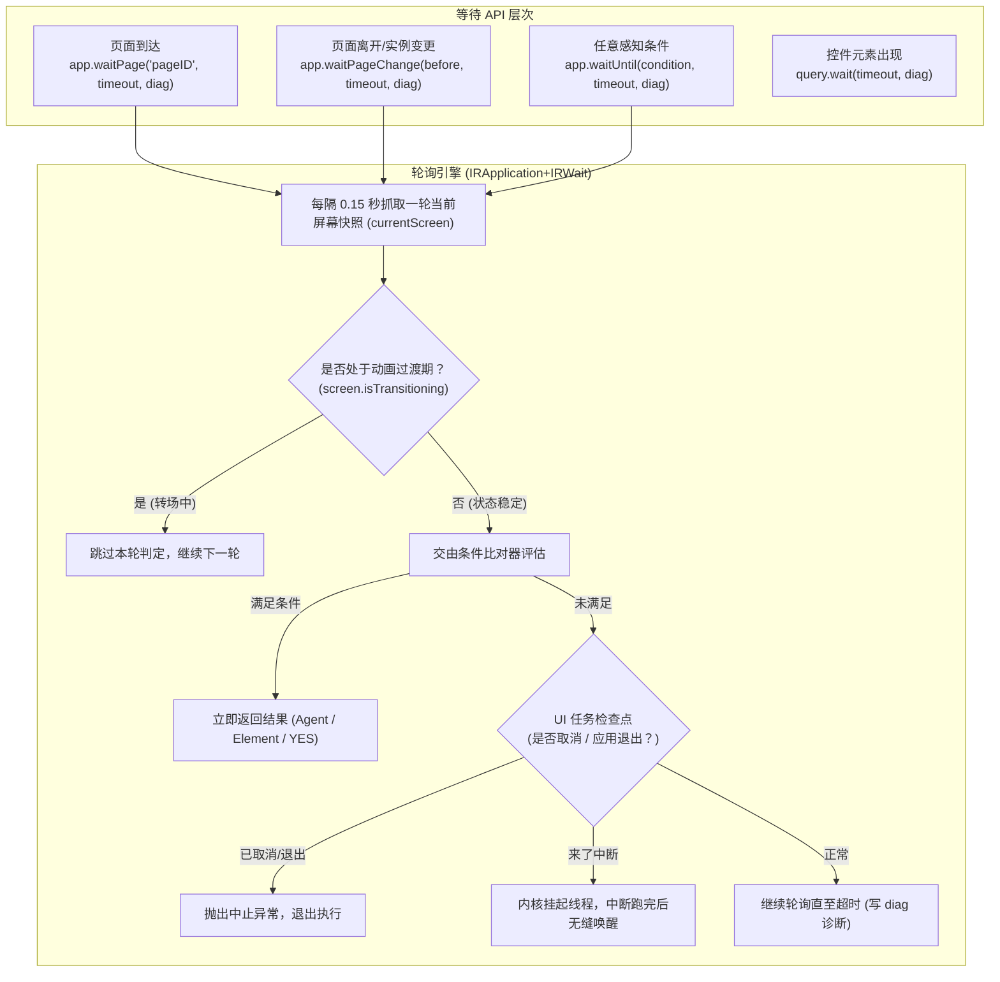

# 等待机制与执行权调度规范（`DOC-06`）

> 文档编号：`DOC-06`（可在 `skills/` 下用 `rg "DOC-06"` 定位本文档）

在移动端自动化中，**界面渲染、网络请求与转场动画均具有不确定性**。IRAutomationKit 提供了面向页面、感知链和视图树的一整套非阻塞等待机制。

---


## 目录索引

- [`[DOC-06.1]` 1. `[R-FLOW-03]` 核心铁律：严禁裸写固定 `sleep`](#DOC-06.1)
- [`[DOC-06.2]` 2. 等待机制全景](#DOC-06.2)
- [`[DOC-06.3]` 3. 页面级等待 (`IRApplication+IRWait`)](#DOC-06.3)
  - [`[DOC-06.3.1]` 3.1 等待目标页面出现 (`waitPage`)](#DOC-06.3.1)
  - [`[DOC-06.3.2]` 3.2 等待页面变更 / 离开当前页面 (`waitPageChange`)](#DOC-06.3.2)
- [`[DOC-06.4]` 4. 任意感知条件等待 (`waitUntil`)](#DOC-06.4)
- [`[DOC-06.5]` 5. 视图树与控件等待 (`query.wait`)](#DOC-06.5)
  - [`[DOC-06.5.1]` 页面到达与内容就绪的双阶段原则](#DOC-06.5.1)
- [`[DOC-06.6]` 6. 键盘与输入焦点等待](#DOC-06.6)
- [`[DOC-06.7]` 7. 诊断与失败处理](#DOC-06.7)
- [`[DOC-06.8]` 8. Good vs Bad 对比清单](#DOC-06.8)

---

<a id="DOC-06.1"></a>
## `[DOC-06.1]` 1. `[R-FLOW-03]` 核心铁律：严禁裸写固定 `sleep`

> [!CAUTION]
> **严禁在自动化逻辑中裸写 `sleep(seconds)` 或 `usleep(...)`**！
> - 慢了白等（严重拖慢自动化吞吐）；
> - 快了误判（网络抖动时页面还没出来就继续往下点，导致连锁报错）；
> - 裸 `sleep` 会阻塞底层操作系统线程，**导致无法响应任务取消（Cancel）、无法响应中断（Interrupt）挂起、甚至触发外部看门狗（Watchdog）超时杀进程**。

如果在 UI 任务执行期间必须进行微小停顿（如等待手势按住、预留渲染稳定窗口），必须使用带任务上下文的调度接口：
```objc
// ✅ 正确：在 IRAutomationTask 或 IRInterruptTask 中调用
[task sleep:0.5]; // 内部自动检查取消点、支持中断线程挂起与恢复
```

---

<!-- [/DOC-06.1] -->
<a id="DOC-06.2"></a>
## `[DOC-06.2]` 2. 等待机制全景



---

<!-- [/DOC-06.2] -->
<a id="DOC-06.3"></a>
## `[DOC-06.3]` 3. 页面级等待 (`IRApplication+IRWait`)

<a id="DOC-06.3.1"></a>
### `[DOC-06.3.1]` 3.1 等待目标页面出现 (`waitPage`)
等待屏幕感知系统解析出的 `currentScreen.pageID` 与指定标识匹配：

```objc
// 等待进入评论页，最长等 5 秒
IRPageAgent *commentPage = app.waitPage(@"feed.comment", 5.0, diag);
if (commentPage == nil) {
    // 超时未等到，原因已记录在 diag (如 "waitPage feed.comment: 超时 5.0s，当前页面: feed.recommend")
    return diag.noError;
}
```

> [!WARNING]
> **若当前屏幕已经是该 `pageID`，`waitPage` 会立即返回成功！**
> 例如在搜索结果页再次点击搜索，页面依然是 `search.result`，此时调用 `waitPage(@"search.result")` 会直接命中**旧页面**。针对“刷新”或“同一类页面再次加载”，必须使用下面的 `waitPageChange`。

<!-- [/DOC-06.3.1] -->
<a id="DOC-06.3.2"></a>
### `[DOC-06.3.2]` 3.2 等待页面变更 / 离开当前页面 (`waitPageChange`)
通过比较 `IRPageAgent` 的**内存实例指针**判断页面是否发生了迁移（即使前后两个页面的 `pageID` 完全相同，只要创建了新的控制器实例，也会判定为变更成功）：

```objc
// 1. 在触发操作前，务必先捕获当前页面实例！
IRPageAgent *beforePage = app.currentAgent;

// 2. 触发可能引发页面切换的操作
refreshButton.tap(diag);

// 3. 等待脱离旧页面，到达任意新页面
IRPageAgent *newPage = app.waitPageChange(beforePage, 5.0, diag);
if (newPage && [newPage.pageID isEqualToString:@"feed.recommend"]) {
    // 确认已成功刷新并进入了新的推荐流控制器实例
}
```

---

<!-- [/DOC-06.3.2] -->
<!-- [/DOC-06.3] -->
<a id="DOC-06.4"></a>
## `[DOC-06.4]` 4. 任意感知条件等待 (`waitUntil`)

利用感知系统生成的响应链（Chain）与屏幕状态（`IRScreenState`）进行高自由度判定：

```objc
// 等待全局弹窗消失 (例如等待 DUXAlertDialog 关闭)
BOOL dismissed = app.waitUntil(^BOOL(IRScreenState *screen) {
    // 检查响应链控制器中是否已无弹窗类
    return ![screen.chain containsClass:@"DUXAlertDialog"];
}, 5.0, diag);

// 等待视频 cell 切换完成 (通过响应链上的 Cell 地址是否变化)
IRRemoteAddress beforeCellAddr = [app.currentScreen.chain firstNodeOfClass:@"AWEFeedCellViewController"].address;
app.swipe(200, 600, 200, 200, 0.25, diag);

BOOL switched = app.waitUntil(^BOOL(IRScreenState *screen) {
    IRRemoteAddress currentAddr = [screen.chain firstNodeOfClass:@"AWEFeedCellViewController"].address;
    return currentAddr != 0 && currentAddr != beforeCellAddr;
}, 5.0, diag);
```

---

<!-- [/DOC-06.4] -->
<a id="DOC-06.5"></a>
## `[DOC-06.5]` 5. 视图树与控件等待 (`query.wait`)

等待某个具体的 UI 控件在视图树中渲染呈现。每一轮均在查询根节点上重新抓取视图树快照并评估：

```objc
// 等待含 "关注成功" 的文字控件出现，最多等 3 秒
IRUIElement *toastElement = app.query.texts(@"关注成功").visible().wait(3.0, diag);
if (toastElement.exists(nil)) {
    NSLog(@"Toast 成功出现");
}

// 级联等待：等待评论输入框出现并点击
IRUIElement *input = app.query.views(@"UITextField").axLabels(@"*输入评论*").wait(5.0, diag);
if (input.exists(diag)) {
    input.tap(diag);
}
```

<a id="DOC-06.5.1"></a>
### `[DOC-06.5.1]` 页面到达与内容就绪的双阶段原则
- **阶段一（页面容器到位）**：`waitPage` 判定的是顶层 ViewController 已经就位；
- **阶段二（异步内容到位）**：页面内部的 Lynx、WebView 或网络异步列表往往比 VC 慢 200~800ms。
- **最佳实践**：先 `waitPage` 确认页面身份，再通过 `query.wait` 锚定一个**代表内容加载完毕的关键控件**（如首条数据的发布者头像或标题）。

---

<!-- [/DOC-06.5.1] -->
<!-- [/DOC-06.5] -->
<a id="DOC-06.6"></a>
## `[DOC-06.6]` 6. 键盘与输入焦点等待

当执行未聚焦输入时，键盘的弹出带有系统动画：

```objc
// 方式 1: 直接使用 element.typeText (内置全自动等键盘流程)
field.typeText(@"自动聚焦输入", diag);

// 方式 2: 手动轮询键盘状态
field.tap(diag);
CFAbsoluteTime deadline = CFAbsoluteTimeGetCurrent() + 3.0;
while (!app.isKeyboardVisible && CFAbsoluteTimeGetCurrent() < deadline) {
    [task sleep:0.1]; // 必须使用 task sleep 维持检查点响应
}
if (app.isKeyboardVisible) {
    app.inputText(@"输入文字", diag);
}
```

---

<!-- [/DOC-06.6] -->
<a id="DOC-06.7"></a>
## `[DOC-06.7]` 7. 诊断与失败处理

所有等待接口在超时时都会保持静默不崩，并将超时上下文注入 `diag`：
- 超时返回值为 `nil`、`NO` 或空元素（`exists == NO`）；
- `diag` 中详细记录：**期望等待的目标、最大超时限制、最后一次轮询时的真实界面状态（当前页面 ID、响应链前 3 级、控件数量）**；
- 业务逻辑只需遵循：
  ```objc
  if (app.waitPage(@"target", 5.0, diag) == nil) {
      return diag.noError; // 错误信息已进 diag，直接退出
  }
  ```

---

<!-- [/DOC-06.7] -->
<a id="DOC-06.8"></a>
## `[DOC-06.8]` 8. Good vs Bad 对比清单

| 场景 | ❌ 错误做法 (Bad) | ✅ 正确做法 (Good) | 说明 |
|---|---|---|---|
| **等待页面刷新** | 点击刷新后调 `sleep(2)` 或调 `app.waitPage(@"same_id")` | `IRPageAgent *before = app.currentAgent; [refresh tap]; app.waitPageChange(before, 5, diag);` | 同类页面跳转或刷新时，`waitPage` 立即误判返回旧页面；必须比对 `before` 实例。 |
| **等待弹窗关闭** | 裸写 `sleep(1)` 盲猜弹窗已消失 | `app.waitUntil(^BOOL(IRScreenState *s) { return !s.chain.contains(@"PopupVC"); }, 3, diag);` | 盲等要么拖慢执行效率，要么在设备卡顿未关闭时提前触发后续点击导致误触。 |
| **等待动画稳定** | 在动画执行中强行点按控件 | 依赖 `app.waitPage` 自动忽略 `isTransitioning` 状态 | 页面切换动画中途坐标与响应链不稳定，等待接口已内置转场过滤，无需自己算延迟。 |
| **任务中途延迟** | 在 `IRAutomationTask` 里调用 `[NSThread sleepForTimeInterval:2]` | 调用 `[task sleep:2]` | `NSThread sleep` 无法响应任务中断与取消信号，会造成任务失控。 |
| **缓存元素等出现** | `IRUIElement *e = query.element; while(!e.exists) sleep(1);` | `IRUIElement *e = query.wait(5.0, diag);` | `query.wait` 内部每轮重新评估查询树；手动循环调用旧元素会频繁读死缓存。 |
<!-- [/DOC-06.8] -->
