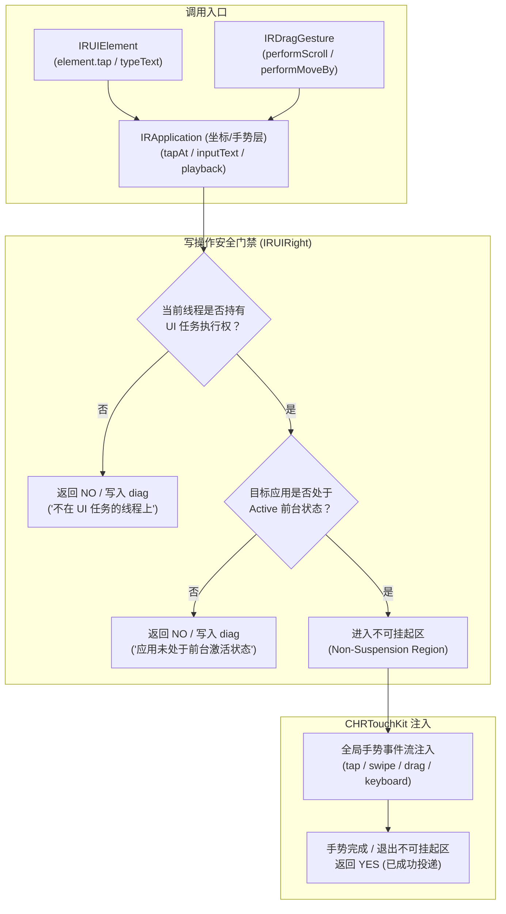

# Operation 触摸输入、手势回放与元素动作（`DOC-08`）

> 文档编号：`DOC-08`（可在 `skills/` 下用 `rg "DOC-08"` 定位本文档）

IRAutomationKit 从进程外自动化目标 App，底层所有写操作（触摸注入、手势回放、键盘文字输入）均委托 `CHRTouchKit` 完成。上层通过 `IRApplication` 暴露坐标操作、`IRDragGesture` 暴露闭环手势、`IRUIElement` 暴露面向控件的语义化动作。

---


## 目录索引

- [`[DOC-08.1]` 1. 架构与执行权约束](#DOC-08.1)
  - [`[DOC-08.1.1]` 核心约束原则](#DOC-08.1.1)
- [`[DOC-08.2]` 2. 坐标触摸操作 (`IRApplication+IRTouch`)](#DOC-08.2)
- [`[DOC-08.3]` 3. 手势回放 (`app.playback`)](#DOC-08.3)
- [`[DOC-08.4]` 4. 合成拖动手势 (`IRDragGesture`)](#DOC-08.4)
  - [`[DOC-08.4.1]` 4.1 列表精确滚动 (`performScroll:by:`)](#DOC-08.4.1)
  - [`[DOC-08.4.2]` 4.2 拟人模板拖拽 (`templatePlanID`)](#DOC-08.4.2)
  - [`[DOC-08.4.3]` 4.3 动态闭环引导 (`performWithHandler:`)](#DOC-08.4.3)
- [`[DOC-08.5]` 5. 文字输入与键盘快照 (`IRApplication+IRInput`)](#DOC-08.5)
  - [`[DOC-08.5.1]` 5.1 基础输入与预设模式](#DOC-08.5.1)
  - [`[DOC-08.5.2]` 5.2 键盘状态快照 (`IRKeyboardInfo`)](#DOC-08.5.2)
  - [`[DOC-08.5.3]` 5.3 逐词上屏监听器 (`IRInputMonitor`)](#DOC-08.5.3)
- [`[DOC-08.6]` 6. 元素层动作封装 (`IRUIElement`)](#DOC-08.6)
  - [`[DOC-08.6.1]` 6.1 内置快捷动作](#DOC-08.6.1)
  - [`[DOC-08.6.2]` 6.2 扩展自定义元素动作](#DOC-08.6.2)
- [`[DOC-08.7]` 7. Good vs Bad 对比清单](#DOC-08.7)

---

<a id="DOC-08.1"></a>
## `[DOC-08.1]` 1. 架构与执行权约束

所有写操作均具有严格的执行权与运行环境要求：



<a id="DOC-08.1.1"></a>
### `[DOC-08.1.1]` 核心约束原则
1. **线程执行权限定**：写操作只能在持有执行权的 UI 任务（`IRAutomationTask` 或 `IRInterruptTask`）的工作线程上调用。在主队列 `app.queue` 或普通异步后台线程调用立即返回 `NO`，`diag` 记录错误。
2. **不可挂起区保护**：单次触摸手势在不可挂起区内同步原子执行。中断（Interrupt）只会在两个手势之间的检查点切入，绝不会在屏幕上残留按住未抬起的手指。
3. **坐标系统规范**：所有坐标均为**竖屏固定坐标空间 points**（与 `UIScreen.mainScreen.fixedCoordinateSpace.bounds` 及 `mpa pviews` 打印的 frame 一致，原点在左上角）。超出屏幕范围的坐标直接拒绝。
4. **返回值语义**：返回 `YES` 仅表示事件流已成功投递给内核触摸系统，并不代表业务逻辑已经达成，后续必须通过**感知与等待接口**（如 `app.waitPageChange`、`query.wait`）确认界面响应。

---

<!-- [/DOC-08.1.1] -->
<!-- [/DOC-08.1] -->
<a id="DOC-08.2"></a>
## `[DOC-08.2]` 2. 坐标触摸操作 (`IRApplication+IRTouch`)

提供最底层的点位级触摸能力：

```objc
#import <IRAutomationKit/IRAutomationKit.h>

// 1. 单击 (带 56~100ms 接触时长与同点微移采样)
BOOL ok1 = [app tapAt:CGPointMake(180, 320) diag:diag];
// 快捷 block 写法
BOOL ok2 = app.tap(180, 320, diag);

// 2. 长按 (按住期间带微漂移，防止被系统识别为坏点丢弃)
BOOL ok3 = [app longPressAt:CGPointMake(200, 400) duration:1.5 diag:diag];
// 快捷 block 写法
BOOL ok4 = app.longPress(200, 400, 1.5, diag);

// 3. 基础滑动 (兜底方式：按下 → 轨迹移动 → 抬起)
BOOL ok5 = [app swipeFrom:CGPointMake(200, 600) to:CGPointMake(200, 200) duration:0.25 diag:diag];
// 快捷 block 写法
BOOL ok6 = app.swipe(200, 600, 200, 200, 0.25, diag);
```

> [!WARNING]
> `app.swipe` 仅用于简单场景兜底。自己计算的直线轨迹缺少真人肌肉牵引的细微晃动与速度加减速特征，容易被风控识别。滑动与复杂交互**强烈推荐优先使用手势回放或 `IRDragGesture`**。

---

<!-- [/DOC-08.2] -->
<a id="DOC-08.3"></a>
## `[DOC-08.3]` 3. 手势回放 (`app.playback`)

基于真机预先录制的真人手势样本（方案 Plan 或单条记录 Record）进行高保真回放，自带拟人抖动与压感噪声：

```objc
// 1. 无覆盖参数回放 (方案 UUID 或单手势 UUID)
BOOL ok = app.playback(@"978B8AAF-6BC4-4C34-B88B-F90E3A96ACF7", diag);

// 2. 带参数覆盖回放 (如微调回放速度、偏移范围)
NSArray *updates = @[
    @{
        CHRTouchPlaybackUpdateScopeKey: CHRTouchPlaybackUpdateScopeCommon,
        CHRTouchPlaybackUpdateOptionsKey: @{
            CHRTouchPlaybackOptionSpeed: @1.15
        }
    }
];
BOOL updatedOk = [app playback:@"978B8AAF-6BC4-4C34-B88B-F90E3A96ACF7"
                       updates:updates
                          diag:diag];
```

---

<!-- [/DOC-08.3] -->
<a id="DOC-08.4"></a>
## `[DOC-08.4]` 4. 合成拖动手势 (`IRDragGesture`)

用于需要**高精度控制位移**或**根据界面反馈动态决策方向**的手势（如将列表精准滚动指定像素、拖拽滑块拼图验证码、拉动进度条）：

```objc
// 获取拖动手势对象 (只能 perform 一次)
IRDragGesture *drag = [IRDragGesture gestureWithApplication:app diag:diag];
drag.startPoint = CGPointMake(200, 400);  // 也可以从 element.dragGesture(diag) 直接获取
drag.speed = 300;                         // 移动速度 (pt/s)，默认 300
drag.holdBeforeRelease = 0.12;            // 松手前原地微移时间 (秒)，消除惯性
```

<a id="DOC-08.4.1"></a>
### `[DOC-08.4.1]` 4.1 列表精确滚动 (`performScroll:by:`)
在拖拽过程中不断读取 `UIScrollView` 的 `contentOffset` 形成闭环，快到达目标时自动减速并在剩余距离 $\le leadDistance$ 时叫停，抬手前进行原地微移，保证**无惯性滑行**，实测误差 $\le 2\text{pt}$：

```objc
IRUIElement *listElement = app.query.views(@"UICollectionView").visible().first().element;
IRUIScrollView *list = (IRUIScrollView *)listElement.node(diag).object;

IRDragGesture *drag = listElement.dragGesture(diag);
// 正数 = 列表向下看 (contentOffset 变大，手指往上拖)；负数 = 往回看
BOOL ok = [drag performScroll:list by:100.0];
if (ok) {
    NSLog(@"精准滚动完成，实际移动: %.1f pt", drag.scrolledDistance);
}
```

<!-- [/DOC-08.4.1] -->
<a id="DOC-08.4.2"></a>
### `[DOC-08.4.2]` 4.2 拟人模板拖拽 (`templatePlanID`)
配合真机录制的真人拖动方案，通过**旋转 + 缩放**自适应映射到当前起点与终点，兼顾拟人曲线与精确位移：

```objc
IRDragGesture *drag = listElement.dragGesture(diag);
drag.templatePlanID = @"A7A4A87D-5E2F-47FF-BE6B-D2FEEB2F5333"; // 抖音视频列表拖动模板
[drag performScroll:list by:150.0];
```

<!-- [/DOC-08.4.2] -->
<a id="DOC-08.4.3"></a>
### `[DOC-08.4.3]` 4.3 动态闭环引导 (`performWithHandler:`)
每帧回调当前状态，由业务动态决定下一帧往哪走（例如跟随某个悬浮按钮或按阶段走折线）：

```objc
[drag performWithHandler:^CGVector(IRDragState *state, BOOL *stop) {
    // 前 60pt 向上拖 (IRDragDirection 90° 为屏幕向上)
    if (state.displacement.dy > -60) {
        return IRDragDirection(90);
    }
    // 原地按住 0.2 秒
    if (state.segmentDuration < 0.2) {
        return CGVectorMake(0, 0); // 零向量表示按住不动
    }
    // 随后向右拖 40pt
    if (state.displacement.dx < 40) {
        return IRDragDirection(0); // 0° 为屏幕向右
    }
    *stop = YES; // 到达目的地，抬手
    return CGVectorMake(0, 0);
}];
```

---

<!-- [/DOC-08.4.3] -->
<!-- [/DOC-08.4] -->
<a id="DOC-08.5"></a>
## `[DOC-08.5]` 5. 文字输入与键盘快照 (`IRApplication+IRInput`)

对当前拥有第一响应者焦点的输入控件注入键盘事件：

<a id="DOC-08.5.1"></a>
### `[DOC-08.5.1]` 5.1 基础输入与预设模式
```objc
// 1. 标准模式 (自然拟人，按词敲击，带节奏停顿与微小笔误修正)
app.inputText(@"抖音热点", diag);

// 2. 极速模式 (零停顿、整词直接上屏，适合自动化冒烟测试)
[app inputText:@"test_fast" mode:IRInputModeFast diag:diag];

// 3. 谨慎模式 (节奏放缓，低笔误率)
[app inputText:@"secure_code" mode:IRInputModeCareful diag:diag];

// 4. 清空输入框
app.clearText(diag);

// 5. 点击键盘 return 键 (搜索 / 发送 / 确认，由输入框 returnKeyType 决定)
app.keyboardReturn(diag);
```

<!-- [/DOC-08.5.1] -->
<a id="DOC-08.5.2"></a>
### `[DOC-08.5.2]` 5.2 键盘状态快照 (`IRKeyboardInfo`)
只读操作，任何线程均可安全读取当前键盘的瞬时快照：

```objc
if (app.isKeyboardVisible) {
    IRKeyboardInfo *info = app.keyboardInfo;
    NSLog(@"整框文本: %@", info.text);
    NSLog(@"光标前文本: %@", info.contextBefore);
    NSLog(@"拼音组合态: %@", info.markedText);     // 如正在打的 "zu qiu"
    NSLog(@"光标索引: %lu", (unsigned long)info.cursorIndex);
    NSLog(@"Return 键类型: %@, 是否可用: %d", info.returnKeyType, info.returnKeyEnabled);
}
```

<!-- [/DOC-08.5.2] -->
<a id="DOC-08.5.3"></a>
### `[DOC-08.5.3]` 5.3 逐词上屏监听器 (`IRInputMonitor`)
输入过程可能持续数秒。利用 `IRInputMonitor` 可以在候选词弹出时立刻截断输入，避免冗余打字：

```objc
__block BOOL foundCandidate = NO;
[app inputText:@"乒乓球拍" config:nil monitor:^BOOL(IRInputProgress *progress) {
    // 注意：monitor 回调在 CHRTouchKit 专用线程上执行，只允许做视图查询，绝对不可执行点击！
    NSLog(@"上屏进度: 第 %lu 步，已上屏: %@", (unsigned long)progress.step, progress.committedText);
    
    // 如果候选词列表里已出现目标项，返回 YES 提前停止剩余输入
    if (app.query.texts(@"乒乓球拍推荐").visible().element.exists(nil)) {
        foundCandidate = YES;
        return YES; // 终止后续字符输入，inputText 算作成功返回 YES
    }
    return NO;
} diag:diag];

if (foundCandidate) {
    // 回到 UI 任务线程再进行点击操作
    app.query.texts(@"乒乓球拍推荐").visible().first().element.tap(diag);
}
```

---

<!-- [/DOC-08.5.3] -->
<!-- [/DOC-08.5] -->
<a id="DOC-08.6"></a>
## `[DOC-08.6]` 6. 元素层动作封装 (`IRUIElement`)

`IRUIElement` 将坐标操作与视图树节点绑定，统一处理**几何可见性校验**与**自动聚焦流程**：

<a id="DOC-08.6.1"></a>
### `[DOC-08.6.1]` 6.1 内置快捷动作
```objc
IRUIElement *submitBtn = app.query.axLabels(@"确定").visible().first().element;

// 1. 点击: 自动要求节点几何可见，点击其 tapPoint (露出区域的中心)
submitBtn.tap(diag);

// 2. 长按: 在 tapPoint 处按住指定秒数
submitBtn.longPress(1.5, diag);

// 3. 输入文字: 自动检查是否聚焦；若未聚焦，先自动点击控件并等待键盘弹出 (默认等待 3 秒) 再输入
IRUIElement *searchField = app.query.views(@"UITextField").first().element;
searchField.typeText(@"搜索内容", diag);

// 4. 先清空再输入
searchField.clearAndTypeText(@"新关键词", diag);

// 5. 带监听器输入
searchField.typeTextWithMonitor(@"长文本", ^BOOL(IRInputProgress *progress) {
    return progress.step >= 2; // 打出两个词即停
}, diag);
```

<!-- [/DOC-08.6.1] -->
<a id="DOC-08.6.2"></a>
### `[DOC-08.6.2]` 6.2 扩展自定义元素动作
通过 `+registerAction:block:` 可以在全局元素表上注册专属动作（或覆盖 SDK 默认的 `tap`）：

```objc
@implementation IRUIElement (CustomActions)

+ (void)load {
    // 注册全局双击动作
    [self registerAction:IRIdentityMake(@"doubleTap", @"元素双击")
                   block:^BOOL(IRApplication *app, IRUIElementActionContext *context, IRDiagnostics *diag) {
        CGPoint p = context.node.tapPoint; // 框架已确保唯一且节点有效
        return [app tapAt:p diag:diag] && [app tapAt:p diag:diag];
    }];
}

// 封装业务调用的快捷 Block
- (BOOL (^)(IRDiagnostics *))custom_doubleTap {
    return ^BOOL(IRDiagnostics *diag) {
        return [self invokeAction:@"doubleTap" diag:diag];
    };
}

@end
```

---

<!-- [/DOC-08.6.2] -->
<!-- [/DOC-08.6] -->
<a id="DOC-08.7"></a>
## `[DOC-08.7]` 7. Good vs Bad 对比清单

| 场景 | ❌ 错误做法 (Bad) | ✅ 正确做法 (Good) | 说明 |
|---|---|---|---|
| **手势滑动** | 硬编码屏幕坐标循环调用 `app.swipe(100, 600, 100, 200, 0.2)` | 优先使用 `app.playback(planUUID, diag)` 或 `IRDragGesture` | 直线匀速手势特征僵硬，极易触发风控对抗；真机回放自带加速度与噪声抖动。 |
| **列表滚动** | 靠肉眼瞎猜 `swipe` 距离，期望刚好滚到某个位置 | 使用 `[drag performScroll:list by:120]` | `performScroll` 闭环读取 `contentOffset`，松手前带原地微移消除惯性，精确受控。 |
| **未聚焦输入** | 手动写 `field.tap`，然后 `sleep(2)` 再调 `app.inputText` | 直接使用 `field.typeText(@"文字", diag)` | `typeText` 内部自动判断聚焦状态，未聚焦时点按并等待键盘弹出，超时与错误自动进 `diag`。 |
| **打断打字** | 在 `IRInputMonitor` 回调中直接写 `app.tap(...)` 点击候选词 | 在 monitor 里只记录 `__block hit = YES`，跳出后在 UI 任务线程中点击 | `monitor` 回调运行在内核输入监控线程，严禁执行注入写操作，否则会死锁或丢事件。 |
| **执行线程** | 在 `dispatch_async(global_queue)` 里直接调用 `app.tap` | 在 `IRAutomationTask` 的 block 内调用坐标或元素动作 | 所有写操作受 `IRUIRight` 保护，非 UI 任务线程调用直接拒绝并写入错误。 |
<!-- [/DOC-08.7] -->
