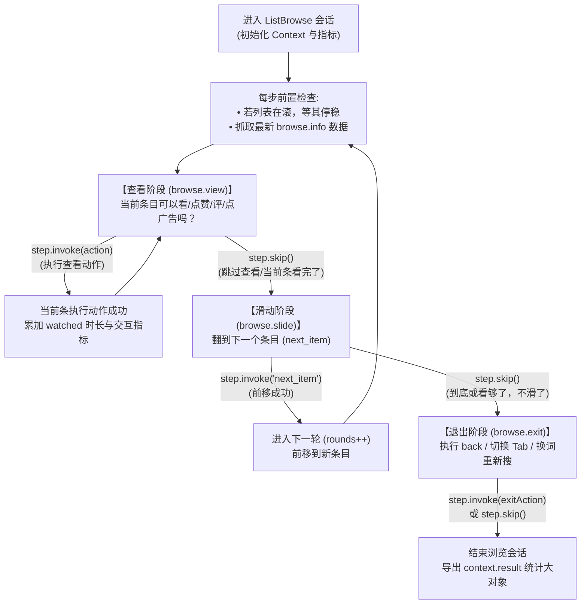
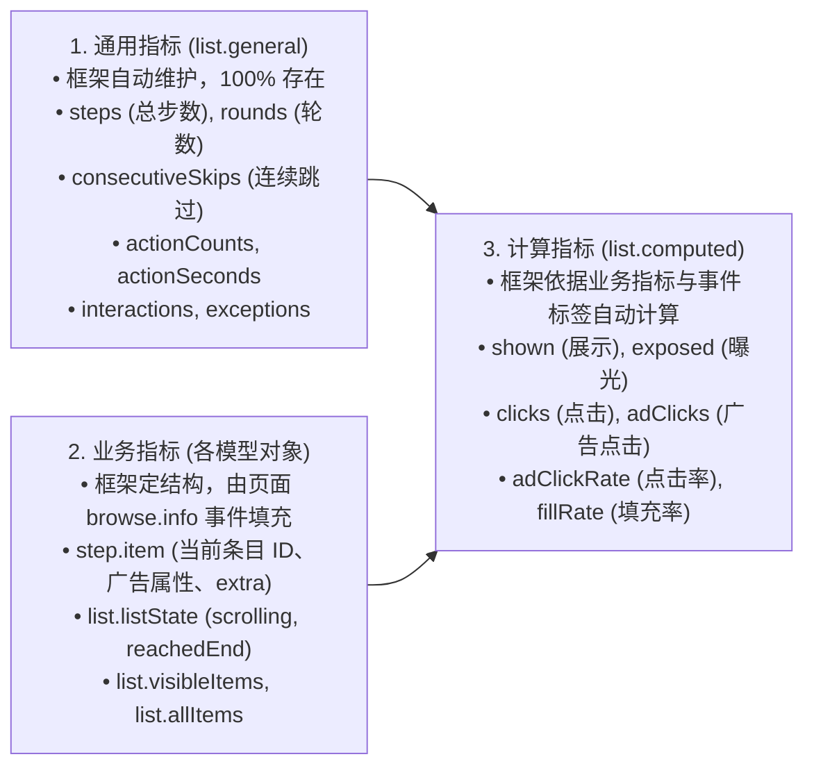

# ListBrowse 列表浏览状态机与防死循环规范（`DOC-09`）

> 文档编号：`DOC-09`（可在 `skills/` 下用 `rg "DOC-09"` 定位本文档）

列表（搜索结果单双列、推荐页 Feed、用户主页作品网格、评论区等）是业务自动化的核心承载场景。
IRAutomationKit 提供了 `ListBrowse` 模块，将列表的浏览调度抽象为 **询问 $\to$ 决策 $\to$ 执行 $\to$ 推进** 的严密有限状态机。

---


## 目录索引

- [`[DOC-09.1]` 1. 核心状态机模型与阶段推进](#DOC-09.1)
  - [`[DOC-09.1.1]` 阶段与标签映射规则](#DOC-09.1.1)
- [`[DOC-09.2]` 2. 场景注册与步骤决策 (`onStep`)](#DOC-09.2)
  - [`[DOC-09.2.1]` 2.1 标准注册结构](#DOC-09.2.1)
  - [`[DOC-09.2.2]` 2.2 决策唯一性铁律](#DOC-09.2.2)
- [`[DOC-09.3]` 3. 三层指标体系 (`IRListBrowseContext`)](#DOC-09.3)
  - [`[DOC-09.3.1]` 3.1 统计标签 (`Tag`)](#DOC-09.3.1)
- [`[DOC-09.4]` 4. 防死循环与空转熔断铁律 (自查核心)](#DOC-09.4)
  - [`[DOC-09.4.1]` 防线 1：必须设置硬编码最大步数 (`max_items`)](#DOC-09.4.1)
  - [`[DOC-09.4.2]` 防线 2：前移检测，严禁假滑动空转 (Anti-Fake-Slide)](#DOC-09.4.2)
  - [`[DOC-09.4.3]` 防线 3：每步前置停稳检测](#DOC-09.4.3)
- [`[DOC-09.5]` 5. 异常自愈与退回列表 (`list.backToList`)](#DOC-09.5)
- [`[DOC-09.6]` 6. Good vs Bad 对比清单](#DOC-09.6)

---

<a id="DOC-09.1"></a>
## `[DOC-09.1]` 1. 核心状态机模型与阶段推进

每个列表浏览场景通过 `[self registerListBrowse:contextClass:builder:]` 注册为一个专属的 flow 事件（如 `browse_ad`、`browse_nurture`）。
底层由框架严格推进 **查看（View）$\to$ 滑动（Slide）$\to$ 退出（Exit）** 三阶段：



<a id="DOC-09.1.1"></a>
### `[DOC-09.1.1]` 阶段与标签映射规则
| 阶段 | 标签 | 阶段语义 | 选了动作 (`invoke`) | 跳过 (`skip`) |
|---|---|---|---|---|
| **查看 (View)** | `browse.view` | 停留观看 N 秒 / 点开大图 / 进详情 / 点赞 / 评论 / 点广告 | 执行后，**再次进入当前条的查看阶段**（供叠加动作，如先看再赞） | 当前条看完了，推进到 **滑动阶段** |
| **滑动 (Slide)** | `browse.slide` | 翻到下一条（`next_item`）/ 瀑布流步进 | 执行前移手势，成功后**进入新条目的查看阶段** | 不再继续滑动，推进到 **退出阶段** |
| **退出 (Exit)** | `browse.exit` | 退出列表（`back`）/ 切单双列 / 换词重搜 | 执行退出动作，**结束浏览流程** | 直接结束流程，停在原地 |

---

<!-- [/DOC-09.1.1] -->
<!-- [/DOC-09.1] -->
<a id="DOC-09.2"></a>
## `[DOC-09.2]` 2. 场景注册与步骤决策 (`onStep`)

<a id="DOC-09.2.1"></a>
### `[DOC-09.2.1]` 2.1 标准注册结构
```objc
@implementation AWBSearchResultPageAgent (ListBrowse)

+ (void)load {
    [self registerListBrowse:IRIdentityMake(@"browse_ad", @"搜索结果广告场景浏览")
                contextClass:AWBSearchListBrowseContext.class
                     builder:^(IRListBrowseBuilder *flow) {
        // 1. 声明 Flow 参数 (外部通过 invokeWith 传入，支持服务器按签名覆盖)
        flow.arg(@"max_items", IRSchemaTypeInteger).setDefaultValue(@15).setComment(@"最多浏览条数");
        flow.arg(@"watch_seconds", IRSchemaTypeInteger).setDefaultValue(@3).setComment(@"每条观看时长");

        // 2. 核心步骤决策回调
        flow.onStep(^(IRListBrowseStep *step, AWBSearchListBrowseContext *list) {
            NSInteger maxItems = [list intParam:@"max_items"];
            BOOL reachedLimit = (list.computed.exposed.integerValue >= maxItems);
            BOOL isEnd = list.listState.reachedEnd;

            // 防线 1: 达到上限或列表到底，在 View 和 Slide 阶段一律跳过，快速下坠到 Exit
            if ((reachedLimit || isEnd) && !step.at(IRListBrowseStageExit)) {
                [step skip];
                return;
            }

            // A. 查看阶段
            if (step.at(IRListBrowseStageView)) {
                // 如果当前条是广告且还没点过，执行点广告；否则观看几秒后跳过
                if (step.item.isAd && !step.item.did(@"open_ad")) {
                    [step invoke:@"open_ad"];
                } else if (step.item.watched < [list intParam:@"watch_seconds"]) {
                    [step invokeWith:@"watch_item" params:@{ @"seconds": @( [list intParam:@"watch_seconds"] ) }];
                } else {
                    [step skip]; // 本条看完，推进到滑动
                }
                return;
            }

            // B. 滑动阶段
            if (step.at(IRListBrowseStageSlide)) {
                [step invoke:@"next_item"];
                return;
            }

            // C. 退出阶段
            if (step.at(IRListBrowseStageExit)) {
                [step invoke:@"back"];
                return;
            }
        }, nil); // exception 传 nil 使用默认自愈策略 (回到列表页重试)
    }];
}

@end
```

<!-- [/DOC-09.2.1] -->
<a id="DOC-09.2.2"></a>
### `[DOC-09.2.2]` 2.2 决策唯一性铁律
在每一步回调中，**必须且只能在 `step.invoke` / `step.invokeWith` 与 `step.skip` 中二选一并调用一次**。严禁多次调用或漏调（漏调会导致状态机卡死抛出异常）。

---

<!-- [/DOC-09.2.2] -->
<!-- [/DOC-09.2] -->
<a id="DOC-09.3"></a>
## `[DOC-09.3]` 3. 三层指标体系 (`IRListBrowseContext`)

ListBrowse 内置严谨的统计指标模型，自动累加并在结束时作为 `context.result` 传出：



<a id="DOC-09.3.1"></a>
### `[DOC-09.3.1]` 3.1 统计标签 (`Tag`)
- **`browse.exposure`**：打在此标签上的查看动作成功执行，且该条目此前未曾曝光过时，`exposed` 计数加 1；
- **`browse.click`**：打在此标签上的点击动作成功执行，`clicks` 计数加 1（若当前条目 `item.isAd` 为真，`adClicks` 同步加 1）；
- **`browse.info`**：挂载在只读查询动作上（如 `current_item`、`list_state`），每步开始前由框架自动拉取并装配进上下文。

---

<!-- [/DOC-09.3.1] -->
<!-- [/DOC-09.3] -->
<a id="DOC-09.4"></a>
## `[DOC-09.4]` 4. 防死循环与空转熔断铁律 (自查核心)

写任何 ListBrowse 业务逻辑时，必须严格满足以下三道防线：

<a id="DOC-09.4.1"></a>
### `[DOC-09.4.1]` 防线 1：必须设置硬编码最大步数 (`max_items`)
- **严禁**只写 `while (!list.listState.reachedEnd)`；
- 必须声明最大浏览条数上限（如 `max_items = 20`）。一旦 `list.computed.exposed >= max_items`，立刻在 View/Slide 阶段 `step.skip()` 下坠到 Exit 退出。

<!-- [/DOC-09.4.1] -->
<a id="DOC-09.4.2"></a>
### `[DOC-09.4.2]` 防线 2：前移检测，严禁假滑动空转 (Anti-Fake-Slide)
- 在瀑布流或双列中，滑到底部或因网络卡顿加载不出来时，`next_item` 动作可能执行成功（手势完成了），但**当前展示条目（`item.key`）并没有发生位移**；
- 若未做检测，下一轮 View 阶段发现当前条已看（`watched > 0`）直接 `skip`，Slide 阶段继续 `next_item`，两阶段会以每秒数次的高频**无限循环空转**！
- **标准防御模式**：
  ```objc
  if (step.at(IRListBrowseStageSlide)) {
      NSString *currentKey = step.item.key;
      NSString *lastKey = list.userInfo[@"last_slide_item_key"];
      NSInteger repeatCount = [list.userInfo[@"fake_slide_count"] integerValue];

      if (currentKey && [currentKey isEqualToString:lastKey]) {
          repeatCount++;
          list.userInfo[@"fake_slide_count"] = @(repeatCount);
          if (repeatCount >= 2) {
              // 连续 2 次滑动当前条目均未前移，判定为卡死或到底，强制退出
              [step skip];
              return;
          }
      } else {
          list.userInfo[@"last_slide_item_key"] = currentKey;
          list.userInfo[@"fake_slide_count"] = @0;
      }
      [step invoke:@"next_item"];
  }
  ```

<!-- [/DOC-09.4.2] -->
<a id="DOC-09.4.3"></a>
### `[DOC-09.4.3]` 防线 3：每步前置停稳检测
框架每步开始前会自动检查 `listState.scrolling`：
- 若列表仍在惯性滑行，框架会自动等待停稳；
- 页面实现的 `next_item` 等滑动事件内部，**也必须保证列表停稳后再返回**，严禁在列表高速滚动的瞬间返回 `YES`。

---

<!-- [/DOC-09.4.3] -->
<!-- [/DOC-09.4] -->
<a id="DOC-09.5"></a>
## `[DOC-09.5]` 5. 异常自愈与退回列表 (`list.backToList`)

当在查看阶段点进详情页（如全屏视频播放、落地页）后由于网络或界面异常未能正常返回：
- 步骤执行完毕后框架会校验当前屏幕是否仍为原列表页；
- 若偏离列表页，框架自动触发异常处理器（默认调用 `list.backToList` 连续按返回键尝试恢复）；
- 成功退回列表页后重试该步；若多次尝试仍无法回到列表页，会话安全终止（`abort`），绝不带着错误界面继续乱点。

---

<!-- [/DOC-09.5] -->
<a id="DOC-09.6"></a>
## `[DOC-09.6]` 6. Good vs Bad 对比清单

| 场景 | ❌ 错误做法 (Bad) | ✅ 正确做法 (Good) | 说明 |
|---|---|---|---|
| **循环退出** | 不设上限，只等 `listState.reachedEnd` 为真才停 | 强制双重检查 `(reachedLimit \|\| isEnd)` | 网络中断或无限上拉列表永远不会出现 `reachedEnd`，不设硬上限会导致自动化无限刷通宵。 |
| **滑动卡死** | 只要在 Slide 阶段就无脑 `[step invoke:@"next_item"]` | 记录 `lastItemKey`，检测到连续 2 次条目未前移时主动 `skip` | 假滑动是引发 CPU 飙升与高频空转的头号原因，必须做位移熔断。 |
| **决策漏选** | 在 `if-else` 分支之外漏写了任何决策，直接方法返回 | 保证所有代码分支有且仅有一个 `[step invoke]` 或 `[step skip]` | 漏选决定会导致状态机抛出“未给出步骤决策”严重异常并终止流程。 |
| **多余动作** | 在 View 阶段把看视频、点赞、关注写在一个巨大的原子方法里 | 拆解为多个原子事件，打上对应标签，由状态机多轮询问驱动 | 状态机天然支持 View 阶段执行多次（执行后会再次进 View），拆分后指标统计更精确。 |
| **异常恢复** | 在异常回调里重新拉起一个全新的流程 | 依赖默认机制调 `list.backToList` 弹栈退回原列表 | 浏览上下文维护着完整的曝光与滑动历史，退回原列表重试能保持历史统计数据的连续性。 |
<!-- [/DOC-09.6] -->
