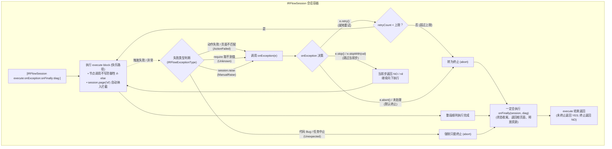
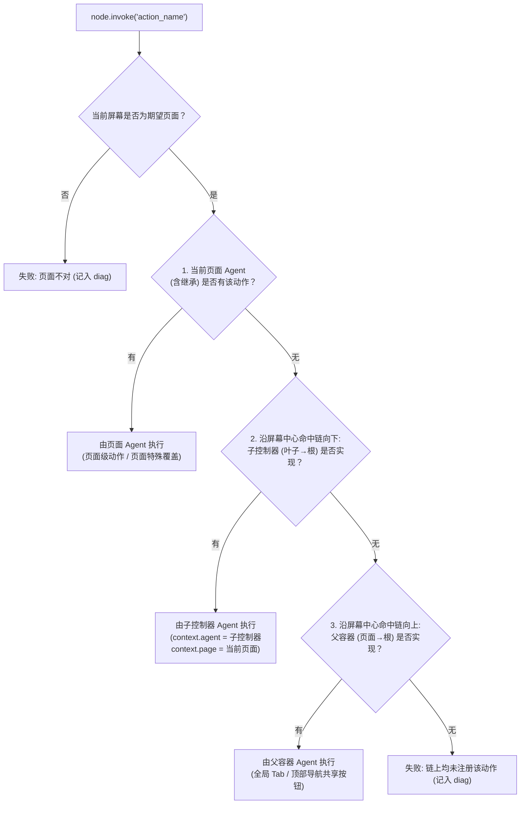
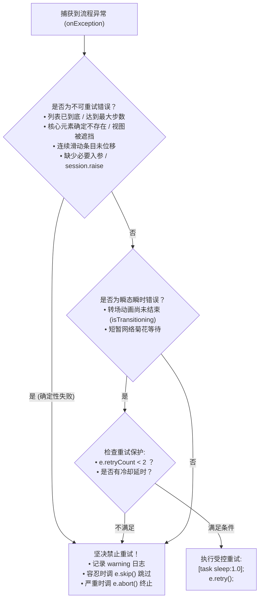

# Flow 流程会话与页面节点模块规范（`DOC-11`）

> 文档编号：`DOC-11`（可在 `skills/` 下用 `rg "DOC-11"` 定位本文档）

IRAutomationKit 提供了两层流程抽象：
1. **`IRPageNode`（页面节点）**：绑定期望页面标识的极轻量操作句柄，负责当前屏幕校验、三级响应链动作寻址与循环控制；
2. **`IRFlowSession`（流程会话）**：提供类似现代编程语言异常捕获的事务级容器，业务只需声明快乐路径（Happy Path），所有页面不匹配与动作失败由 `onException` 统一拦截、重试、跳过或终止。

---


## 目录索引

- [`[DOC-11.1]` 1. 架构与执行流生命周期](#DOC-11.1)
  - [`[DOC-11.1.1]` 1.1 控制流核心定位：纯剧本编排（Orchestrator），严禁搬砖打杂](#DOC-11.1.1)
- [`[DOC-11.2]` 2. 页面节点 (`IRPageNode`)](#DOC-11.2)
  - [`[DOC-11.2.1]` 2.1 构造与页面校验](#DOC-11.2.1)
  - [`[DOC-11.2.2]` 2.2 三级响应链动作寻址算法](#DOC-11.2.2)
  - [`[DOC-11.2.3]` 2.3 常用调用能力](#DOC-11.2.3)
  - [`[DOC-11.2.4]` 2.3 核心心智：诊断状态与重试原则（强制）](#DOC-11.2.4)
  - [`[DOC-11.2.5]` 2.4 断言与主动抛错设计哲学 (`ensure` vs `raise`)](#DOC-11.2.5)
    - [`[DOC-11.2.5.1]` 核心设计哲学：](#DOC-11.2.5.1)
- [`[DOC-11.3]` 3. 流程会话 (`IRFlowSession`)](#DOC-11.3)
  - [`[DOC-11.3.1]` 3.1 适用范围：顶层场景流与中阶串流程 Action](#DOC-11.3.1)
  - [`[DOC-11.3.2]` 3.2 标准范式](#DOC-11.3.2)
  - [`[DOC-11.3.3]` 3.2 异常分类 (`IRFlowExceptionType`)](#DOC-11.3.3)
- [`[DOC-11.4]` 4. 异常处理铁律与重试决策模型](#DOC-11.4)
  - [`[DOC-11.4.1]` 4.1 异常决策分级表](#DOC-11.4.1)
  - [`[DOC-11.4.2]` 4.2 自愈退回原则](#DOC-11.4.2)
- [`[DOC-11.5]` 5. 声明式看播时间轴 (`IRWatchTimeline` / `node.timeline`) 与页面级决策点 (`IRDecisionPoint`)](#DOC-11.5)
  - [`[DOC-11.5.1]` 5.1 页面级决策点 (`registerDecisionPoint:` / `node.decision`)](#DOC-11.5.1)
- [`[DOC-11.6]` 6. 工程编译约束：ARC 异常安全](#DOC-11.6)
- [`[DOC-11.7]` 7. Good vs Bad 对比清单](#DOC-11.7)

---

<a id="DOC-11.1"></a>
## `[DOC-11.1]` 1. 架构与执行流生命周期



<a id="DOC-11.1.1"></a>
### `[DOC-11.1.1]` 1.1 控制流核心定位：纯剧本编排（Orchestrator），严禁搬砖打杂

> [!IMPORTANT]
> **控制流（Flow）是「剧本导演 / 业务编排者」，而不是「搬砖打杂的执行者」。**
> - **代码体量严控在 10~25 行**：任何人读控制流，应该像读产品需求说明书一样，一眼望到底；
> - **严禁在 Flow 内部写微观执行逻辑**：严禁在 Flow 里计算时长、画板倒计时、手动拼装字典、就地 fallback 假数据、手写多层防御性 `if-else`；
> - **Flow 只表达高阶业务意图与页面流转**：
>   以推荐流为例，主干循环只有两句话：
>   ```objc
>   feed.loop(@"watch_batch", total, ^(NSUInteger index, NSUInteger totalCount, BOOL *stop) {
>       // 1. 看当前内容 (由 Feed 容器路由自决: 支持 watch 调 watch，不支持走兜底权重)
>       feed.invokeWith(@"watch_content", @{ @"index": @(index + 1), @"total": @(totalCount) });
>
>       // 2. 拟人切换视频 (由 Feed 容器漫游自决: 大概率下滑，偶发回看 1~N 条)
>       feed.invoke(@"switch_video");
>   });
>   ```
> - **各层清晰分工**：
>   - **Flow 层**：只管编排剧本（看内容 $\to$ 切视频）；
>   - **容器层（Feed）**：负责 Cell 路由（`watch_content`）与翻页漫游（`switch_video`）；
>   - **内容层（Player）**：负责单作品消费闭环（`watch`，含看播、伴生评论、伴生搜索）。

---

<!-- [/DOC-11.1.1] -->
<!-- [/DOC-11.1] -->
<a id="DOC-11.2"></a>
## `[DOC-11.2]` 2. 页面节点 (`IRPageNode`)

`IRPageNode` 是流程层对底层 Agent 能力的封装。

<a id="DOC-11.2.1"></a>
### `[DOC-11.2.1]` 2.1 构造与页面校验
```objc
// 构造宏: IRPageNode(pageID, diag)
IRPageNode *feed = IRPageNode(@"feed.recommend", diag);

// 任意页面节点 (nil 或 @""): 当前屏幕是什么页面就调用什么页面的动作 (如通用 back)
IRPageNode *any = IRPageNode(nil, diag);
```
- **页面严格校验**：调用 `invoke` 时，框架首先抓取当前屏幕状态。若 `currentScreen.pageID` 与节点的 `pageID` 不匹配，**立即失败返回 NO**（原因记入 `node.diag`），绝不盲目等待（若需要等，先调 `app.waitPage`）。
- **必须传入 `diag`（严禁传 `nil`）**：在业务代码中构造 `IRPageNode(pageID, diag)` 或调用查询时**必须传入有效的 `diag`**，严禁传 `nil` 丢弃诊断上下文；若为可容错探测，调用后显式 `node.clearError()`。
- **任意页面要求**：`IRPageNode(nil, ...)` 也要求当前屏幕是一个**可识别的有标识页面**；若当前处于未知页面，调用依然失败。

<!-- [/DOC-11.2.1] -->
<a id="DOC-11.2.2"></a>
### `[DOC-11.2.2]` 2.2 三级响应链动作寻址算法
当在 `IRPageNode` 上调用 `invoke(@"action_name")` 时，框架按照以下固定顺序寻找接收者：



<!-- [/DOC-11.2.2] -->
<a id="DOC-11.2.3"></a>
### `[DOC-11.2.3]` 2.3 常用调用能力
```objc
// 1. 执行动作与传参
BOOL ok = feed.invoke(@"next_video");
BOOL okWithParam = feed.invokeWith(@"watch", @{ @"duration": @5.0 });

// 2. 获取上一步返回值
if (feed.invoke(@"get_video_info")) {
    NSDictionary *info = feed.result; // 取出动作执行写入的 context.result
}

// 3. 查询模式调用 (不触发写操作，只读取数据)
NSString *title = feed.invokeQuery(@"current_title");

// 4. 可用性判断 (只读快速探测当前能否执行)
if (feed.available(@"download_video")) {
    feed.invoke(@"download_video");
}

// 5. 循环控制 (每轮开始前自动检查页面是否在场，页面离开自动中断循环; count <= 0 安全跳过，无需手写 if (count > 0))
feed.loop(@"watch_5_times", 5, ^(NSUInteger index, NSUInteger total, BOOL *stop) {
    feed.invoke(@"watch");
    feed.invoke(@"next_video");
    if (/* 达到业务退出条件 */ index >= 3) *stop = YES;
});

// 6. 等待控制 (seconds <= 0 安全跳过不等待，无需手写 if (seconds > 0))
feed.wait(feed.weightOrValue(@"dwell", @(2.5)).doubleValue);

// 6. 无限重复 (依靠内部 *stop = YES 退出)
feed.repeat(@"browse_until_end", ^(NSUInteger iteration, BOOL *stop) {
    if (!feed.invoke(@"next_video")) *stop = YES;
});

// 7. 条件轮询与重试 (自带画板提示、页面断言、自动清诊断错误，支持链式 .onExhausted)
// 最多尝试 3 次，每次间隔 0.5s，画板自动显示 "退出评论 1/3" -> "重试 退出评论 2/3"
comment.repeatUntil(@"退出评论", 3, 0.5, ^(NSUInteger attempt, NSUInteger total, BOOL *stop) {
    if (fatalError) {
        comment.diag.error(-1, @"发生致命异常");
        *stop = YES; // 提前报致命错退出，不会触发 onExhausted
        return;
    }
    comment.invoke(@"back");
    if (!comment.isVisible()) *stop = YES; // 达标正常退出
}).onExhausted(^{
    comment.diag.error(-1, @"重试 3 次退出评论均未成功");
});

if (comment.hasError) {
    // 处理异常或降级
    comment.clearError(); // 之后继续使用该节点
}

// 8. 一键退回本页面 (默认最多执行 5 次 back, 间隔 0.5s, 直到回到 node.pageID; 不走 session 异常防递归)
if (feed.backToSelf()) {
    // 已安全回到 feed.recommend，可继续后续逻辑或 skip
}

// 8. 条件等待 (带超时与间隔轮询，自带画板进度，支持链式 .onExhausted)
// 最多等 5.0s，每 0.2s 检查一次，画板自动显示等待耗时
feed.waitUntil(@"等待视频就绪", 5.0, 0.2, ^(BOOL *stop) {
    if (feed.available(@"watch")) *stop = YES;
}).onExhausted(^{
    feed.diag.error(-1, @"等待视频就绪超时");
});
if (feed.noError) {
    feed.invoke(@"watch");
}

// 9. 任务睡眠 (等同于当前 UI 任务的 [task sleep:]，响应取消与中断挂起)
feed.wait(1.5);

// 10. 前置断言与主动抛错 (严格不可修复 Fatal 异常, 直接终止流程)
feed.ensure(targetCount > 0, @"目标观看数必须大于 0");
feed.ensureNamed(@"valid_target", targetCount > 0, @"目标观看数必须大于 0");
feed.raise(@"遇到不支持的账号状态");
feed.raiseNamed(@"unsupported_state", @"遇到不支持的账号状态");

// 11. 错误清理 (同一节点连续多次调用前若已知晓错误，需先清空 diag)
feed.clearError();
```

<!-- [/DOC-11.2.3] -->
<a id="DOC-11.2.4"></a>
### `[DOC-11.2.4]` 2.3 核心心智：诊断状态与重试原则（强制）
- **成功与失败的唯一判断依据**：
  - `node.noError == YES`：代表上一步成功，直接往下走；
  - `node.hasError == YES`：代表上一步失败，错误原因在 `node.errorMessage`。
- **重试前必须 `clearError()`**：
  - 节点的诊断对象遵循单一错误契约，未清理错误时后续调用可能会直接拦截或断言；
  - **如果一步失败后要想重试或执行兜底操作，必须先调 `node.clearError()`**；
  - `node.repeatUntil` 与 `node.waitUntil` 内部已在每一轮尝试前自动执行 `self.diag.clearError()`；执行完毕后若 `node.hasError` 为 `YES`，业务要在其内发起新的重试也必须显式 `node.clearError()`。

<!-- [/DOC-11.2.4] -->
<a id="DOC-11.2.5"></a>
### `[DOC-11.2.5]` 2.4 断言与主动抛错设计哲学 (`ensure` vs `raise`)

`IRPageNode` 提供了面向流程防御的四组 API：

| API 语法 | 语义 | 适用场景 | Session 中异常属性 |
|---|---|---|---|
| **`feed.ensure(condition, reason)`** | 匿名条件断言 | 入参校验、必要业务前置守护 (Guard Clause) | `type = ManualRaise`, `canRetry = NO`, `canSkip = NO` |
| **`feed.ensureNamed(name, condition, reason)`** | 带标识条件断言 | 区分多个关键检查点，报错带明确 `e.name` | `type = ManualRaise`, `name = name`, 致命不可重试/跳过 |
| **`feed.raise(reason)`** | 匿名主动抛错 | 深层分支判断、致命状态抛出 | `type = ManualRaise`, 致命不可重试/跳过 |
| **`feed.raiseNamed(name, reason)`** | 带标识主动抛错 | 状态机 `default` 异常、明确故障点 | `type = ManualRaise`, `name = name`, 致命不可重试/跳过 |

<a id="DOC-11.2.5.1"></a>
#### `[DOC-11.2.5.1]` 核心设计哲学：
1. **`ensure`（前置断言 Guard Clause）**：
   - 当 `condition == NO` 时立即触发终止并上报错误，消除繁琐的 `if (!condition) { ... return; }` 样板代码；
   - **命名注记**：由于 C/C++ 标准库 `<assert.h>` 里的 `assert(e)` 宏被 Foundation 引入时是单参宏，若命名为 `assert` 会导致编译器报 `too many arguments provided to function-like macro invocation`，因此统一命名为 `ensure` / `ensureNamed`。
2. **`raise`（主动异常抛出）**：
   - 用于深层状态机分支中（如 `switch (accountStatus)` 遇到未授权或封禁状态）无条件主动抛错。
3. **不可修复性哲学（Fatal Invariants）**：
   - `ensure` 与 `raise` 代表**代码逻辑或业务前置契约被严重破坏**（如必填入参为 0、账号被封禁），**属于严格不可自愈、不可跳过的致命异常**；
   - 在 `IRFlowSession` 中，它们抛出的异常被定性为 `ManualRaise`，此时 `e.canRetry == NO`、`e.canSkip == NO`，`onException` 中禁止也无法执行重试或跳过，强制立即中断并展开到 `onFinally` 收尾；
   - 在普通非 Session 中，它们直接将错误写入绑定的 `diag`。

---

<!-- [/DOC-11.2.5.1] -->
<!-- [/DOC-11.2.5] -->
<!-- [/DOC-11.2] -->
<a id="DOC-11.3"></a>
## `[DOC-11.3]` 3. 流程会话 (`IRFlowSession`)

<a id="DOC-11.3.1"></a>
### `[DOC-11.3.1]` 3.1 适用范围：顶层场景流与中阶串流程 Action

> [!IMPORTANT]
> **`IRFlowSession` 不仅用于宏观场景流（如 `flow`），更是一切「串流程 Action」的首选编码范式！**
> - **顶层场景流**：如 `AWBFeedPageAgent+Flow` 中的 `flow`，负责驱动长效业务主干（看内容 $\to$ 切视频）；
> - **中阶串流程 Action**：如 `switch_video`（决策方向 $\to$ 回滑 $\to$ 停留 $\to$ 回正 $\to$ 切下条），凡是涉及两个及以上时序物理步骤、循环漫游或跳转的动作，**必须优先使用 `[IRFlowSession execute:...]` 编码**；
> - **只有纯原子事件（单步按钮点击、单手势滑动、单属性查询）才允许跳过会话**。

<!-- [/DOC-11.3.1] -->
<a id="DOC-11.3.2"></a>
### `[DOC-11.3.2]` 3.2 标准范式
```objc
// Action perform 内部标准范式: 直接 return execute，产出结算与状态清理统一在 onFinally
action.perform(^BOOL(IRApplication *app, IRActionContext *context, IRDiagnostics *diag) {
    __block NSInteger watchedCount = 0;

    return [IRFlowSession execute:^(IRFlowSession *session) {
        // 1. 通过 session.page(...) 获取节点: 绑定的错误会自动导向 onException
        IRPageNode *feed = session.page(@"feed.recommend");
        
        feed.invoke(@"watch");
        feed.wait(1.0);
        feed.invoke(@"open_comment");
        
        // 2. 页面流转: 切换到新页面
        IRPageNode *comment = session.page(@"feed.comment");
        comment.invoke(@"like_first_comment");
        comment.invoke(@"back"); // 退出评论页
        
        // 3. 依赖提取 require: 返回 nil 会自动触发 onException
        NSString *author = session.require(@"author_name", ^id(IRRequireInfo *info) {
            NSString *name = feed.invokeQuery(@"author");
            if (name.length == 0) {
                info.reason = @"未能在当前卡片读到作者名";
                return nil; // 触发异常
            }
            return name;
        });
        
        // 4. 手动终止
        if (session[@"need_stop"]) {
            session.raise(-101, @"业务要求强行终止");
        }
    } onException:^(IRFlowException *exception) {
        // 统一异常决策中心
        NSLog(@"流程异常: 类型=%ld, 动作=%@, 页面=%@, 原因=%@", (long)exception.type, exception.name, exception.pageID, exception.reason);
        
        // 尝试自愈退回根页面 (回到预期页且可跳过才允许 skip)
        if (IRPageNode(@"feed.recommend", diag).backToSelf() && exception.canSkip) {
            exception.skip(); // 跳过当前失败步骤，流程继续向下
            return;
        }
        
        if (exception.canRetry && exception.retryCount < 2) {
            [task sleep:1.0]; // 冷却 1 秒
            exception.retry();       // 就地重试
            return;
        }
        // 不调用 skip / retry 时，默认就是终止
    } onFinally:^(IRFlowSession *session, IRDiagnostics *flowDiag) {
        // 收尾保证：无论成功、跳过还是终止，必定执行
        context.result = @(watchedCount);
        [self cleanTempState];
    } diag:diag];
});
```

> [!TIP]
> **Action perform 中直接 `return [IRFlowSession execute:... diag:diag];`**
> - `[IRFlowSession execute:...]` 原生带有返回值（`BOOL`: `YES` = 正常结束或已跳过自愈，`NO` = 流程终止）；
> - 传入外部 action 的 `diag` 后，框架内部在流程全周期、异常捕获、以及 `onFinally` 中产生的错误与警告都会自动并入此 `diag`；
> - 因此在 `action.perform(^BOOL(app, context, diag) { ... })` 中，无需定义多余的中间局部变量 `BOOL ok`，直接 `return [IRFlowSession execute:...]`，将产出结算（如 `context.result = @(count);`）收拢在必定执行的 `onFinally` 即可。语法最简练、语义最直接。

<!-- [/DOC-11.3.2] -->
<a id="DOC-11.3.3"></a>
### `[DOC-11.3.3]` 3.2 异常分类 (`IRFlowExceptionType`)
| 类型 | 枚举值 | 产生来源 | 允许的决策 |
|---|---|---|---|
| **`ActionFailed`** | `-1` | `session.page` 的 `invoke` / `loop` / `repeat` 失败或页面不匹配 | `retry()` / `skip()` / `abort()` |
| **`Unknown`** | `0` | `session.require` 提取依赖时返回 `nil` | `retry()` / `skip()` / `skipWith(val)` / `abort()` |
| **`ManualRaise`** | `1` | 业务手动调用 `session.raise(code, reason)` | **仅能 `abort()`**（不可重试、不可跳过） |
| **`Unexpected`** | `2` | 流程中抛出 Objective-C 异常或任务被外部取消中止 | **仅能 `abort()`**（框架原样重抛） |

---

<!-- [/DOC-11.3.3] -->
<!-- [/DOC-11.3] -->
<a id="DOC-11.4"></a>
## `[DOC-11.4]` 4. 异常处理铁律与重试决策模型

> [!CAUTION]
> **严禁在 `onException` 中无脑调用 `e.retry()`！**
> 无脑重试不仅毫无意义，还会导致高频空转刷屏、堵塞远程 IPC 管道，甚至触发系统看门狗 Kernel Panic。

<a id="DOC-11.4.1"></a>
### `[DOC-11.4.1]` 4.1 异常决策分级表


<!-- [/DOC-11.4.1] -->
<a id="DOC-11.4.2"></a>
### `[DOC-11.4.2]` 4.2 自愈退回原则
当某一步（如打开详情页）执行失败且留在中间页面时：
1. **不要在 `onException` 内再用 `session.page`**：`session.page` 再次失败会因为会话处于异常态而直接二次终止；
2. **必须使用独立的原始节点 `IRPageNode(nil, diag)`** 连续调用 `back` 退回到安全页面；
3. 确认退回安全页面后，再调用 `e.skip()`，让主流程在干净的界面状态下继续后续步骤。

---

---

<!-- [/DOC-11.4.2] -->
<!-- [/DOC-11.4] -->
<a id="DOC-11.5"></a>
## `[DOC-11.5]` 5. 声明式看播时间轴 (`IRWatchTimeline` / `node.timeline`) 与页面级决策点 (`IRDecisionPoint`)

用于按总时长百分比调度看播伴生交互（如点赞、评论、搜索、进主页），替代“全部看完再点”的机械顺序：
- **链式语法糖**：`node.timeline(name, duration)` 返回自动绑定 `node.diag` 的 `IRWatchTimeline` 实例，通过 `.on(percent, name, desc, handler)` 链式注册全部节点后直接 `.start()` 立即启动（或保存实例延后 `.start()`）；
- **中途停止 (`-stop` / `stopped`)**：在时间轴回调中调用 `[timeline stop]` 可立即置 `timeline.stopped = YES`，终止剩余等待及后续所有尚未触发的时间轴事件；
- **冷却间隔**：在确定真执行时调用 `timeline.waitMinInterval(action, 2.0)`，仅当距离上次真动作（`previousActionExecuteTime`）不足时按检查点补足间隔；
- **声明式约束**：必须在 `start` 前注册完毕，启动后禁止动态添加，启动前自动按 `scheduledTime` 升序排序。

完整范式见示例 [examples/flow/watch-timeline.m](../examples/flow/watch-timeline.m)。

<a id="DOC-11.5.1"></a>
### `[DOC-11.5.1]` 5.1 页面级决策点 (`registerDecisionPoint:` / `node.decision`)

当一个观看/停留过程包含**总时长抽样 + 多个伴生子事件的触发进度与触发概率**，且可能需要与远程 AI 决策服务协同决策时，使用 `IRDecisionPoint` 将**权重自动注册、可选远程网络决策、小范围动态判断队列 (`IRWatchTimeline`) 与生命周期回调**合为一体：

#### 1. 注册决策点（`+registerDecisionPoint:builder:`）
```objc
[self registerDecisionPoint:IRIdentityMake(@"watch_video", @"视频观看决策点")
                    builder:^(IRDecisionPointBuilder *point) {
    // (1) 网络决策开关: 默认 NO (纯本地权重决策, 不发网络请求); 设为 YES 时才向 IRDecisionRemote.sharedRemote.decider 请求远程决策
    point.remote(YES);

    // (2) 选填: 声明入参与出参签名 (支持透传 watch_duration 与测试覆写 test_override)
    [point setTypeEncodingBlock:^(IRTypeEncoding *encoding) {
        encoding.argWith(@"watch_duration", @0).setComment(@"指定观看时长 (秒, <=0 走决策点权重)");
        encoding.arg(@"test_override", IRSchemaTypeObject).setRequired(NO).setComment(@"测试期望指令 (要求服务器返回对应事件)");
    }];

    // (3) 决策上下文动作 (自动调用本页 queryAction 作为上下文上报/注入 ctxInfo)
    point.contextAction(@"video_info");

    // (4) 自动注册 <pointID>.duration 总时长权重组
    point.duration(8, ^(id<IRWeightGroupChain> group) {
        group.item(@"short", 35).value(IRTimeRangeMake(5, 12)).comment(@"短").factor(@"video_length", -0.7)
             .item(@"medium", 45).value(IRTimeRangeMake(13, 28)).comment(@"中").factor(@"video_length", 1.0)
             .item(@"long", 20).value(IRTimeRangeMake(29, 60)).comment(@"长").factor(@"video_length", 2.5);
    });

    // (5) 注册伴生候选事件:
    //     - progress(@[...]): 数组长度 N 自动将 0~100% 均分为 N 段，注册 <pointID>.<action>.progress 权重组
    //     - probability(p): 支持小数 (0~100)，按万分比注册 <pointID>.<action>.probability 的 yes/no 权重组
    point.addEvent(@"like")
         .progress(@[ @35, @40, @25 ])
         .probability(4.5);

    point.addEvent(@"try_comment")
         .progress(@[ @15, @45, @40 ])
         .probability(3.0);
}];
```

> [!IMPORTANT]
> **决策点核心约束**：
> 1. **`point.remote(BOOL)` 默认关闭 (`NO`)**：只有显式调用 `point.remote(YES)` 的决策点才会在启动前收集当前页面 `isAvailable == YES` 的候选事件签名（`name` / `comment` / `agent` / `signature`）并询问 `IRDecisionRemote.sharedRemote.decider`；未开启时零网络开销、直接跑本地权重。
> 2. **三层参数与决策优先级**：**服务器返回 > 本地指定（入参 `watch_duration` 或 `before` 回调改写）> 本地权重抽样**；当服务器不可达、超时或返回 `watch_not_available` 时，自动无缝降级到本地权重。
> 3. **子类权重空间独立性**：`IRWeight` 按调用类（`NSStringFromClass(self)`）独立建表，不跨继承链查找。若子类 Agent（如 `AWBRichContentSubAgent : AWBImageAlbumPageAgent`）会作为命中实例执行决策点，子类也必须在自身 `+load` 中调用 `registerDecisionPoint:` 注册独立权重表。

#### 2. 调用决策点（`node.decision(pointID)`）
在 `watch` 动作的 `IRFlowSession` 中通过 `node.decision(pointID)` 获取链式 `IRDecisionPointRunner`：
```objc
IRPageNode *node = session.page(context.page.pageID);
node.decision(@"watch_video")
    .params(context.params)
    .before(^(NSString *eventPath, NSDictionary *decisionParams, IRDecisionEvent *event) {
        // eventPath: 决策点自身为 @"watch_video"，子事件为 @"watch_video.like" / @"watch_video.try_comment"
        // 可通过 [event addParams:@{...}] 补充本地默认参数（服务器同名参数优先级更高）
        // 可通过 [event skip] 跳过当前事件，或 [event stop] 终止整个决策点及后续时间轴
    })
    .after(^(NSString *eventPath, NSDictionary *decisionParams, IRDecisionEvent *event) {
        if ([eventPath isEqualToString:@"watch_video"] && [event.result isKindOfClass:NSDictionary.class]) {
            watchResult = event.result; // 含 watched / dwell_type / executed_actions 及上下文信息
        }
    })
    .execute();
```

#### 3. 两层测试干预字段（`test_override`）
当开启 `point.remote(YES)` 且入参传入 `test_override` 字典时，框架自动将其随请求 `context.test_override` 透传给服务端，支持两层测试验证：
- **Layer 1（只指定事件名，由服务端 AI 生成参数与触发时机）**：
  `@{ @"test_override": @{ @"actions": @[ @"like", @"comment" ] } }`
- **Layer 2（指定事件名 + 显式参数/时机覆写）**：
  `@{ @"test_override": @{ @"duration": @12, @"actions": @[ @{ @"name": @"comment", @"at_percent": @40, @"params": @{ @"text": @"测试评论" } } ] } }`

<!-- [/DOC-11.5.1] -->
---

<!-- [/DOC-11.5] -->
<a id="DOC-11.6"></a>
## `[DOC-11.6]` 6. 工程编译约束：ARC 异常安全

由于 `IRFlowSession` 内部基于 `@try ... @catch` 实现终止时的跨栈帧展开（Stack Unwinding）：
- **必须开启 `-fobjc-arc-exceptions`**：在集成 IRAutomationKit 的业务工程或 Target 的 Build Settings 中，将 **`Objective-C Automatic Reference Counting`** 设置中的异常清理开启（或在 `Other C Flags` 添加 `-fobjc-arc-exceptions`）。
- **否则后果**：在 `e.abort()` 展开退出时，栈上的局部 OC 对象（如 `NSString`、自定义模型）不会被 ARC 插入 `release`，将造成局部变量内存泄漏。

---

<!-- [/DOC-11.6] -->
<a id="DOC-11.7"></a>
## `[DOC-11.7]` 7. Good vs Bad 对比清单

| 场景 | ❌ 错误做法 (Bad) | ✅ 正确做法 (Good) | 说明 |
|---|---|---|---|
| **异常恢复** | 在 `onException` 里写 `session.page(@"feed").invoke(@"back")` | 使用独立节点 `IRPageNode(nil, diag).invoke(@"back")` | `session.page` 绑在当前会话上，在异常回调内二次失败会破坏会话状态机；自愈修复应使用独立节点。 |
| **终止写法** | 在 `onException` 末尾显式写 `exception.abort();` | 不调 `retry()` / `skip()` 直接 `return` | `IRFlowSession` 默认未处理即终止，无需显式调用 `abort()`。 |
| **动作调用** | `if (node.available(@"watch")) { node.invokeWith(@"watch", ...); } else { node.wait(2); }` | 直接 `node.invoke(@"watch");` | 不要手写 `available` 静默兜底，直接调用让框架自动报错并由 `onException` 接管；也不要透传无用的展示可选参数（如 `index`/`total`）。 |
| **职责边界** | 在 `flow` 循环里手写 `ensure(isVisible())` 或 `video_info` 判重校验切视频是否成功 | `flow` 只负责纯剧本串联，切视频成功由 `next_video` 自己保证 | `loop` / `invoke` 每步自带页面校验；切视频失败/滑到底由底层动作自己校验并抛给 `onException`，`flow` 严禁搬砖代劳。 |
| **重试控制** | `onException:^(e) { e.retry(); }`（无脑重试） | 检查 `if (e.canRetry && e.retryCount < 2) { [task sleep:1]; e.retry(); }`（默认即终止，无需写 `e.abort()`） | 无脑重试是引发 IPC 堵死与看门狗重启的头号元凶；必须加次数熔断与冷却等待。 |
| **页面严格性** | 无论在什么页面，直接裸调 `[agent invokeAction:...]` | 业务流统一走 `feedNode.invoke(...)` | 底层 `invokeAction` 不校验页面，容易在页面被弹窗遮挡或切走时误触发背景操作；`IRPageNode` 严格守门。 |
| **流程收尾** | 把状态重置代码直接写在流程最后一行 | 将关键状态重置与资源清理写在 `onFinally` 闭包内 | 若流程中途发生异常跳出或被 `abort()`，末尾代码根本不会被执行；`onFinally` 保证 100% 必定触发。 |
| **可选依赖** | 手写繁复的 `@try { ... } @catch` 提取数据 | 使用 `session.require(@"token", ^id(info) { ... })` | `session.require` 将依赖提取标准化，缺失时自动向 `onException` 报告，支持通过 `skipWith` 提供默认替补值。 |
<!-- [/DOC-11.7] -->
