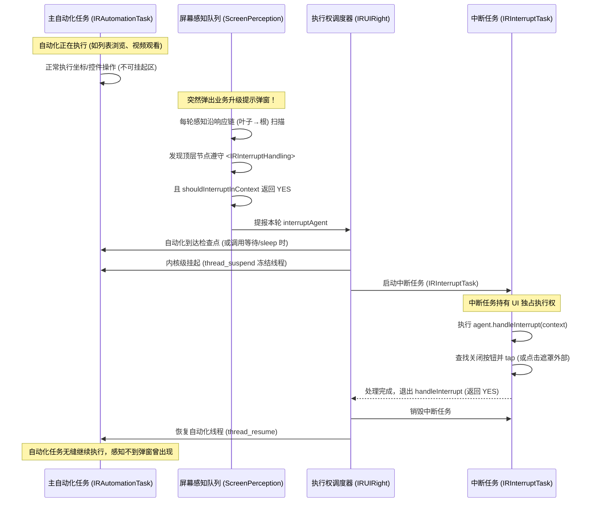

# Interrupt 中断任务机制与弹窗自愈规范（`DOC-12`）

> 文档编号：`DOC-12`（可在 `skills/` 下用 `rg "DOC-12"` 定位本文档）

在自动化运行过程中，系统权限弹窗、业务升级提示、青少年模式提醒、签到弹窗等往往**不期而至**。
IRAutomationKit 摒弃在业务流程中到处硬写 `if (hasPopup) dismiss()` 的高耦合写法，采用**事件驱动的中断机制（Interrupt）**：
- **弹窗自己最清楚怎么关掉自己**：将关闭逻辑下沉给绑定弹窗的 Agent；
- **非侵入式自动拦截**：屏幕感知系统每轮分析时自动命中弹窗；
- **内核级任务挂起**：主自动化任务被整线安全挂起，弹窗关闭后无缝原地恢复。

---


## 目录索引

- [`[DOC-12.1]` 1. 中断调度与执行权时序](#DOC-12.1)
- [`[DOC-12.2]` 2. 弹窗代理协议 (`<IRInterruptHandling>`)](#DOC-12.2)
- [`[DOC-12.3]` 3. 弹窗 Agent 编写实战](#DOC-12.3)
  - [`[DOC-12.3.1]` 3.1 控制器型弹窗范例 (`IRPageAgent`)](#DOC-12.3.1)
  - [`[DOC-12.3.2]` 3.2 视图型弹窗范例 (`IRViewAgent`)](#DOC-12.3.2)
- [`[DOC-12.4]` 4. 关键运行机制与安全策略](#DOC-12.4)
  - [`[DOC-12.4.1]` 4.1 识别寻址顺序（叶子 → 根）](#DOC-12.4.1)
  - [`[DOC-12.4.2]` 4.2 抢占机制 (Preemption)](#DOC-12.4.2)
  - [`[DOC-12.4.3]` 4.3 连续派发熔断与防死循环 (`context.attempt`)](#DOC-12.4.3)
  - [`[DOC-12.4.4]` 4.4 检查点与协作式退出](#DOC-12.4.4)
- [`[DOC-12.5]` 5. Good vs Bad 对比清单](#DOC-12.5)

---

<a id="DOC-12.1"></a>
## `[DOC-12.1]` 1. 中断调度与执行权时序



---

<!-- [/DOC-12.1] -->
<a id="DOC-12.2"></a>
## `[DOC-12.2]` 2. 弹窗代理协议 (`<IRInterruptHandling>`)

任何 `IRPageAgent`（控制器型弹窗）或 `IRViewAgent`（视图型弹窗）只要遵守 `<IRInterruptHandling>` 协议，即成为具备自愈能力的弹窗 Agent。

```objc
#import <IRAutomationKit/IRAutomationKit.h>

@protocol IRInterruptHandling <NSObject>

@optional
/// 本轮是否需要触发自动处理 (不实现默认返回 YES)
/// 在屏幕感知队列 (非 UI 线程) 上同步调用。
/// 只能做快速轻量判定 (读内存 / 读 ivar / 读 chain 节点)，严禁执行耗时 IPC 或写操作！
- (BOOL)shouldInterruptInContext:(IRChainContext *)context;

@required
/// 执行弹窗关闭逻辑 (核心处理入口)
/// 运行在专属中断 UITask 线程上，此时主自动化已被挂起，中断任务独占 UI 写操作执行权。
/// - Parameter context: 中断现场 (包含 task、chain、attempt、取消检查点等)
/// - Returns: 是否处理成功 (YES = 成功关闭; NO = 处理失败)
- (BOOL)handleInterrupt:(IRInterruptContext *)context;

@end
```

---

<!-- [/DOC-12.2] -->
<a id="DOC-12.3"></a>
## `[DOC-12.3]` 3. 弹窗 Agent 编写实战

<a id="DOC-12.3.1"></a>
### `[DOC-12.3.1]` 3.1 控制器型弹窗范例 (`IRPageAgent`)
用于以独立 `UIViewController` 形式弹出的全屏或半屏弹窗（如隐私协议、升级弹窗、青少年模式）：

```objc
// AWBUpgradeDialogAgent.h
#import <IRAutomationKit/IRAutomationKit.h>

@interface AWBUpgradeDialogAgent : IRPageAgent <IRInterruptHandling>
@end

// AWBUpgradeDialogAgent.m
@implementation AWBUpgradeDialogAgent

+ (void)load {
    [self registerAgent:^(id<IRPageAgentRegistration> r) {
        r.bindClass = @"AWEUpgradeDialogViewController"; // 目标弹窗控制器
        r.comment   = @"应用升级提示弹窗";
    }];
}

#pragma mark - <IRInterruptHandling>

- (BOOL)shouldInterruptInContext:(IRChainContext *)context {
    // 快速过滤：例如只有当弹窗处于前台且包含特定按钮时才处理
    return YES;
}

- (BOOL)handleInterrupt:(IRInterruptContext *)context {
    IRApplication *app = context.application;
    IRDiagnostics *diag = [IRDiagnostics diagnosticsWithDomain:@"interrupt.upgrade"];
    
    do {
        // 1. 优先尝试点击 "以后再说" 或 "暂不更新" 按钮
        IRUIElement *cancelBtn = app.query.axLabels(@"以后再说").visible().first().element;
        if (cancelBtn.exists(nil)) {
            if (cancelBtn.tap(diag)) break;
        }

        // 2. 兜底尝试右上角关闭按钮
        IRUIElement *closeBtn = app.query.views(@"UIButton").axLabels(@"*关闭*").visible().first().element;
        if (closeBtn.exists(nil)) {
            if (closeBtn.tap(diag)) break;
        }

        // 3. 兜底点击空白遮罩区域
        [app tapAt:CGPointMake(200, 100) diag:diag];
    } while (NO);

    // 等待弹窗在感知链中消失 (最长等 3 秒)
    BOOL gone = [app waitUntil:^BOOL(IRScreenState *screen) {
        return ![screen.chain containsClass:@"AWEUpgradeDialogViewController"];
    } timeout:3.0 diag:diag];

    return gone;
}

@end
```

<!-- [/DOC-12.3.1] -->
<a id="DOC-12.3.2"></a>
### `[DOC-12.3.2]` 3.2 视图型弹窗范例 (`IRViewAgent`)
用于以 `UIView` 浮层添加到主窗口上的轻量弹窗（如签到浮层、活动悬浮窗）：

```objc
@interface AWBSignInFloatAgent : IRViewAgent <IRInterruptHandling>
@end

@implementation AWBSignInFloatAgent

+ (void)load {
    [self registerAgent:^(id<IRViewAgentRegistration> r) {
        r.bindClass = @"AWESignInFloatingView";
        r.comment   = @"每日签到浮窗";
    }];
}

- (BOOL)handleInterrupt:(IRInterruptContext *)context {
    // 视图 Agent 直接从自身子树寻找关闭按钮
    IRUIElement *closeIcon = context.agent.query.views(@"UIImageView").tapPoint(nil); // 或按 axLabel
    return closeIcon.tap(nil);
}

@end
```

---

<!-- [/DOC-12.3.2] -->
<!-- [/DOC-12.3] -->
<a id="DOC-12.4"></a>
## `[DOC-12.4]` 4. 关键运行机制与安全策略

<a id="DOC-12.4.1"></a>
### `[DOC-12.4.1]` 4.1 识别寻址顺序（叶子 → 根）
屏幕感知系统在每一轮获取屏幕响应链后，**从最靠前、处于最上层的叶子节点开始向根节点倒序扫描**。第一个满足 `<IRInterruptHandling>` 且 `shouldInterruptInContext:` 为 `YES` 的节点即被选定。这保证了**最上层盖住用户的弹窗永远最先被处理**。

<!-- [/DOC-12.4.1] -->
<a id="DOC-12.4.2"></a>
### `[DOC-12.4.2]` 4.2 抢占机制 (Preemption)
如果当前正在执行弹窗 A 的中断处理（如 A 是活动弹窗），此时系统又弹出了弹窗 B（系统通知或更上层强制弹窗）：
- 框架感知到链上出现了比当前 `interruptAgent` 更靠前的处理者；
- 当前中断上下文 `context.isCancelled` 置为 `YES`，`cancelReason` 记为 `IRInterruptCancelReasonPreempted`；
- 下一次调用 SDK 等待或检查点时抛出中止异常，当前任务退出；
- 调度器立刻拉起弹窗 B 的中断任务进行抢占处理。

<!-- [/DOC-12.4.2] -->
<a id="DOC-12.4.3"></a>
### `[DOC-12.4.3]` 4.3 连续派发熔断与防死循环 (`context.attempt`)
若弹窗点击后由于各种原因未成功关闭（如点错了非响应区域），下一轮感知可能会再次发现该弹窗：
- `context.attempt` 记录当前弹窗连续被派发的次数（从 1 开始递增）；
- **熔断机制**：当同一个 Agent 连续派发达到上限（如 3 次）仍未关闭，框架会判定为该弹窗不可自愈，**主动放弃继续派发并记录高优先级报警**，恢复主自动化任务，防止自动化卡死在弹窗死循环中。

<!-- [/DOC-12.4.3] -->
<a id="DOC-12.4.4"></a>
### `[DOC-12.4.4]` 4.4 检查点与协作式退出
在 `handleInterrupt:` 内部执行多步操作时，必须关注取消信号：
```objc
- (BOOL)handleInterrupt:(IRInterruptContext *)context {
    // 步骤 1
    [closeBtn tap:diag];
    
    // 过检查点：如果已被外部抢占或应用退出，此方法立刻抛中止异常跳出
    [context checkpoint];
    
    // 步骤 2 (若需停顿，必须使用 context.sleep 而非裸 sleep)
    [context sleep:0.5];
    
    return YES;
}
```

---

<!-- [/DOC-12.4.4] -->
<!-- [/DOC-12.4] -->
<a id="DOC-12.5"></a>
## `[DOC-12.5]` 5. Good vs Bad 对比清单

| 场景 | ❌ 错误做法 (Bad) | ✅ 正确做法 (Good) | 说明 |
|---|---|---|---|
| **业务流混入弹窗** | 在每个页面的业务代码里手写 `if (app.query.views(@"Dialog").exists) ...` | 为弹窗编写专属 `PageAgent <IRInterruptHandling>` | 弹窗弹出时机不可预测，到处插入侵入式检查会导致业务代码极其臃肿，且在翻页或等待中途弹窗依然会卡死。 |
| **轻量决策耗时** | 在 `shouldInterruptInContext:` 里做耗时 IPC 或遍历大视图树 | 仅通过 `context.chain` 读控制器类名或读取简单的 ivar | `shouldInterruptInContext:` 在感知主循环上同步调用，若在此处耗时会直接卡死帧感知。 |
| **中断内部停顿** | 在 `handleInterrupt:` 中写 `sleep(1)` 等待弹窗淡出动画 | 使用 `[context sleep:1]` 或 `app.waitUntil` 等待类名从 chain 消失 | 裸 `sleep` 不响应检查点与抢占信号；`waitUntil` 结合 chain 消失更精准高效。 |
| **忽略 attempt 盲试** | 无论处理多少次都用同一套必定失败的点位死循环 | 检查 `if (context.attempt >= 2)` 启用暴力兜底策略（如按固定返回键或点四周遮罩） | 利用 `context.attempt` 梯次降级，避免同一种错误点击连续重复三次触发熔断。 |
| **多层弹窗死板处理** | 强行在单次处理里把内外两层弹窗一起关掉 | 让每个弹窗独立遵守协议，依靠框架的叶子优先与抢占机制自然分批处理 | 框架自底向上处理机制能天然保证无论弹窗叠放多少层，均自上而下逐层干净剥离。 |
<!-- [/DOC-12.5] -->
