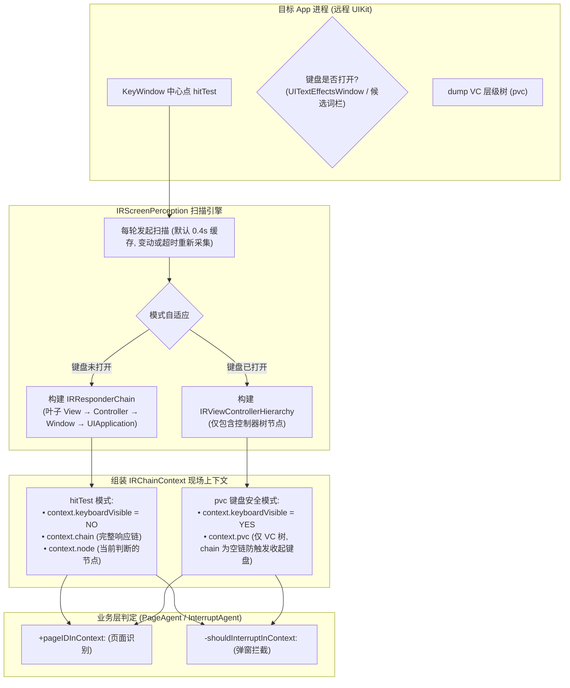

# 响应链与屏幕感知体系（`IRResponderChain` / `IRScreenState` / `IRChainContext`）（`DOC-14`）

> 文档编号：`DOC-14`（可在 `skills/` 下用 `rg "DOC-14"` 定位本文档）

本文档说明 IRAutomationKit **屏幕感知引擎如何探测当前界面**、**如何沿响应链自底向上识别页面**，以及在业务 `PageAgent` 中编写识别条件（`pageIDInContext:` / `shouldInterruptInContext:`）的标准代码范式。

---


## 目录索引

- [`[DOC-14.1]` 核心架构图：感知扫描与双模式判定](#DOC-14.1)
- [`[DOC-14.2]` 一、双模式感知机制（hitTest 模式 vs pvc 键盘安全模式）](#DOC-14.2)
  - [`[DOC-14.2.1]` 1. 为什么会有两种模式？](#DOC-14.2.1)
- [`[DOC-14.3]` 二、端到端代码示例：按响应链精确区分复用控制器](#DOC-14.3)
  - [`[DOC-14.3.1]` 示例 1：利用 `context.node.under` 区分容器层级（推荐写法）](#DOC-14.3.1)
  - [`[DOC-14.3.2]` 示例 2：利用 `parentViewController` 区分直属父控制器](#DOC-14.3.2)
  - [`[DOC-14.3.3]` 示例 3：弹窗中断拦截中的链判定（`shouldInterruptInContext:`）](#DOC-14.3.3)
- [`[DOC-14.4]` 三、链节点语法糖速查与判断准则](#DOC-14.4)
- [`[DOC-14.5]` 四、Bad Case vs Good Case 对比](#DOC-14.5)
  - [`[DOC-14.5.1]` ❌ 错误做法：在 `pageIDInContext:` 中发起耗时远程方法调用](#DOC-14.5.1)
  - [`[DOC-14.5.2]` ✅ 正确做法：只读内存或依赖已构建好的节点结构](#DOC-14.5.2)
- [`[DOC-14.6]` 五、遇到什么情况该怎么做？](#DOC-14.6)

---

<a id="DOC-14.1"></a>
## `[DOC-14.1]` 核心架构图：感知扫描与双模式判定



---

<!-- [/DOC-14.1] -->
<a id="DOC-14.2"></a>
## `[DOC-14.2]` 一、双模式感知机制（hitTest 模式 vs pvc 键盘安全模式）

框架每轮屏幕感知产出一份不可变的快照对象 `IRScreenState`（包含 `pageAgent`、`interruptAgent`、`chain` 或 `pvc`）。

<a id="DOC-14.2.1"></a>
### `[DOC-14.2.1]` 1. 为什么会有两种模式？
- **普通模式（`hitTest`）**：在目标 App 的 `keyWindow` 中心点执行 hitTest，从命中的最上层叶子视图沿 `nextResponder` 链一直读到 `UIApplication`。
- **键盘安全模式（`pvc`）**：
  - **核心痛点**：iOS 某些页面只要在屏幕中心调用 `hitTest:`，UIKit 内部就会触发失去焦点并**强行把键盘收起**！
  - **框架自动切换**：一旦框架检测到键盘浮层（`UITextEffectsWindow`）处于活动状态，会自动切入 `pvc` 模式，通过控制器树遍历来感知页面；此时 `context.chain` 为安全空链，`context.pvc` 生效。

---

<!-- [/DOC-14.2.1] -->
<!-- [/DOC-14.2] -->
<a id="DOC-14.3"></a>
## `[DOC-14.3]` 二、端到端代码示例：按响应链精确区分复用控制器

在大型 App（如抖音）中，同一个控制器类名经常被多个不同业务场景复用（如频道流控制器在推荐、关注、同城等容器里复用）。**严禁直接用单类名绑死，必须结合响应链上下文 `context.node` 判定**。

<a id="DOC-14.3.1"></a>
### `[DOC-14.3.1]` 示例 1：利用 `context.node.under` 区分容器层级（推荐写法）

```objc
// AWBMallPageAgent.m
#import "AWBMallPageAgent.h"

@implementation AWBMallPageAgent

+ (void)load {
    [self registerAgent:^(id<IRPageAgentRegistration> registration) {
        registration.bindClass = @"AWEECNewMallViewController";
        // 声明当前类可能返回的多种 pageID 身份
        registration.pageIDs = @[ @"home.mall", @"common.mall" ];
        registration.comment = @"抖音商城";
    }];
}

/// 核心识别入口：由框架屏幕感知轮询时自动调用
+ (nullable NSString *)pageIDInContext:(IRChainContext *)context {
    // context.node 指向当前绑定的 AWEECNewMallViewController
    
    // 场景 1：如果外层容器（根侧/底侧）存在 AWEHPSlidingViewController，说明是从首页滑动频道进去的商城
    if (context.node.under(@"AWEHPSlidingViewController")) {
        return @"home.mall";
    }
    
    // 场景 2：如果是底部 Tab 或个人页独立进入的商城
    return @"common.mall";
}

@end
```

<!-- [/DOC-14.3.1] -->
<a id="DOC-14.3.2"></a>
### `[DOC-14.3.2]` 示例 2：利用 `parentViewController` 区分直属父控制器

```objc
// AWBFeedPageAgent.m
#import "AWBFeedPageAgent.h"

@implementation AWBFeedPageAgent

+ (void)load {
    [self registerAgent:^(id<IRPageAgentRegistration> registration) {
        registration.bindClass = @"AWEFeedTableViewController";
        registration.pageIDs = @[ @"feed.home" ];
        registration.comment = @"首页推荐双列/单列流";
    }];
}

+ (nullable NSString *)pageIDInContext:(IRChainContext *)context {
    // 必须确保直属父控制器是频道容器，才代表是真正的推荐流页面；
    // 如果被别的内容页嵌入复用，返回 nil（代表不作为独立页面处理，控制权让给外层页面）
    if ([context.node.parentViewController.className isEqualToString:@"AWEHPChannelPageViewController"]) {
        return @"feed.home";
    }
    return nil;
}

@end
```

<!-- [/DOC-14.3.2] -->
<a id="DOC-14.3.3"></a>
### `[DOC-14.3.3]` 示例 3：弹窗中断拦截中的链判定（`shouldInterruptInContext:`）

```objc
// AWBNearbySkyLightViewAgent.m
#import "AWBNearbySkyLightViewAgent.h"

@interface AWBNearbySkyLightViewAgent () <IRInterruptHandling>
@end

@implementation AWBNearbySkyLightViewAgent

/// 询问当前弹出的天窗/浮层是否需要立即由中断机制自动关掉
- (BOOL)shouldInterruptInContext:(IRChainContext *)context {
    // 如果当前链上方存在搜索视图或登录弹窗，优先让更紧急的弹窗处理，当前浮层暂不拦截
    if (context.chain.contains(@"AWESearchView") || context.chain.contains(@"AWELoginWindow")) {
        return NO;
    }
    // 只有当前浮层处于最顶层可见时才触发中断处理
    return context.node.front;
}

- (BOOL)handleInterrupt:(IRInterruptContext *)ctx {
    // 执行关闭浮层操作...
    return YES;
}

@end
```

---

<!-- [/DOC-14.3.3] -->
<!-- [/DOC-14.3] -->
<a id="DOC-14.4"></a>
## `[DOC-14.4]` 三、链节点语法糖速查与判断准则

在 `IRChainContext` 中，`context.node`（当前节点）和 `context.chain`（整条链）提供了一组专为写判断设计的语法糖：

| 语法糖 | 作用 | 典型场景 |
|---|---|---|
| **`node.under(@"ClassName")`** | 根侧（底层）是否有类名为 `ClassName` 的节点 | 判断当前页面是否嵌在某个特定的导航、滑动容器或特定 Window 下 |
| **`node.above(@"ClassName")`** | 叶子侧（顶层）是否有类名为 `ClassName` 的节点 | 判断当前页面上面是否盖着某种特定的视图/蒙层 |
| **`node.isFront`** | 当前节点是否是整个链上**叶子侧第一个 VC**（最顶层控制器） | 确保当前控制器处于前台顶层，而不是被别的控制器 present 覆盖 |
| **`node.parentViewController`** | 获取当前节点在根侧的直属父控制器节点 | 严格判断嵌套容器层级（如直属 parent 必须是 TabBar 或 Navigation） |
| **`chain.contains(@"ClassName")`** | 整条链上是否存在类名为 `ClassName` 的节点（含 View/VC/Window） | 快速探测页面背景是否有特定的遮罩或业务标记 |

---

<!-- [/DOC-14.4] -->
<a id="DOC-14.5"></a>
## `[DOC-14.5]` 四、Bad Case vs Good Case 对比

<a id="DOC-14.5.1"></a>
### `[DOC-14.5.1]` ❌ 错误做法：在 `pageIDInContext:` 中发起耗时远程方法调用
```objc
// ❌ 严重错误：每轮页面识别会高频运行（~0.4s），在回调里调复杂的远程方法会严重拖慢目标主线程，引发卡顿甚至看门狗重启！
+ (nullable NSString *)pageIDInContext:(IRChainContext *)context {
    // 错误：调远程方法
    BOOL isPlaying = [[context.node.agent.remoteObject call:@"isPlaying"] boolValue]; 
    return isPlaying ? @"feed.playing" : @"feed.pause";
}
```

<!-- [/DOC-14.5.1] -->
<a id="DOC-14.5.2"></a>
### `[DOC-14.5.2]` ✅ 正确做法：只读内存或依赖已构建好的节点结构
```objc
// ✅ 正确做法：识别只查结构（类名、响应链层级、或者纯内存 ivar），判断快、零 IPC 开销
+ (nullable NSString *)pageIDInContext:(IRChainContext *)context {
    if (context.node.under(@"AWEMainWindow") && context.node.front) {
        return @"feed.main";
    }
    return nil;
}
```

---

<!-- [/DOC-14.5.2] -->
<!-- [/DOC-14.5] -->
<a id="DOC-14.6"></a>
## `[DOC-14.6]` 五、遇到什么情况该怎么做？

- **情况 1：`context.isKeyboardVisible` 为 YES 时怎么写判断？**
  - 当键盘弹出时，`context.chain` 为安全空链，`context.node` 也是空节点（调用 `node.under` 等一律返回 `NO`，不崩但也不命中）。
  - **做法**：如果该页面需要在键盘弹起时保持识别，必须使用 `context.pvc`（控制器树结构）来判断：
    ```objc
    if (context.isKeyboardVisible) {
        if ([context.pvc contains:@"AWESearchSugViewController"]) {
            return @"search.sug";
        }
    }
    ```
- **情况 2：同一个控制器在转场过渡中（如 Push / Present），识别出现偶发丢帧？**
  - **框架已自动平滑**：`IRScreenState.isTransitioning` 会在系统转场期间自动沿用上一轮确定的 `pageAgent`，业务不需要在 `pageIDInContext:` 里面自己写延时重试。
- **情况 3：页面上有遮罩弹窗，背后的页面算不算当前页面？**
  - 屏幕感知回答两个独立问题：`screen.pageAgent`（回答“当前主要是什么页面”）与 `screen.interruptAgent`（回答“是否有需要自动处理的弹窗”）。
  - 如果弹窗是半透明覆盖在 Feed 之上，Feed 控制器依然在响应链底层，`pageAgent` 依然是 Feed；如果弹窗是全屏阻断性 Controller，则 `pageAgent` 切换为弹窗。
<!-- [/DOC-14.6] -->
