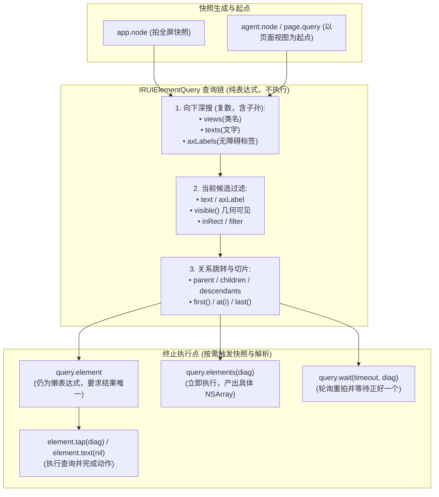

# 视图树快照与链式查询（`IRUIElementQuery` / `IRUIElement`）（`DOC-15`）

> 文档编号：`DOC-15`（可在 `skills/` 下用 `rg "DOC-15"` 定位本文档）

本文档说明 IRAutomationKit **视图树链式查询的设计哲学**、**快照式懒执行机制**，并提供在 `PageAgent` 与自动化脚本中定位与操作控件的端到端标准代码模板。

---


## 目录索引

- [`[DOC-15.1]` 核心架构图：快照、查询链与元素执行流转](#DOC-15.1)
- [`[DOC-15.2]` 一、核心设计哲学：快照式懒执行与唯一性约束](#DOC-15.2)
- [`[DOC-15.3]` 二、端到端代码模板（常用高频场景直接抄）](#DOC-15.3)
  - [`[DOC-15.3.1]` 示例 1：最常用的按钮点击（类名 + 辅助标签 + 可见性）](#DOC-15.3.1)
  - [`[DOC-15.3.2]` 示例 2：动态轮询等待控件出现（`wait`）](#DOC-15.3.2)
  - [`[DOC-15.3.3]` 示例 3：批量提取列表/单元格（`.elements(diag)`）](#DOC-15.3.3)
  - [`[DOC-15.3.4]` 示例 4：层级关联跳转（子树条件判断与反查父容器）](#DOC-15.3.4)
  - [`[DOC-15.3.5]` 示例 5：自定义条件深筛（`filter`）](#DOC-15.3.5)
- [`[DOC-15.4]` 三、通配符与文字匹配规则](#DOC-15.4)
- [`[DOC-15.5]` 四、Bad Case vs Good Case 对比](#DOC-15.5)
  - [`[DOC-15.5.1]` ❌ 错误写法 1：没有显式加 `visible()` 导致点到被隐藏的层](#DOC-15.5.1)
  - [`[DOC-15.5.2]` ✅ 正确写法 1：显式声明可见性](#DOC-15.5.2)
  - [`[DOC-15.5.3]` ❌ 错误写法 2：在循环遍历中使用未解析的通用 element](#DOC-15.5.3)
  - [`[DOC-15.5.4]` ✅ 正确写法 2：一次性取出 `elements` 后遍历操作](#DOC-15.5.4)
- [`[DOC-15.6]` 五、遇到什么情况该怎么做？](#DOC-15.6)

---

<a id="DOC-15.1"></a>
## `[DOC-15.1]` 核心架构图：快照、查询链与元素执行流转



---

<!-- [/DOC-15.1] -->
<a id="DOC-15.2"></a>
## `[DOC-15.2]` 一、核心设计哲学：快照式懒执行与唯一性约束

1. **链式表达式不执行（Lazy Evaluation）**：
   - `IRUIElementQuery` 本身只是一个查询管道定义。无论你链式拼了多少步（`views().texts().visible()`），在没有调用 `.elements(diag)`、`.wait()` 或在 `.element` 上发起操作之前，**完全不发生任何远程 IPC 交互**。
2. **操作与单值读取要求“正好一个”（歧义即错误）**：
   - 当在 `query.element` 上调用 `.tap(diag)`、`.text(nil)`、`.frame(nil)` 时，框架要求该查询在当前快照中**必须命中唯一控件**；
   - 如果命中 0 个或找到多个，框架会直接返回错误并在 `diag` 中详细列出冲突控件的类名和坐标。**若预期存在多个，必须显式调用 `.first()`、`.last()` 或 `.at(index)` 消除歧义**。
3. **向下询问（复数） vs 过滤（单数）的区别**：
   - **向下询问（`views` / `texts` / `axLabels`）**：从当前每个节点出发，在其**自己以及全部子孙节点**中深搜匹配；
   - **过滤（`text` / `axLabel` / `visible()`）**：只对**当前这批候选节点自身**的属性做筛选，不往下深入。

---

<!-- [/DOC-15.2] -->
<a id="DOC-15.3"></a>
## `[DOC-15.3]` 二、端到端代码模板（常用高频场景直接抄）

<a id="DOC-15.3.1"></a>
### `[DOC-15.3.1]` 示例 1：最常用的按钮点击（类名 + 辅助标签 + 可见性）

```objc
// 推荐写法：找类名 -> 匹配辅助标签 -> 过滤几何可见 -> 取第一个 -> 点击
app.query.views(@"AWENormalModeTabBarGeneralButton")
         .axLabels(@"首页")
         .visible()
         .first()
         .element
         .tap(diag);
```

<!-- [/DOC-15.3.1] -->
<a id="DOC-15.3.2"></a>
### `[DOC-15.3.2]` 示例 2：动态轮询等待控件出现（`wait`）

在网络加载、弹窗弹出或页面切换后，使用 `.wait(timeout, diag)` 自动循环重拍并等待控件出现：

```objc
// wait 会在每轮循环头部自动重拍快照，直到正好出现 1 个满足条件的元素或超时
IRUIElement *confirmBtn = app.query.views(@"DUXButton")
                                  .text(@"确认*")
                                  .visible()
                                  .wait(5.0, diag);

if (confirmBtn.exists(diag)) {
    confirmBtn.tap(diag);
}
```

<!-- [/DOC-15.3.2] -->
<a id="DOC-15.3.3"></a>
### `[DOC-15.3.3]` 示例 3：批量提取列表/单元格（`.elements(diag)`）

```objc
// 立即执行当前查询，产出具体的元素数组
NSArray<IRUIElement *> *cells = page.query.views(@"CachalotCommonCollectionViewCell")
                                          .visible()
                                          .elements(diag);

for (IRUIElement *cell in cells) {
    // 每一项都是独立持有单个节点的具体元素，后续在其子树内查询直接基于该节点
    NSString *title = cell.query.descendants().views(@"UILabel").first().element.text(nil);
    NSLog(@"Cell title: %@", title);
}
```

<!-- [/DOC-15.3.3] -->
<a id="DOC-15.3.4"></a>
### `[DOC-15.3.4]` 示例 4：层级关联跳转（子树条件判断与反查父容器）

```objc
// 场景：找到包含“猜你想搜”的标题，并跳转到其父容器再找同级文字
NSArray<IRUIElement *> *related = page.query.texts(@"猜你想搜")
                                            .first()
                                            .parent()
                                            .views(@"LynxTextView")
                                            .visible()
                                            .elements(diag);
```

<!-- [/DOC-15.3.4] -->
<a id="DOC-15.3.5"></a>
### `[DOC-15.3.5]` 示例 5：自定义条件深筛（`filter`）

```objc
// 场景：在所有列表容器中，筛选出子树里包含特定 Cell 类型的那个 CollectionView
IRUIElement *targetList = agent.query.views(@"UICollectionView")
                                     .visible()
                                     .filter(^BOOL(IRUIElement *element) {
                                         // 在每个候选控件的子树内发起二次轻量探测
                                         return element.query.views(@"AWEDCFeedStandardVideoCell").element.exists(nil);
                                     })
                                     .first()
                                     .element;
```

---

<!-- [/DOC-15.3.5] -->
<!-- [/DOC-15.3] -->
<a id="DOC-15.4"></a>
## `[DOC-15.4]` 三、通配符与文字匹配规则

在 `texts()`、`text()`、`axLabels()`、`axLabel()` 中支持以下标准 `*` 通配模式：

| 匹配模式 | 示例 | 匹配说明 |
|---|---|---|
| **完全相等** | `@"评论"` | 只有完全等于“评论”才匹配 |
| **前缀匹配** | `@"相关搜索*"` | 以“相关搜索”开头的所有文字 |
| **后缀匹配** | `@"*关闭"` | 以“关闭”结尾的所有文字（如“✕ 关闭”） |
| **包含匹配** | `@"*广告*"` | 任意位置包含“广告”的文字 |
| **顺序段匹配** | `@"*共*条*评论*"` | 文本中按顺序出现这些片段 |

> [!NOTE]
> - 通配符模式区分大小写；
> - 若需要忽略大小写或复杂正则，使用 `.textMatches(@"regex")` 或 `.axLabelMatches(@"regex")`。

---

<!-- [/DOC-15.4] -->
<a id="DOC-15.5"></a>
## `[DOC-15.5]` 四、Bad Case vs Good Case 对比

<a id="DOC-15.5.1"></a>
### `[DOC-15.5.1]` ❌ 错误写法 1：没有显式加 `visible()` 导致点到被隐藏的层
```objc
// ❌ 错误：很多 App（如抖音）会在后台保留被 hidden 或 alpha=0 的同名按钮；
// 不加 visible() 会导致命中多个元素报错，或者误点到不可见的离屏按钮！
app.query.views(@"UIButton").text(@"关注").element.tap(diag);
```
<!-- [/DOC-15.5.1] -->
<a id="DOC-15.5.2"></a>
### `[DOC-15.5.2]` ✅ 正确写法 1：显式声明可见性
```objc
// ✅ 正确：显式过滤几何可见，并在多结果时取第一个
app.query.views(@"UIButton").text(@"关注").visible().first().element.tap(diag);
```

---

<!-- [/DOC-15.5.2] -->
<a id="DOC-15.5.3"></a>
### `[DOC-15.5.3]` ❌ 错误写法 2：在循环遍历中使用未解析的通用 element
```objc
// ❌ 错误：在循环里反复用 element 去查，每次都在整屏全量重新匹配，极度低效
for (int i = 0; i < 5; i++) {
    app.query.views(@"Cell").at(i).element.tap(diag); // 每次循环都全树重搜
}
```
<!-- [/DOC-15.5.3] -->
<a id="DOC-15.5.4"></a>
### `[DOC-15.5.4]` ✅ 正确写法 2：一次性取出 `elements` 后遍历操作
```objc
// ✅ 正确：先一次性拿到当前快照下的元素列表，再逐个处理，快照完全复用
NSArray<IRUIElement *> *cells = app.query.views(@"Cell").visible().elements(diag);
for (IRUIElement *cell in cells) {
    cell.tap(diag);
}
```

---

<!-- [/DOC-15.5.4] -->
<!-- [/DOC-15.5] -->
<a id="DOC-15.6"></a>
## `[DOC-15.6]` 五、遇到什么情况该怎么做？

- **情况 1：我想从当前特定的页面 / 弹窗内查找，避免搜到全屏干扰项？**
  - **不要用 `app.query`**，改用 **`page.query`** 或 **`context.agent.query`**。
  - 框架会自动将当前 Agent 所绑定的视图作为查询树根，搜索范围严格限定在其子树以内。
- **情况 2：查出来的控件点击位置歪了或点不到？**
  - `element.tapPoint` 默认计算几何 `visibleRect` 的中心点；
  - 检查该控件是否被同级悬浮栏部分遮挡，必要时调用 `element.inRect(screenRect)` 进一步限制有效点击区域。
- **情况 3：调试时想知道这条链每一步过滤出了几个节点？**
  - 开启 `element.debugEnabled = YES` 或调用 `element.debugOutline(1000, @"测试")`，框架会在屏幕上方画出高亮红框并输出每一步的过滤明细。
<!-- [/DOC-15.6] -->
