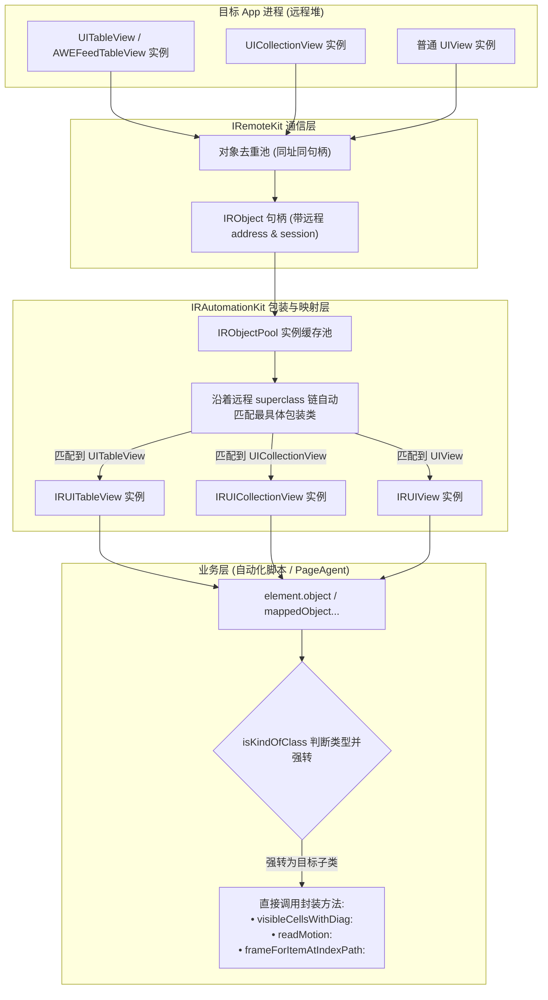

# 远程类包装与实例扫描（`IRNSObject` / `IRUIView` / `IRInstanceScanner`）（`DOC-17`）

> 文档编号：`DOC-17`（可在 `skills/` 下用 `rg "DOC-17"` 定位本文档）

本文档说明 IRAutomationKit 对**目标进程远程对象的包装体系**（`IRNSObject` 及其 UIKit 子类）以及**堆实例扫描器**（`IRInstanceScanner`）的规范用法。

> [!IMPORTANT]
> **核心原则：`IRObject` 及其包装子类代表目标进程中的远程实体，严禁用户自行 `alloc init`！**
> - **没有对应的远程对象，本地构造无任何意义**：`IRNSObject` 及其 UIKit 子类（`IRUIView` / `IRUIScrollView` / `IRUITableView` / `IRUICollectionView`）的 `init` 和 `new` 均为 `NS_UNAVAILABLE`；
> - **全局唯一与生命周期托管**：所有远程包装实例由底层的对象去重池与类映射系统（`IRObjectPool`）全权托管（同会话同地址单例、随远程实体生灭）；
> - **业务层零包装成本**：业务在 `UIElement`、`Agent` 或流程中拿到的对象**已经是映射好的具体强类型子类**，只需直接做类型判断（`isKindOfClass:`）后强转使用，严禁自行套娃二次包装！

---


## 目录索引

- [`[DOC-17.1]` 核心架构图：远程对象到本地强类型映射](#DOC-17.1)
- [`[DOC-17.2]` 一、远程包装类的核心机制与扩展方式 (`IRNSObject` 体系)](#DOC-17.2)
  - [`[DOC-17.2.1]` 1. 怎么扩展：自定义专属的 UI 包装便利类](#DOC-17.2.1)
  - [`[DOC-17.2.2]` 2. 为什么 `element.object` 拿到的已经是包装子类？](#DOC-17.2.2)
  - [`[DOC-17.2.3]` 3. 正确代码范式：只做类型判断与强转（禁止套娃包装）](#DOC-17.2.3)
  - [`[DOC-17.2.4]` 4. 身份与比较规则](#DOC-17.2.4)
  - [`[DOC-17.2.5]` 5. 挂载本地自定义数据 (`userInfo`)](#DOC-17.2.5)
- [`[DOC-17.3]` 二、业务数据模型绑定与子类注册（`IRObject` 子类映射）](#DOC-17.3)
  - [`[DOC-17.3.1]` 1. 怎么绑定：子类 `+load` 注册类映射](#DOC-17.3.1)
  - [`[DOC-17.3.2]` 2. 映射生效后的效果与正确用法](#DOC-17.3.2)
- [`[DOC-17.4]` 三、对象生命周期与引用管理（本地壳 vs 远程实体）](#DOC-17.4)
  - [`[DOC-17.4.1]` 1. 核心原则：默认 Weak 借用，开发者优先自行维护生命周期](#DOC-17.4.1)
  - [`[DOC-17.4.2]` 2. 什么时候应该钉住本地壳 (`cacheObjectAtAddress:`)？](#DOC-17.4.2)
  - [`[DOC-17.4.3]` 3. 本地保活速查表](#DOC-17.4.3)
- [`[DOC-17.5]` 四、UIKit 包装类的能力分层（纯读内存 vs 远程调用）](#DOC-17.5)
  - [`[DOC-17.5.1]` 遇到什么情况该怎么做？](#DOC-17.5.1)
- [`[DOC-17.6]` 五、实例扫描器 (`IRInstanceScanner`) — 跟踪远程堆对象](#DOC-17.6)
  - [`[DOC-17.6.1]` 1. 怎么用：创建、配置与监听](#DOC-17.6.1)
  - [`[DOC-17.6.2]` 2. 遇到什么情况该怎么做？](#DOC-17.6.2)

---

<a id="DOC-17.1"></a>
## `[DOC-17.1]` 核心架构图：远程对象到本地强类型映射



---

<!-- [/DOC-17.1] -->
<a id="DOC-17.2"></a>
## `[DOC-17.2]` 一、远程包装类的核心机制与扩展方式 (`IRNSObject` 体系)

IRAutomationKit 提供了 `IRNSObject` 包装体系（`IRNSObject` → `IRUIView` → `IRUIScrollView` → `IRUITableView` / `IRUICollectionView`）。

> [!TIP]
> **可扩展性：内置类只是开箱即用的常用便利类！**
> `IRUIView`、`IRUIScrollView`、`IRUITableView`、`IRUICollectionView` 只是框架内置好的基础便利类，**不是封闭的唯一选择**。
> 用户完全可以根据自己业务关心的系统控件或自研 UI 组件（例如特定视频播放视图、富文本控件、Tab 栏等），继承 `IRUIView`（或 `IRNSObject`）并重写 `+systemClassName`，框架在类映射时就会**自动登记并沿父类链匹配并派发为你自定义的便利类**！

<a id="DOC-17.2.1"></a>
### `[DOC-17.2.1]` 1. 怎么扩展：自定义专属的 UI 包装便利类

只需继承 `IRUIView` 并覆盖 `+systemClassName`，即可无缝接入全局类映射：

```objc
// AWBVideoPlayerView.h
#import <IRAutomationKit/IRAutomationKit.h>

@interface AWBVideoPlayerView : IRUIView
/// 封装针对该播放控件的便捷只读属性或远程方法
@property (nonatomic, readonly) BOOL isPlaying;
@end

// AWBVideoPlayerView.m
#import "AWBVideoPlayerView.h"

@implementation AWBVideoPlayerView

+ (NSString *)systemClassName {
    // 声明对应的远程类名（目标进程中该类或其子类都会自动映射为当前包装类）
    return @"IESLiveVideoPlayerView";
}

- (BOOL)isPlaying {
    // 封装纯内存读取或快捷方法
    return [self.object ivarNamed:@"_isPlaying"].value.boolValue;
}

@end
```
> 一旦声明了上述子类，当 `app.query.views(@"IESLiveVideoPlayerView").first.element.object` 拿到对象时，框架底层就会自动沿远程父类链匹配，**直接产出 `AWBVideoPlayerView` 实例**！

<!-- [/DOC-17.2.1] -->
<a id="DOC-17.2.2"></a>
### `[DOC-17.2.2]` 2. 为什么 `element.object` 拿到的已经是包装子类？

- **自动类映射**：当你在业务中拿到 `element.object`，或者通过 `[IRNSObject mappedObjectWithAddress:session:]` 获取对象时，框架内部会**沿着远程对象的父类继承链向上查找已注册的包装类**。
  - 如果目标是 `AWEFeedTableView`，因为它是 `UITableView` 的子类，框架自动将其包成 `IRUITableView` 实例返回；
  - 如果目标是瀑布流列表，自动返回 `IRUICollectionView` 实例；
  - 如果只是普通的容器视图，返回 `IRUIView` 实例。
- **同一会话同一地址全局唯一**：由内部 `IRObjectPool` 强行保证同一远程对象对应同一个本地包装实例，因此挂在实例身上的 `userInfo` 全局共享。

<!-- [/DOC-17.2.2] -->
<a id="DOC-17.2.3"></a>
### `[DOC-17.2.3]` 3. 正确代码范式：只做类型判断与强转（禁止套娃包装）

```objc
// ✅ 正确做法：element.object 本身已经是映射好的 IRNSObject 子类
if ([element.object isKindOfClass:[IRUITableView class]]) {
    IRUITableView *table = (IRUITableView *)element.object;
    NSArray<IRUIView *> *cells = [table visibleCellsWithDiag:diag];
}

// ❌ 错误做法：拿到 element.object 再去调 viewWithObject:（多此一举，误以为它是裸句柄）
// IRUITableView *table = [IRUITableView viewWithObject:element.object]; // 严禁这样写！

// ✅ 正确做法：从原始地址获取时，走类映射（自动返回对应子类）：
IRNSObject *mapped = [IRNSObject mappedObjectWithAddress:node.address session:app.session];
if ([mapped isKindOfClass:[IRUICollectionView class]]) {
    IRUICollectionView *cv = (IRUICollectionView *)mapped;
    CGRect frame = [cv frameForItemAtIndexPath:indexPath diag:diag];
}
```

> [!NOTE]
> **`+viewWithObject:` 和 `+objectWithObject:` 的真正用途**：
> 这两个方法属于底层防御工厂，仅在直接从 `IRSession` 裸拿到原生 `IRObject` 句柄时做类型校验和转换。**在写自动化业务（Agent / Element / Node）时，拿到的一律是已经映射好的对象，直接判类型强转即可**。

<!-- [/DOC-17.2.3] -->
<a id="DOC-17.2.4"></a>
### `[DOC-17.2.4]` 4. 身份与比较规则

- **同一会话 + 同一地址 = 同一个远程对象**：
  - `IRNSObject` 重写了 `isEqual:` 和 `hash`。用父类包装和用子类包装同一个远程地址，`isEqual:` 恒为 `YES`，可以安全放入 `NSSet` 或作为 `NSDictionary` 的 Key。
  - 通过 `mappedObjectWithObject:` / `mappedObjectWithAddress:` 获取的实例由缓存池管理，同一会话同一地址多次调用返回同一个包装实例。
- **类型判断必须用 `isKindOfClassNamed:`**：
  - **严禁**用本地 `[wrapper isKindOfClass:[UITableView class]]`（本地包装类不是真正的 UIKit 类）。
  - **正确用法**：`[wrapper isKindOfClassNamed:@"UITableView"]`，它会纯读内存沿着目标进程里的远程 `superclass` 链逐级校验。
- **对象存活校验**：
  - `wrapper.isValidObject`：纯读内存校验远程 isa，确认目标对象在远程堆上是否仍是合法活对象。

<!-- [/DOC-17.2.4] -->
<a id="DOC-17.2.5"></a>
### `[DOC-17.2.5]` 5. 挂载本地自定义数据 (`userInfo`)

同一个远程对象在整个进程内共享一份 `userInfo` 字典（由底层 `IRemoteKit` 保持同址同句柄）：

```objc
// 挂载/读取本地自定义状态（随远程对象生灭，不修改目标进程内存）
[wrapper setUserObject:@"tag_123" forKey:@"my_tag"];
NSString *tag = [wrapper userObjectForKey:@"my_tag"];
```

---

<!-- [/DOC-17.2.5] -->
<!-- [/DOC-17.2] -->
<a id="DOC-17.3"></a>
## `[DOC-17.3]` 二、业务数据模型绑定与子类注册（`IRObject` 子类映射）

除了框架内置的 UIKit 系统类，当业务需要为目标 App 的数据模型（如抖音的视频模型 `AWEAwemeModel`、用户模型 `AWEUserModel`）定制专属的强类型包装类时，可以通过 `[IRObject registerSubclass:forRemoteClass:]` 进行注册。

<a id="DOC-17.3.1"></a>
### `[DOC-17.3.1]` 1. 怎么绑定：子类 `+load` 注册类映射

业务包装类继承自 `IRObject`，并在 `+load` 中声明与远程类的对应关系：

```objc
// AWBUser.h
#import <IRAutomationKit/IRAutomationKit.h>

NS_ASSUME_NONNULL_BEGIN

@interface AWBUser : IRObject
@property (nonatomic, copy, readonly, nullable) NSString *userID;
@property (nonatomic, copy, readonly, nullable) NSString *nickname;
@end

NS_ASSUME_NONNULL_END
```

```objc
// AWBUser.m
#import "AWBUser.h"

@implementation AWBUser

+ (void)load {
    // 核心注册：目标进程里 AWEUserModel（及其子类）的对象，
    // 今后在任何地方创建句柄时（包括扫描器、ivar 读取等），框架统一实例化为 AWBUser！
    [IRObject registerSubclass:self forRemoteClass:@"AWEUserModel"];
}

- (NSString *)userID {
    // 纯读远程 ivar，免 worker、零主线程开销
    return [self ivarNamed:@"_userID"].value.objectValue.stringValue;
}

- (NSString *)nickname {
    return [self ivarNamed:@"_nickname"].value.objectValue.stringValue;
}

@end
```

<!-- [/DOC-17.3.1] -->
<a id="DOC-17.3.2"></a>
### `[DOC-17.3.2]` 2. 映射生效后的效果与正确用法

- **全链路自动强类型化**：
  - 在 `PageAgent` 中读取控制器的模型属性：
    ```objc
    // 通过 ivar 取到的远程对象句柄，因为已经注册映射，拿到的直接就是 AWBUser 实例！
    AWBUser *user = [self.remoteObject ivarNamed:@"_user"].value.objectValue;
    NSString *name = user.nickname;
    ```
  - 在 `IRInstanceScanner` 扫描回调中：
    ```objc
    [scanner observe:IRInstanceEventAdded block:^(IRInstanceEvent event, NSArray<IRObject *> *objects) {
        for (IRObject *o in objects) {
            // objects 里符合该类的实例已经是 AWBUser 类型，直接强转使用
            if ([o isKindOfClass:[AWBUser class]]) {
                AWBUser *user = (AWBUser *)o;
                NSLog(@"新发现用户: %@", user.nickname);
            }
        }
    }];
    ```
- **KVO 与动态子类天然适配**：
  - `IRemoteKit` 在查找注册表时沿远程对象的父类链查找。目标对象即使被 KVO 包装为 `NSKVONotifying_AWEUserModel`，其父类仍是 `AWEUserModel`，依然能精确命中并实例化为 `AWBUser`。

---

<!-- [/DOC-17.3.2] -->
<!-- [/DOC-17.3] -->
<a id="DOC-17.4"></a>
## `[DOC-17.4]` 三、对象生命周期与引用管理（本地壳 vs 远程实体）

在进程外自动化中，远程对象的生命周期分为两层：**本地句柄壳的生命周期**与**目标进程远程实体的生命周期**。

<a id="DOC-17.4.1"></a>
### `[DOC-17.4.1]` 1. 核心原则：默认 Weak 借用，开发者优先自行维护生命周期

就像常规 iOS 开发一样，**开发者应该优先自己持有（强引用）需要持续使用的业务对象，并随着业务流程的结束自然释放**：
- 从视图树元素（`element.object`）、扫描器或 `[session objectAtAddress:]` 拿到的对象，底层对远程实体默认是 **Weak 借用**（`IRObjectOwnershipWeak`）；
- 我们**不增加目标 App 进程内部的引用计数**（不调用远程 `objc_retain`），不会阻碍目标自身的内存释放；
- 本地句柄壳在底层通过弱引用去重表保证“同址同壳”，只要你的业务逻辑还在引用它，上面的解析缓存和 `userInfo` 就会一直在；业务变量超出作用域释放后，本地壳随之自然销毁。

<!-- [/DOC-17.4.1] -->
<a id="DOC-17.4.2"></a>
### `[DOC-17.4.2]` 2. 什么时候应该钉住本地壳 (`cacheObjectAtAddress:`)？

不需要到处都把对象钉在全局缓存里。只有满足以下条件的少数重量级对象，才适合调用 `[session cacheObjectAtAddress:]` 由框架额外强持保活：
1. **全局经常被多处访问，且本地承载繁重序列化/解析任务的对象**：
   - 例如作品模型 `AWBAweme`。因为从远程读 JSON 文本并本地反序列化开销很大（数十毫秒），一旦本地壳被频繁释放，下次访问又得重新远程拉取反序列化。所以扫描器发现新作品时会在底层将其钉住，直到扫描发现作品在远程已被销毁时再调用 `discardObjectAtAddress:` 释放。
2. **生命周期长、变化慢且身上需要挂载临时业务数据的核心结构**：
   - 例如页面控制器树（ViewController）、全局核心单例。这类对象不常释放，而且业务经常需要在上面挂载一些本地临时标记（通过 `userInfo`）。
   - 钉住后，业务无需在自己模块里到处声明全局变量去强引用它，随时通过地址取到的都是同一个带缓存的活对象。

<!-- [/DOC-17.4.2] -->
<a id="DOC-17.4.3"></a>
### `[DOC-17.4.3]` 3. 本地保活速查表

| 对象类型 | 获取方式 | 谁来维护生命周期？ | 为什么？ |
|---|---|---|---|
| **普通视图与控件** | `element.object`<br>`[session objectAtAddress:]` | **业务自身持有 (局部变量/属性)**，随流程结束自然释放 | 数量极大、界面瞬息万变，钉住会导致宿主内存泄漏 |
| **临时业务数据** | ivar 读取返回的子对象 | **业务自己引用**，用完即丢 | 无繁重解析，随用随走 |
| **重度解析业务模型**<br>(如 `AWBAweme`) | 扫描器 Added 自动钉住<br>或业务显式 `cacheObjectAtAddress:` | **框架底层托管**<br>(配合 `discardObjectAtAddress:`) | 解析成本极高，避免因本地壳释放导致反复重复远程序列化 |
| **控制器/长驻页面结构** | `cacheObjectAtAddress:` | **框架/会话级强持** | 变化慢、需要跨步骤共享挂载在 `userInfo` 上的临时标记 |

---

<!-- [/DOC-17.4.3] -->
<!-- [/DOC-17.4] -->
<a id="DOC-17.5"></a>
## `[DOC-17.5]` 四、UIKit 包装类的能力分层（纯读内存 vs 远程调用）

包装类上的属性和方法有严格的性能与线程边界：

| 包装类 | 纯读内存（任意线程可调，零主线程开销） | 远程主线程调用（带 `diag`，**严禁在 `app.queue` 调**） |
|---|---|---|
| **`IRUIView`** | • `window`：所在窗口 `IRUIView`（纯读 `_window`）<br>• `viewController`：根视图所属控制器（纯读 `_viewDelegate`，子视图为 `nil`） | • `-boundsWithDiag:`<br>• `-frameInWindowWithDiag:`（换算到窗口坐标） |
| **`IRUIScrollView`** | • `-readMotion:`（**单次内存读取**拿全一帧运动数据）<br>• `contentOffset` / `contentSize` / `contentInset`<br>• `velocity`（速度 pt/ms）/ `decelerationTarget`（惯性终点）<br>• `isTracking`（手指按着）/ `isDecelerating`（惯性中）/ `isScrolling` | • `-readAdjustedContentInset:diag:`（读取带安全区的边距） |
| **`IRUITableView`** | *(继承 `IRUIScrollView` 的全部纯读属性)* | • `-visibleCellsWithDiag:`<br>• `-indexPathsForVisibleRowsWithDiag:`<br>• `-numberOfSectionsWithDiag:` / `-numberOfRowsInSection:diag:`<br>• `-cellForRowAtIndexPath:diag:`（未显示返回 nil，不算错误）<br>• `-indexPathForCell:diag:`<br>• `-rectForRowAtIndexPath:diag:`（内容坐标，未显示也能算） |
| **`IRUICollectionView`** | *(继承 `IRUIScrollView` 的全部纯读属性)* | • `-visibleCellsWithDiag:`<br>• `-indexPathsForVisibleItemsWithDiag:`<br>• `-numberOfSectionsWithDiag:` / `-numberOfItemsInSection:diag:`<br>• `-cellForItemAtIndexPath:diag:`（未显示返回 nil，不算错误）<br>• `-indexPathForCell:diag:`<br>• `-frameForItemAtIndexPath:diag:`（内容坐标，未排版返回 CGRectNull） |

<a id="DOC-17.5.1"></a>
### `[DOC-17.5.1]` 遇到什么情况该怎么做？

- **情况 1：高频监控列表滚动速度与停稳状态**
  - **严禁**反复调远程方法。
  - **正确做法**：在后台循环中按 5ms~10ms 间隔调用 `[scroll readMotion:&motion]`。单次原子读完 `contentOffset`、`velocity`、`tracking`、`decelerating`，耗时小于 1μs。
- **情况 2：在 `app.queue`（自动化主队列）中调用 `visibleCellsWithDiag:`**
  - **会直接触发防御报错并返回 `nil`**（`app.queue 上远程调用被拒`）。
  - **正确做法**：带 `diag` 的远程调用只能在业务线程或普通后台队列调用；若在 Task block 里，需异步分发到后台执行。
- **情况 3：查询某个 cell / frame 返回 `nil` 或 `CGRectNull`**
  - 先检查 `diag.noError`：
    - `diag.noError == YES`：说明远程调用正常，只是该 cell 当前不在可视区，或 CollectionView 瀑布流尚未排版到该 item（**正常业务现象**）。
    - `diag.noError == NO`：说明发生 IPC 故障、目标对象已释放或参数越界。

---

<!-- [/DOC-17.5.1] -->
<!-- [/DOC-17.5] -->
<a id="DOC-17.6"></a>
## `[DOC-17.6]` 五、实例扫描器 (`IRInstanceScanner`) — 跟踪远程堆对象

用于持续监控目标进程堆上某些特定类（如播放器控制器、弹窗类、特定 Model）的生命周期。

<a id="DOC-17.6.1"></a>
### `[DOC-17.6.1]` 1. 怎么用：创建、配置与监听

```objc
// 1. 创建扫描器（支持单类或多类数组）
IRInstanceScanner *scanner = [IRInstanceScanner scannerWithApplication:app
                                                            classNames:@[@"AWEFeedTableViewController", @"AWEPlayInteractionViewController"]];
scanner.interval = 10.0; // 定时轮询间隔（秒），0 = 不定时

// 2. 联动页面变化（纯通知机制）
// 注意：页面切换默认绝不自动扫描！必须在 handler 里显式提交请求
[scanner onPageChange:^(IRPageAgent * _Nullable from, IRPageAgent *to) {
    if ([to.pageID isEqualToString:@"Aweme.FeedPage"]) {
        // 推荐：用时间范围请求，让框架把同 App 下多个扫描器的请求合并为一轮堆遍历
        [scanner scanTimeRangeMin:0.5 max:3.0];
    } else if ([to.pageID isEqualToString:@"Aweme.SearchPage"]) {
        [scanner scanNow]; // 紧急需要：立即扫
    }
}];

// 3. 订阅事件（Added / Removed / Scanned 可组合）
[scanner observe:IRInstanceEventAdded | IRInstanceEventRemoved
           block:^(IRInstanceEvent event, NSArray<IRObject *> *objects) {
    if (event == IRInstanceEventAdded) {
        for (IRObject *obj in objects) {
            // 多类扫描时，按 originalClassName 区分（自动剥离 NSKVONotifying_ 动态子类）
            NSString *realClass = obj.originalClassName;
            // 回调自带 IRemoteKit 隐式 worker，可直接调用 obj.remote 门面或 call:，不占自动化执行权
        }
    } else if (event == IRInstanceEventRemoved) {
        for (IRObject *obj in objects) {
            // 警告：Removed 对象远程已释放，严禁远程调用！仅 obj.addr 有效，用于清理本地缓存
            IRRemoteAddress deadAddr = obj.addr;
        }
    }
}];

// 4. 启停控制
[scanner start];
// 停止：[scanner stop];
```

<!-- [/DOC-17.6.1] -->
<a id="DOC-17.6.2"></a>
### `[DOC-17.6.2]` 2. 遇到什么情况该怎么做？

- **情况 1：同一个应用有多个模块都要扫实例，频繁扫堆卡顿目标 App？**
  - **不要担心创建多个扫描器**：IRAutomationKit 底层按 `IRApplication` 自动合并扫描组。无论创建多少个 `IRInstanceScanner`，同一轮扫描都只做一次 `instancesOfClasses:` 全堆遍历，然后按类分发到各自的独立队列。
  - **主动触发时尽量用 `scanTimeRangeMin:max:`**：给出一个时间窗口，框架会把该时间段内所有扫描器的请求合并成一轮，极大降低目标进程挂起开销。
- **情况 2：如何从扫描器直接查询当前活着的实例快照？**
  - 无需发起扫描，直接读取本地快照（纯本地数据，不调远程）：
    ```objc
    NSArray<IRObject *> *currentLiveObjects = scanner.objects;
    IRObject *specific = [scanner objectForAddress:targetAddr]; // 存在返回 IRObject，不存在返回 nil
    ```
- **情况 3：在扫描回调里处理耗时任务卡死下一轮扫描？**
  - 每个扫描器拥有自己的独立串行队列，单个扫描器回调耗时或抛出异常，既不会卡死其他扫描器，也不会影响全局扫描调度。
<!-- [/DOC-17.6.2] -->
<!-- [/DOC-17.6] -->
