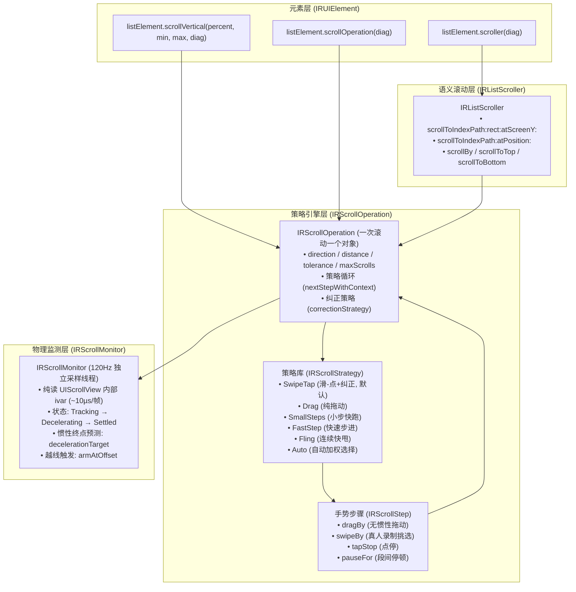

# Scroll 滚动引擎、停稳检测与列表滚动规范（`DOC-18`）

> 文档编号：`DOC-18`（可在 `skills/` 下用 `rg "DOC-18"` 定位本文档）

在移动端自动化中，**列表滚动是最高频也是最易引发风控、漏判和误触的环节**。
IRAutomationKit 提供了自底向上的三层滚动体系：
1. **底座监测层 (`IRScrollMonitor`)**：在独立采样线程上以 120Hz 纯读内存（~10µs/帧），精准感知触摸按下、松手惯性终点、跨线与停稳；
2. **策略执行层 (`IRScrollOperation`)**：以策略循环驱动手势步骤（回放、拖动、点停、纠正），支持拟人反应时间与惯性预判；
3. **列表语义层 (`IRListScroller`)**：对标原生 UIKit API，支持按 `NSIndexPath` 将指定 Cell 或媒体区精准滚到屏幕指定位置。

---


## 目录索引

- [`[DOC-18.1]` 1. 滚动模块架构分层](#DOC-18.1)
- [`[DOC-18.2]` 2. 物理监视层：120Hz 高速停稳检测 (`IRScrollMonitor`)](#DOC-18.2)
  - [`[DOC-18.2.1]` 2.1 核心工作原理](#DOC-18.2.1)
  - [`[DOC-18.2.2]` 2.2 事件监听用法](#DOC-18.2.2)
- [`[DOC-18.3]` 3. 策略引擎层：闭环滚动操作 (`IRScrollOperation`)](#DOC-18.3)
  - [`[DOC-18.3.1]` 3.1 核心属性与配置](#DOC-18.3.1)
  - [`[DOC-18.3.2]` 3.2 内置策略族 (`IRScrollStrategy`)](#DOC-18.3.2)
  - [`[DOC-18.3.3]` 3.3 步骤生成与手势结束方式 (`IRScrollStep`)](#DOC-18.3.3)
- [`[DOC-18.4]` 4. 语义滚动层：列表对齐滚动 (`IRListScroller`)](#DOC-18.4)
  - [`[DOC-18.4.1]` 4.1 滚动到指定 IndexPath](#DOC-18.4.1)
  - [`[DOC-18.4.2]` 4.2 偏移与边界快捷滚动](#DOC-18.4.2)
  - [`[DOC-18.4.3]` 4.3 闭环两阶段寻址机制](#DOC-18.4.3)
- [`[DOC-18.5]` 5. 元素层快捷扩展 (`IRUIElement`)](#DOC-18.5)
- [`[DOC-18.6]` 6. Good vs Bad 对比清单](#DOC-18.6)

---

<a id="DOC-18.1"></a>
## `[DOC-18.1]` 1. 滚动模块架构分层



---

<!-- [/DOC-18.1] -->
<a id="DOC-18.2"></a>
## `[DOC-18.2]` 2. 物理监视层：120Hz 高速停稳检测 (`IRScrollMonitor`)

<a id="DOC-18.2.1"></a>
### `[DOC-18.2.1]` 2.1 核心工作原理
`IRScrollMonitor` 在独立后台采样线程上运行，**不通过远程 ObjC 消息发送（避免 IPC 开销），而是直接高速读取目标 App 的 `UIScrollView` 内部结构体与 ivar**（单帧耗时仅约 10µs）：
- **状态流转**：`Idle`（静止） $\to$ `Tracking`（手指按住） $\to$ `Decelerating`（松手惯性滑行） $\to$ `Idle`（静止）。
- **停稳判定 (`settleFrames`)**：默认连续 6 帧（120Hz 下约 50ms）手指未按着、无减速惯性、且 `contentOffset` 严格不变，即发出 `IRScrollEventSettled`。
- **惯性终点捕获 (`decelerationTarget`)**：在手指抬起的第 1 帧惯性时，系统 UIKit 已计算出惯性滑行终点并存入内部变量，Monitor 立即捕获供上层算法预判是否会冲出目标范围。

<!-- [/DOC-18.2.1] -->
<a id="DOC-18.2.2"></a>
### `[DOC-18.2.2]` 2.2 事件监听用法
```objc
IRScrollMonitor *monitor = [IRScrollMonitor monitorWithScrollView:scrollView];
[monitor start];

// 预设触发线：当垂直偏移越过 2400pt 时触发 Reached (带提前量 lead 抵消反应延迟)
[monitor armAtOffset:2400.0 axis:IRScrollAxisVertical lead:1.0/60.0];

// 触发手势
app.playback(@"978B8AAF-6BC4-4C34-B88B-F90E3A96ACF7", diag);

// 等待松手或越线事件
IRScrollEvent event = [monitor waitForEvents:(IRScrollEventReleased | IRScrollEventReached) timeout:3.0];
if (event & IRScrollEventReached) {
    // 越线点停
    [app tapAt:CGPointMake(200, 300) diag:nil];
}

// 等待最终停稳
[monitor waitForEvents:IRScrollEventSettled timeout:3.0];
[monitor stop];
```

---

<!-- [/DOC-18.2.2] -->
<!-- [/DOC-18.2] -->
<a id="DOC-18.3"></a>
## `[DOC-18.3]` 3. 策略引擎层：闭环滚动操作 (`IRScrollOperation`)

每次滚动由一个独立的 `IRScrollOperation` 实例执行，按策略分步决策并完成误差收敛。

<a id="DOC-18.3.1"></a>
### `[DOC-18.3.1]` 3.1 核心属性与配置
```objc
IRScrollOperation *scroll = element.scrollOperation(diag);
scroll.direction = IRScrollForward; // 往前 (偏移变大 = 往下看)；IRScrollBackward 为往回看
scroll.distance = 350.0;           // 期望滚动距离 (pt)
scroll.tolerance = 30.0;          // 允许误差 (pt)，最终停在 [320, 380] 即算成功
scroll.maxScrolls = 3;            // 最多执行手势步数 (含首滑与纠正)
scroll.strategy = IRScrollStrategySwipeTap; // 滚动策略，默认滑-点
scroll.reactionTime = 0.22;       // 点停拟人反应时间 (秒，均值 0.22s ± 0.05s 正态分布)

// 执行滚动 (同步阻塞直至停稳，只能 start 一次)
BOOL ok = [scroll start];
if (ok) {
    NSLog(@"滚动成功，实际滚动: %.1f pt，耗时: %.2fs，发手势 %lu 次，点停 %lu 次",
          scroll.scrolledDistance, scroll.duration, 
          (unsigned long)scroll.scrollCount, (unsigned long)scroll.tapStopCount);
} else {
    NSLog(@"滚动失败: %@", scroll.failureReason);
}
```

<!-- [/DOC-18.3.1] -->
<a id="DOC-18.3.2"></a>
### `[DOC-18.3.2]` 3.2 内置策略族 (`IRScrollStrategy`)
| 策略名称 | 常量 | 行为特征与适用场景 |
|---|---|---|
| **滑-点 + 纠正** (默认) | `IRScrollStrategySwipeTap` | 按剩余距离挑选真人录制手势，惯性越过目标时按拟人反应时间点停；停稳后若未进区间，自动调纠正策略补齐。 |
| **纯拖动** | `IRScrollStrategyDrag` | 小距离（$\le 150\text{pt}$）单次拖动，超长距离自动拆段；松手前原地微移，**零惯性精准停放**。 |
| **小步快跑** | `IRScrollStrategySmallSteps` | 拆分成几段小幅度滑-点，段间带停顿，适合连续阅读 feed 流。 |
| **快速步进** | `IRScrollStrategyFastStep` | 尽量等惯性自然减速停稳，仅在明显过头时才点停。 |
| **连续快甩** | `IRScrollStrategyFling` | 抬手松手后不等停稳立即连甩下一滑，最后一步才滑-点停稳，适合极速翻长列表。 |
| **自动优选** | `IRScrollStrategyAuto` | 自动根据剩余距离筛选最匹配的策略，加权随机挑选，拟人度最高。 |

<!-- [/DOC-18.3.2] -->
<a id="DOC-18.3.3"></a>
### `[DOC-18.3.3]` 3.3 步骤生成与手势结束方式 (`IRScrollStep`)
策略在 `nextStepWithContext:` 中返回 `IRScrollStep`：
- **`IRScrollStepEndingNoInertia`**：停住再抬手，无惯性（拖动专属）；
- **`IRScrollStepEndingTapStop`**：惯性快到达目标位置时执行拟人点击停住；
- **`IRScrollStepEndingNatural`**：不点停，由 UIKit 摩擦力自然减速停止；
- **`IRScrollStepEndingRelease`**：手指一松开立刻判定该步结束，直接进行下一步连甩。

---

<!-- [/DOC-18.3.3] -->
<!-- [/DOC-18.3] -->
<a id="DOC-18.4"></a>
## `[DOC-18.4]` 4. 语义滚动层：列表对齐滚动 (`IRListScroller`)

专门面向 `UITableView` 和 `UICollectionView`，提供对标原生 UIKit 语义的高层接口。

<a id="DOC-18.4.1"></a>
### `[DOC-18.4.1]` 4.1 滚动到指定 IndexPath
```objc
IRListScroller *scroller = listElement.scroller(diag);
scroller.tolerance = 20.0; // 停稳后离目标误差超过 20pt 自动小段拖动纠正

NSIndexPath *ip = [NSIndexPath indexPathForRow:5 inSection:0];

// 1. 将 cell 滚到可见区域正中间
[scroller scrollToIndexPath:ip atPosition:IRListPositionMiddle];

// 2. 将 cell 顶端与列表可见区域顶部对齐
[scroller scrollToIndexPath:ip atPosition:IRListPositionTop];

// 3. 将 cell 内部的媒体播放器区域滚到屏幕绝对 Y 坐标 368pt (正中心):
CGRect mediaRect = CGRectMake(0, 100, 375, 250); // 相对 cell 的局部坐标
[scroller scrollToIndexPath:ip rect:mediaRect atScreenY:368.0];
```

<!-- [/DOC-18.4.1] -->
<a id="DOC-18.4.2"></a>
### `[DOC-18.4.2]` 4.2 偏移与边界快捷滚动
```objc
// 从当前位置继续向前滚动 400pt
[scroller scrollBy:400.0];

// 滚回顶部
[scroller scrollToTop];

// 滚到最底部 (到底后会自动等一轮数据加载更多)
[scroller scrollToBottom];
```

<!-- [/DOC-18.4.2] -->
<a id="DOC-18.4.3"></a>
### `[DOC-18.4.3]` 4.3 闭环两阶段寻址机制
1. **未就绪远距离逼近**：若目标 IndexPath 尚未被原生布局计算出来，或距离当前位置超过 1.5 屏，Scroller 先向该方向自动步进 1.5 屏（最多 8 轮），直至目标 Cell 进入布局计算范围；
2. **纯内存坐标比对**：一旦目标位置确定，滚动期间**不调用任何列表的远程方法**，只靠内存读取 `contentOffset` 进行闭环跟踪；停稳后统一做一次像素级校准。

---

<!-- [/DOC-18.4.3] -->
<!-- [/DOC-18.4] -->
<a id="DOC-18.5"></a>
## `[DOC-18.5]` 5. 元素层快捷扩展 (`IRUIElement`)

对于业务最常见的滚动需求，可直接使用元素上的 Block 链式语法：

```objc
IRUIElement *list = app.query.views(@"UITableView").visible().first().element;

// 1. 按百分比垂直滚动一段: 距离 = 200 + (800 - 200) * 0.3 = 380pt (正数向下看)
list.scrollVertical(0.3, 200.0, 800.0, diag);

// 2. 往回向上看 500pt
list.scrollVertical(-0.5, 200.0, 800.0, diag);
```

---

<!-- [/DOC-18.5] -->
<a id="DOC-18.6"></a>
## `[DOC-18.6]` 6. Good vs Bad 对比清单

| 场景 | ❌ 错误做法 (Bad) | ✅ 正确做法 (Good) | 说明 |
|---|---|---|---|
| **滚到特定条目** | 靠肉眼盲猜滑动距离，写循环 `app.swipe` + 查文字控件 | 使用 `[scroller scrollToIndexPath:ip atPosition:IRListPositionMiddle]` | 列表复用机制下远处的 Cell 根本没生成视图；`IRListScroller` 依据布局层偏移驱动，且停稳自动微移校准。 |
| **滑动后立刻点击** | 滑动后直接调用 `cell.tap()` | 等待滚动停稳，或使用自带停稳保证的 `scrollOperation` / `scroller` | 列表在惯性滑行时点击，系统会优先拦截触摸作为“点停”手势，导致原本想触发的点击事件丢失。 |
| **滚到正中播放** | 滚完后算 frame 偏差，再用固定坐标手动补一段 swipe | 使用 `[scroller scrollToIndexPath:ip rect:mediaRect atScreenY:screenCenterY]` | 专为短视频/图集媒体对准设计，支持传入 Cell 内子区域并将其中点精准吸附在屏幕指定 Y 轴。 |
| **滚动停稳检测** | 在主线程轮询 `sleep(0.5)` 盲猜列表已经停下 | 依托 `IRScrollMonitor` 监听 `IRScrollEventSettled` | 盲等既严重浪费自动化时长，又无法防范设备掉帧或长惯性滑行中途误判。 |
| **到底检测** | 自己算 `contentOffset.y + bounds.height >= contentSize.height` | 使用 `[scroller scrollToBottom]` 或由 `IRScrollOperation` 内部到底拦截 | 原生列表底部常带有安全区 inset、加载更多菊花和反弹回弹（Bouncing），框架已内置边界过滤。 |
<!-- [/DOC-18.6] -->
